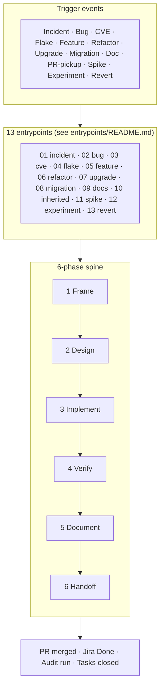

# Skill: Development Process

The canonical framework for how work flows from trigger to merged change in this repository. Every task — feature, bug, hotfix, spike, RFC, revert — funnels through one of 13 **entrypoints** into a shared 6-phase **spine**, gated by **risk-tier checks** and producing **structured artifacts** that downstream tooling can consume.

This skill is the design layer. The operational runbook for the dominant path (planned ticket → worktree → PR → merge) lives in [workflow-overview](../workflow-overview/SKILL.md). The bot-PR review contract lives in [pr-lifecycle](../pr-lifecycle/SKILL.md). This skill explains **why** those steps exist, **when** they apply, and **what** other paths exist for non-default work.

## Critical Rules

1. **Pick an entrypoint before you start.** Every task maps to exactly one of the 13 entrypoints in [entrypoints/](entrypoints/). Picking determines which artifacts are required and which gates apply. If unsure, see [entrypoints/README.md](entrypoints/README.md) for the decision tree.
2. **Risk tier governs gate strictness.** Low/Medium/High/Critical (see [gates/risk-tiers.md](gates/risk-tiers.md)) — Critical tier (incidents, security, reverts) skips RFC/design but mandates postmortem and stricter review.
3. **Artifacts are mandatory at known paths.** RFCs in `docs/rfcs/`, ADRs in `docs/decisions/`, postmortems in `docs/postmortems/`. See [artifacts/](artifacts/) for schemas. Tools depend on these locations.
4. **Documentation lives in the same PR as the code it describes.** No "I'll document it later" tickets — see [gates/documentation-freshness.md](gates/documentation-freshness.md).
5. **Determinism is non-negotiable in tests.** E2E and integration tests must follow the 12 determinism principles in [../testing/references/e2e-determinism.md](../testing/references/e2e-determinism.md). Flake is treated as a P1 bug.

## The 6-Phase Spine

Every entrypoint, regardless of trigger, flows through these phases. See [spine.md](spine.md) for the full description.

| Phase            | Purpose                                                                                       | Exit gate                                        |
| ---------------- | --------------------------------------------------------------------------------------------- | ------------------------------------------------ |
| 1. **Frame**     | Restate the problem in your own words; identify scope and risk                                | Risk tier assigned, ticket exists                |
| 2. **Design**    | Design gate per risk tier (see [gates/risk-tiers.md](gates/risk-tiers.md)); test plan for all | RFC accepted (if required), test plan written    |
| 3. **Implement** | Vertical slices, green tree per commit, docs alongside code                                   | All planned changes coded                        |
| 4. **Verify**    | `make pc` + manual exercise + edge cases + determinism check                                  | All gates green                                  |
| 5. **Document**  | Update touched docs, archive RFC/ADR if produced, write postmortem                            | All affected docs current                        |
| 6. **Handoff**   | PR opened, reviewed, merged; tracking tasks closed                                            | PR merged, Jira Done, audit run, tasks completed |

## Master Flow Diagram

Full diagram source (more detail per node) at [diagrams/master-flow.mmd](diagrams/master-flow.mmd). Regenerate SVG for external use with `make diagrams`.

## The 13 Entrypoints

| #   | Entrypoint                                                 | Trigger                                | Default risk tier |
| --- | ---------------------------------------------------------- | -------------------------------------- | ----------------- |
| 1   | [incident-hotfix](entrypoints/01-incident-hotfix.md)       | Production outage or P0 bug            | Critical          |
| 2   | [bug-investigation](entrypoints/02-bug-investigation.md)   | Reported defect, no ticket yet         | Medium            |
| 3   | [security-cve](entrypoints/03-security-cve.md)             | CVE alert, security advisory           | Critical          |
| 4   | [ci-flaky-triage](entrypoints/04-ci-flaky-triage.md)       | Flaky test or CI-on-main failure       | Medium            |
| 5   | [new-feature](entrypoints/05-new-feature.md)               | Backlog feature ticket                 | Medium            |
| 6   | [refactor](entrypoints/06-refactor.md)                     | Tech debt, behavior-preserving         | Medium            |
| 7   | [dependency-upgrade](entrypoints/07-dependency-upgrade.md) | Dependabot, manual upgrade             | Medium            |
| 8   | [migration](entrypoints/08-migration.md)                   | Schema, data, infra change             | High              |
| 9   | [docs-only](entrypoints/09-docs-only.md)                   | Documentation change with no code      | Low               |
| 10  | [inherited-pr](entrypoints/10-inherited-pr.md)             | Picking up someone else's in-flight PR | Medium            |
| 11  | [spike](entrypoints/11-spike.md)                           | Timeboxed research / POC               | Low               |
| 12  | [experimentation](entrypoints/12-experimentation.md)       | Feature flag, A/B test rollout         | High              |
| 13  | [revert](entrypoints/13-revert.md)                         | Roll back a merged change              | Critical          |

See [entrypoints/README.md](entrypoints/README.md) for the entrypoint decision tree.

## Artifacts

Every artifact has a stable schema and a known path so MCP tools and CI can consume them.

| Artifact          | Path pattern                                                                                                                                          | Required by                                                                                                                                  | Schema doc                                                       |
| ----------------- | ----------------------------------------------------------------------------------------------------------------------------------------------------- | -------------------------------------------------------------------------------------------------------------------------------------------- | ---------------------------------------------------------------- |
| RFC               | `docs/rfcs/LS-####-slug.md`                                                                                                                           | High/Critical design changes; recommended for Medium (2026-07-02 recalibration — see [gates/risk-tiers.md](gates/risk-tiers.md)); all spikes | [artifacts/rfc.md](artifacts/rfc.md)                             |
| ADR               | `docs/decisions/NNNN-slug.md`                                                                                                                         | Any architectural decision                                                                                                                   | [artifacts/adr.md](artifacts/adr.md)                             |
| Test plan         | PR body section OR `docs/test-plans/`                                                                                                                 | All entrypoints except 9 (docs-only)                                                                                                         | [artifacts/test-plan.md](artifacts/test-plan.md)                 |
| Repro report      | Jira ticket field                                                                                                                                     | Entrypoint 2 (bug-investigation), 4 (CI flake)                                                                                               | [artifacts/repro-report.md](artifacts/repro-report.md)           |
| Continuation plan | PR comment with `<!-- continuation-plan -->` marker (the string `continuation_status` searches for — see `tools/mcp/dev-process-server/src/index.ts`) | Entrypoint 10 (inherited PR)                                                                                                                 | [artifacts/continuation-plan.md](artifacts/continuation-plan.md) |
| Postmortem        | `docs/postmortems/YYYY-MM-DD-slug.md`                                                                                                                 | Entrypoints 1, 3, 13 + any Critical tier                                                                                                     | [artifacts/postmortem.md](artifacts/postmortem.md)               |

Templates for each live in [templates/](templates/).

## Gates

| Gate                                                        | When it applies                                         |
| ----------------------------------------------------------- | ------------------------------------------------------- |
| [Risk tiers](gates/risk-tiers.md)                           | Phase 1 (Frame) — drives all subsequent gate strictness |
| [Pre-PR checklist](gates/pre-pr-checklist.md)               | Phase 4 (Verify) → Phase 6 (Handoff) transition         |
| [Documentation freshness](gates/documentation-freshness.md) | Phase 5 (Document) — touch-map enforcement              |

## How this skill relates to others

- [workflow-overview](../workflow-overview/SKILL.md) — operational runbook for the new-feature entrypoint (the dominant path). This skill describes _which entrypoint_ you're on; workflow-overview describes _how to execute_ the new-feature entrypoint specifically.
- [pr-lifecycle](../pr-lifecycle/SKILL.md) — the bot-PR review contract (Cycles 1/2/3, FIX/JUSTIFY/CANNOT-COMPLY). This skill stops at "PR opened"; pr-lifecycle takes over from there.
- [planning](../plan-ticket/references/planning.md) — risk classification details. Used by Phase 1 (Frame).
- [standards](../standards/SKILL.md) — coding conventions enforced during Phase 3 (Implement).
- [testing](../testing/SKILL.md) — test type selection and the determinism reference used by Phase 4 (Verify).
- [worktree-workflow](../worktree-workflow/SKILL.md) — the substrate for code changes. Every entrypoint that produces code uses this.

## Tooling (implemented)

The artifact tool surface is **implemented** (verified 2026-07-02) in the `legacy-sports-dev-process` stdio MCP server — source `tools/mcp/dev-process-server/src/index.ts`, registered in `.mcp.json`. Per-tool schemas live in the artifact docs' `#tool-surface` sections.

| Artifact          | Tools                                                               | Spec                                                                          |
| ----------------- | ------------------------------------------------------------------- | ----------------------------------------------------------------------------- |
| RFC               | `rfc_create`, `rfc_validate`, `rfc_list_open`, `rfc_accept`         | [artifacts/rfc.md](artifacts/rfc.md#tool-surface)                             |
| ADR               | `adr_create`, `adr_supersede`, `adr_list`                           | [artifacts/adr.md](artifacts/adr.md#tool-surface)                             |
| Test plan         | `testplan_extract`, `testplan_coverage_check`, `testplan_diff`      | [artifacts/test-plan.md](artifacts/test-plan.md#tool-surface)                 |
| Repro report      | `repro_capture`, `repro_replay`, `repro_close_no_repro`             | [artifacts/repro-report.md](artifacts/repro-report.md#tool-surface)           |
| Continuation plan | `continuation_post`, `continuation_status`                          | [artifacts/continuation-plan.md](artifacts/continuation-plan.md#tool-surface) |
| Postmortem        | `postmortem_create`, `postmortem_action_items`, `postmortem_recent` | [artifacts/postmortem.md](artifacts/postmortem.md#tool-surface)               |

If the server is missing from a session (stdio servers require a working `node_modules/.bin/tsx` — see the MCP note in [AGENTS.md](../../../AGENTS.md)), fall back to scaffolding from [templates/](templates/) by hand at the same paths.

## Provenance and maintenance

- 2026-07-02: tooling section, continuation marker, and RFC-gate recalibration updated from the skills audit (`scratch/skills-audit/`).
- Verify tool list: `grep -A1 "^server.tool(" tools/mcp/dev-process-server/src/index.ts`
- Verify continuation marker: `grep -n "continuation-plan -->" tools/mcp/dev-process-server/src/index.ts`
- Verify artifact dirs exist: `ls docs/rfcs docs/decisions docs/postmortems docs/test-plans`
