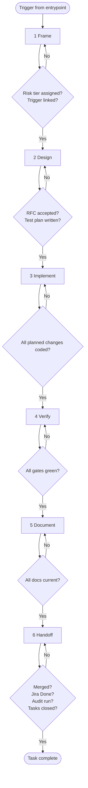

# The 6-Phase Spine

Every entrypoint funnels into this spine. The spine is constant; entrypoints differ only in which **artifacts they require** and which **gates apply**.

Full diagram source at [diagrams/spine-detail.mmd](diagrams/spine-detail.mmd).

## Phase 1: Frame

**Goal**: produce a shared, written understanding of what is being done and why before any other work begins.

**Activities:**

- Read the trigger (Jira ticket, incident report, CVE, etc.) end-to-end. No skimming.
- Restate the problem and acceptance criteria in your own words. If you cannot, the trigger is not yet ready — clarify before proceeding.
- Identify out-of-scope items explicitly. Surface anything tempting that you are deliberately not doing.
- Assign a **risk tier** (Low / Medium / High / Critical) using [gates/risk-tiers.md](gates/risk-tiers.md).
- For investigation entrypoints (bug, CI-flake, security): produce a **repro report** before any code is touched.

**Exit gate:**

- Risk tier assigned.
- Trigger artifact (Jira ticket, incident, etc.) exists and is linked.
- For investigation entrypoints: repro report attached to the trigger.

## Phase 2: Design

**Goal**: decide _how_ before writing code. Surface alternatives and risks while change is cheap.

**Activities:**

- Medium and higher risk: produce an **RFC** (see [artifacts/rfc.md](artifacts/rfc.md)). Critical-tier incidents skip the RFC — postmortem replaces it.
- Any architectural decision (new pattern, dependency, boundary): produce an **ADR** (see [artifacts/adr.md](artifacts/adr.md)). ADRs may be standalone or embedded in an RFC.
- All entrypoints except docs-only: produce a **test plan** listing the cases that prove "done." This becomes the test file skeleton and the PR's Test Plan section.
- For UI work: run the [shape](../frontend-design/SKILL.md) and [critique](../frontend-design/SKILL.md) skills before implementing.

**Exit gate:**

- RFC accepted (if required by risk tier).
- ADR drafted (if architectural decision involved).
- Test plan written.
- Touch-map identified — list which docs will need updating in Phase 5.

## Phase 3: Implement

**Goal**: write the code in vertical slices that leave the tree green at every commit.

**Activities:**

- Each commit compiles, types, lints, and passes tests for what it touches. Never a "WIP" commit pushed to a shared branch.
- Update docs in the same commit as the code they describe (docs-as-code).
- Apply [coding standards](../standards/SKILL.md). Never suppress (`@ts-ignore`, `eslint-disable`) — fix the root cause.
- Tests written alongside the code, not after.

**Exit gate:**

- All planned changes coded.
- Touched docs updated in-commit.
- Local build clean for affected projects.

## Phase 4: Verify

**Goal**: prove the change works end-to-end before asking anyone to review it.

**Activities:**

- Run `make pc` until clean. Never substitute individual targets.
- Manually exercise the change: golden path + at least one edge case.
- For E2E/integration tests: run them locally (CI does not gate integration tests on PRs — see [testing](../testing/SKILL.md)).
- Confirm test plan is fully implemented — every case in the plan has a corresponding test.
- Run the determinism checklist on any new E2E/integration test (see [../testing/references/e2e-determinism.md](../testing/references/e2e-determinism.md)).

**Exit gate:**

- `make pc` green.
- All test-plan cases covered by tests.
- Determinism checklist passes for new E2E/integration tests.
- Manual exercise documented in PR body Test Plan section.

## Phase 5: Document

**Goal**: leave the docs more accurate than you found them.

**Activities:**

- Apply the **touch-map**: for every file touched, check the touch-map ([gates/documentation-freshness.md](gates/documentation-freshness.md)) for downstream docs that must update.
- Archive RFC if produced — move from `docs/rfcs/draft-*.md` to `docs/rfcs/LS-####-slug.md` with `Status: Accepted`.
- Promote draft ADRs to numbered ADRs.
- Critical-tier and incident entrypoints: write the **postmortem** (see [artifacts/postmortem.md](artifacts/postmortem.md)).
- Update the human-facing summary at `docs/dev-process/README.md` if process itself changed.

**Exit gate:**

- All docs in the touch-map updated.
- All artifacts archived to canonical paths.
- Postmortem written if required.

## Phase 6: Handoff

**Goal**: drive the change to merged, confirm Jira reflects reality, and close all tracking signals.

**Activities:**

- Self-review (mandatory) — see [pre-PR checklist](gates/pre-pr-checklist.md).
- Open PR as draft → apply `agent-in-progress` label → mark ready → request review. See [pr-lifecycle](../pr-lifecycle/SKILL.md).
- Respond to bot review per the bot-PR contract (Cycles 1/2/3).
- Merge via `github_merge_pr`.
- Verify Jira transitioned to Done.
- Run MCP gap audit if session was above the minimum threshold (see [mcp-gaps](../mcp-gaps/SKILL.md)).
- Close all tracking tasks (`TaskUpdate(taskId, status: "completed")`).

**Exit gate (Task Completion Signal — also defined in AGENTS.md):**

- `github_view_pr` returns `state: "MERGED"`.
- Jira ticket is "Done".
- MCP gap audit run or skipped per threshold.
- All tracking tasks completed.

If any of these is false, the task is not done — keep working.
