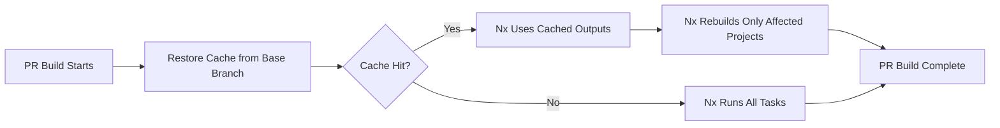
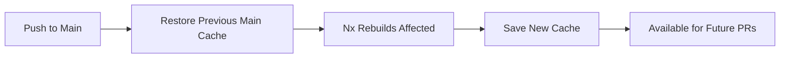

# Nx Remote Cache Action

This custom GitHub Action implements Nx remote caching using GitHub Actions cache, providing similar benefits to Nx Cloud DTE without the cost.

## Features

- ✅ **Base Branch Cache Restoration**: PRs automatically restore cache from the base branch (typically `main`)
- ✅ **Incremental Builds**: Nx only rebuilds projects affected by your changes
- ✅ **Cost Effective**: Uses GitHub Actions cache instead of paid Nx Cloud
- ✅ **Smart Cache Keys**: Considers dependencies and Nx configuration changes
- ✅ **Automatic Fallbacks**: Multiple restore-keys for partial cache hits

## How It Works

### For Pull Requests



**Key Benefit**: When you open a PR, your branch restores the build cache from `main`. Nx then only rebuilds projects affected by your changes, dramatically speeding up CI.

### For Main Branch Pushes



**Key Benefit**: Main branch builds incrementally and saves cache for PRs to use.

## Usage

### Basic Setup (Already Integrated)

The action is automatically used in the `setup` action:

```yaml
- name: 'Setup Nx Remote Cache'
  uses: ./.github/actions/nx-cache
  with:
    restore-only: ${{ github.event_name == 'pull_request' }}
    base-branch: 'main'
```

### Inputs

| Input          | Description                                     | Default |
| -------------- | ----------------------------------------------- | ------- |
| `restore-only` | Only restore cache, don't save (useful for PRs) | `false` |
| `base-branch`  | Base branch to restore cache from               | `main`  |

### Outputs

| Output         | Description                                                 |
| -------------- | ----------------------------------------------------------- |
| `cache-hit`    | Whether cache was fully restored                            |
| `cache-source` | Source of cache: `base-branch`, `current-branch`, or `none` |

## Performance Improvements

### Expected Savings

Based on your monorepo size, here are estimated time savings:

| Scenario                                   | Before (No Cache) | After (With Cache) | Savings                |
| ------------------------------------------ | ----------------- | ------------------ | ---------------------- |
| **PR with Small Changes** (1-2 projects)   | 15-20 min         | 3-5 min            | **75%**                |
| **PR with Medium Changes** (5-10 projects) | 15-20 min         | 6-10 min           | **50%**                |
| **PR with Large Changes** (20+ projects)   | 15-20 min         | 12-15 min          | **25%**                |
| **Main Branch Push** (All projects)        | 15-20 min         | 15-20 min\*        | 0% (but saves for PRs) |

\*Main branch caches outputs for future PR use

### Real-World Example

**Scenario**: You fix a bug in `lib/utils`

**Without Remote Cache**:

1. CI runs on your PR
2. Rebuilds ALL projects (~15 min)
3. Tests ALL projects (~5 min)
4. **Total**: ~20 minutes

**With Remote Cache**:

1. CI runs on your PR
2. Restores cache from `main` (30 sec)
3. Nx detects only `lib/utils` + 3 dependent apps changed
4. Rebuilds only 4 projects (~2 min)
5. Tests only affected projects (~2 min)
6. **Total**: ~5 minutes ⚡

**Savings**: 15 minutes per PR!

## How Nx Uses the Cache

When the cache is restored, Nx:

1. **Checks each task hash**: Did inputs change for this project?
2. **Restores outputs**: If hash matches, copies cached build outputs
3. **Skips execution**: Task marked as cached, no rebuild needed
4. **Rebuilds affected**: Only tasks with changed inputs run

### What Gets Cached

```
.nx-cache/
├── terminal-outputs/       # Console logs from previous runs
└── <project-hash>/         # Actual build outputs
    ├── dist/              # Compiled code
    ├── .next/             # Next.js builds
    ├── coverage/          # Test coverage
    └── ...
```

## Cache Key Strategy

### Cache Key Format

```
nx-cache-<branch>-<deps-hash>-<config-hash>
```

**Components**:

- `branch`: Git branch name (e.g., `main`, `feature/my-branch`)
- `deps-hash`: Hash of `pnpm-lock.yaml` or `package-lock.json`
- `config-hash`: Hash of `nx.json` and `tsconfig.base.json`

### Restore Priority (PRs)

1. **Exact match**: Same base branch + deps + config
2. **Deps match**: Same base branch + deps (config changed)
3. **Branch match**: Same base branch (deps or config changed)

### Example

**PR Build** (branch: `feature/api-update`, base: `main`):

```yaml
# Tries to restore in order:
1. nx-cache-main-abc123-def456        # Exact match
2. nx-cache-main-abc123-              # Same deps, any config
3. nx-cache-main-                     # Any cache from main
```

## Disabling Nx Cloud

If you want to exclusively use GitHub Actions cache and disable Nx Cloud:

### Option 1: Remove Nx Cloud Token (Recommended)

Remove or comment out in [nx.json](../../../nx.json):

```json
{
  // "nxCloudAccessToken": "$(NX_CLOUD_ACCESS_TOKEN)",
  "useDaemonProcess": true,
  ...
}
```

### Option 2: Environment Variable

Set in workflow:

```yaml
env:
  NX_CLOUD_ACCESS_TOKEN: '' # Disable Nx Cloud
```

### Comparison: GitHub Actions Cache vs Nx Cloud

| Feature          | GitHub Actions Cache        | Nx Cloud DTE              |
| ---------------- | --------------------------- | ------------------------- |
| **Cost**         | Free (10 GB limit per repo) | Paid ($299+/month)        |
| **Speed**        | Fast (same-region cache)    | Very Fast (optimized CDN) |
| **Distribution** | Manual (actions/cache)      | Automatic (DTE agents)    |
| **Cache Size**   | 10 GB total per repo        | Unlimited                 |
| **Analytics**    | Basic (GitHub logs)         | Advanced (dashboard)      |
| **Setup**        | This action ✅              | Nx Cloud account          |

**Recommendation**: Start with GitHub Actions cache (this action). Upgrade to Nx Cloud if:

- You exceed 10 GB cache limit
- You need advanced analytics
- You want automatic DTE agent distribution

## Monitoring Cache Performance

### Check Cache Hit Rate

In your workflow logs, look for:

```
✅ Cache HIT from base branch (main)
⚡ Nx will only rebuild affected projects!
📦 Cache size: 450M
```

### Verify Nx Cache Usage

After cache restoration, run:

```bash
pnpm exec nx affected -t build --verbose
```

Look for:

```
[cached] Successfully ran target build for project web (0ms)
```

### GitHub Cache Usage

Check cache usage at:

```
https://github.com/<org>/<repo>/actions/caches
```

## Troubleshooting

### Cache Not Restoring

**Symptom**: CI runs full build every time

**Check**:

1. Look for cache restoration step in logs
2. Verify base branch has run CI recently (to create cache)
3. Check if dependencies changed (triggers cache miss)

**Solution**:

```bash
# Manually run CI on main to warm cache
gh workflow run ci-pipeline.yml --ref main
```

### Cache Size Too Large

**Symptom**: Hitting 10 GB GitHub cache limit

**Check**:

```bash
# Local cache size
du -sh .nx-cache

# GitHub cache usage (via API)
gh api repos/:owner/:repo/actions/caches
```

**Solution**:

1. Add more patterns to `.gitignore` for Nx cache
2. Clean cache periodically
3. Consider Nx Cloud for unlimited cache

### Nx Not Using Cache

**Symptom**: Cache restores but Nx still rebuilds everything

**Check**:

```bash
# Verify Nx sees the cache
pnpm exec nx show project <project-name> --web

# Check cache directory
ls -la .nx-cache
```

**Solution**:

1. Ensure `NX_CACHE_DIRECTORY=.nx-cache` is set
2. Verify `NX_SKIP_NX_CACHE=false`
3. Check that `.nx-cache` directory is not in `.gitignore`

## Advanced Configuration

### Custom Cache Paths

If you need to cache additional build outputs:

```yaml
- name: 'Setup Nx Remote Cache'
  uses: ./.github/actions/nx-cache
  with:
    restore-only: false
    base-branch: 'main'

# Then manually cache additional paths
- uses: actions/cache@v4
  with:
    path: |
      apps/web/.next
      apps/app/android/app/build
    key: additional-${{ hashFiles('...') }}
```

### Multi-Branch Strategy

For release branches:

```yaml
- name: 'Setup Nx Remote Cache'
  uses: ./.github/actions/nx-cache
  with:
    restore-only: ${{ github.event_name == 'pull_request' }}
    base-branch: ${{ github.base_ref || 'main' }} # Uses PR base
```

## FAQ

**Q: Will this work with Nx Cloud DTE simultaneously?**

A: Yes! They complement each other. Nx Cloud takes precedence, and GitHub Actions cache is a fallback.

**Q: What happens if the base branch hasn't run CI yet?**

A: The action falls back to any available cache from the base branch, even if slightly outdated.

**Q: Does this work for forks?**

A: Yes, but forks can't write to cache. They can read from the parent repo's cache on `main`.

**Q: How long is cache kept?**

A: GitHub Actions cache expires after 7 days of no access, or when the 10 GB limit is hit (oldest caches deleted first).

**Q: Can I use this locally?**

A: No, this uses GitHub Actions cache infrastructure. For local caching, Nx's built-in local cache is automatic.

## Related Documentation

- [GitHub Actions Cache](https://docs.github.com/en/actions/using-workflows/caching-dependencies-to-speed-up-workflows)
- [Nx Caching](https://nx.dev/concepts/how-caching-works)
- [Nx Affected Commands](https://nx.dev/concepts/affected)

## Maintenance

This action is maintained alongside the CI pipeline. Updates may be needed when:

- Nx version changes significantly
- GitHub Actions cache API changes
- Cache strategy needs optimization

**Owner**: DevOps Team  
**Last Updated**: February 2026
