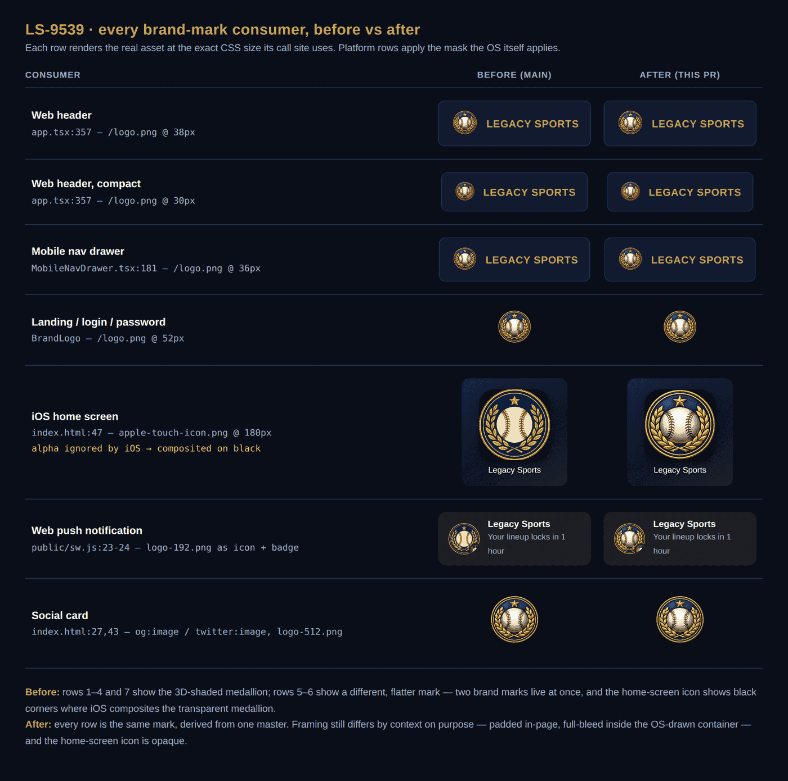

# Web brand assets

`logo-master.png` is the **canonical Legacy Sports brand mark** — 1024×1024, the highest-fidelity
copy we hold. Every icon under `apps/web/public/` is generated from it by
[`scripts/generate-web-icons.mjs`](../../../scripts/generate-web-icons.mjs). Nothing under
`apps/web/public/` should be hand-edited or replaced with a separately-exported file.

```bash
node scripts/generate-web-icons.mjs           # regenerate the icons
node scripts/generate-web-icons.mjs --check    # verify the icons still match the master
```

This directory is not served: `apps/web/vite.config.mts` sets `publicDir: 'public'`, so only
`apps/web/public/` is copied into the build. The master never reaches a browser.

## Why a single master (LS-9539)

`apps/web/public/` previously shipped **two visually different brand marks at once**:

| file                   | mark                                                     |
| ---------------------- | -------------------------------------------------------- |
| `logo.png`             | 3D-shaded medallion, thinner gold ring, ~10% padding     |
| `logo-512.png`         | same                                                     |
| `logo-192.png`         | flat medallion, heavier stitching, bold ring, full-bleed |
| `apple-touch-icon.png` | same                                                     |



_Every consumer rendered at the exact CSS size its call site uses, before and after LS-9539.
Platform rows apply the mask the OS itself applies. Regenerate by serving a production build
and re-running the harness described in the LS-9539 PR._

Pairwise RMSE at 192×192 (lanczos3) was **107** across the two groups and **3.8 / 31** within
them — different artwork, not different resolutions of one file. A user who installed the PWA
saw one mark on their home screen and a different one once the app opened, and web push
notifications used the home-screen variant. The 3D-shaded medallion — the mark that renders in
the app UI — is canonical.

## Framing is per-context, and deliberate

The master carries a transparent margin: the mark's alpha bounding box is 820×810 inside the
1024×1024 frame, so it occupies ~80% of its frame. Each icon either keeps that margin or trims
it, according to where it renders:

| framing    | icons                                  | why                                                                                                                                                                                                                           |
| ---------- | -------------------------------------- | ----------------------------------------------------------------------------------------------------------------------------------------------------------------------------------------------------------------------------- |
| **padded** | `logo.png`, `logo-512.png`             | Rendered inline in the page, next to text (header, mobile drawer, landing, login, forgot/reset password) or as a social card. The margin is optical breathing room, and the transparency lets the mark sit on any background. |
| **bleed**  | `logo-192.png`, `apple-touch-icon.png` | Rendered inside a container the platform draws — an iOS rounded rect, an Android circular notification mask. Those containers supply their own padding, so an in-asset margin only shrinks the mark inside them.              |

`apple-touch-icon.png` is additionally flattened onto the brand page background `#0A0F1A`.
iOS ignores the alpha channel and composites onto black, and the mark is a circular medallion
with fully transparent corners — left transparent it renders with black corners on the home
screen.

## Size budget

LS-9529 established a **< 100 KB web image payload** for a page load. A page load fetches
`logo.png` (28,215 B) and `favicon.ico` (3,120 B) — 31,335 B. The other three are fetched only
by a crawler (`logo-512.png` as `og:image`), when a notification displays (`logo-192.png`), or
when a user adds the app to their home screen (`apple-touch-icon.png`).

All four are encoded with `{ compressionLevel: 9, effort: 10 }`, which lets sharp pick a palette
encoding wherever it wins. Do not force a palette below 128 colours to shrink them further:
at 128 colours `logo-512.png` drops to 32,883 B but the seam red `#C41E3A` shifts to brown and
the ball posterizes (RMSE 2.25 → 9.33).
