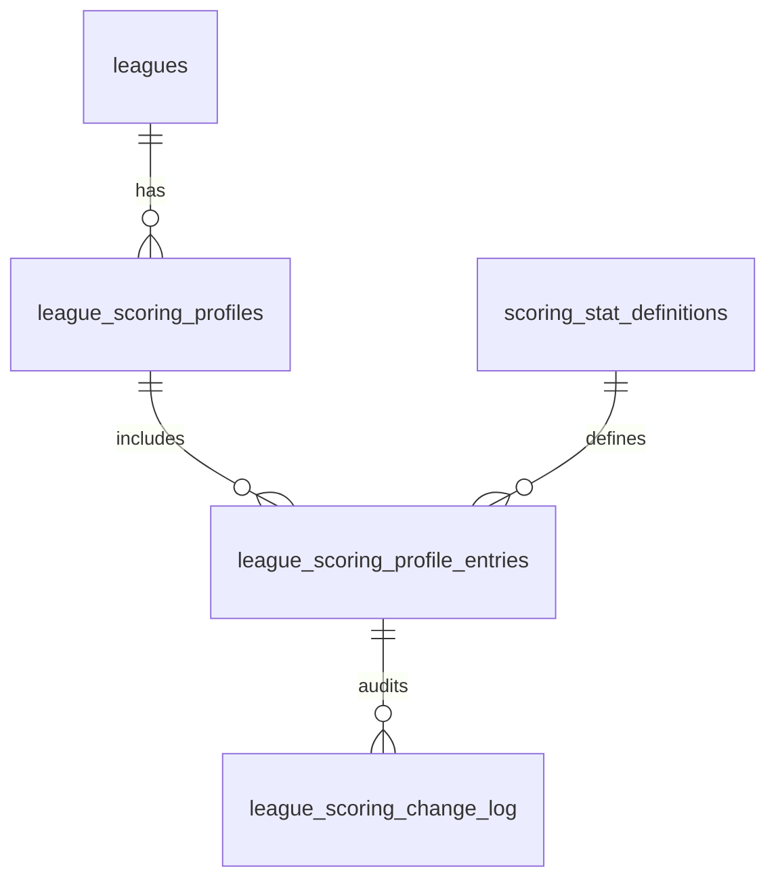

# Legacy Sports Database Tables Documentation

## Overview

The Legacy Sports database follows a **season-to-career aggregation pattern** with comprehensive baseball statistics tracking. The database stores both granular season-level data and pre-aggregated career statistics through PostgreSQL views.

## Database Architecture

### Core Design Principles

1. **Season-Level Source Data**: Individual season statistics are stored as the source of truth
2. **Career-Level Views**: Aggregated views automatically calculate career totals from season data
3. **Major League Filtering**: Career views filter for AL/NL leagues only
4. **Type Safety**: Drizzle ORM provides complete TypeScript integration
5. **Performance**: Indexed columns for common queries (player lookups, statistics)

---

## Core Data Tables

### 1. **Players** (`players`)

**Purpose**: Master registry of all baseball players in the system

| Column       | Type                 | Description                                |
| ------------ | -------------------- | ------------------------------------------ |
| `id`         | SERIAL (PK)          | Unique player identifier                   |
| `first_name` | TEXT                 | Player's first name                        |
| `last_name`  | TEXT                 | Player's last name                         |
| `bref_id`    | VARCHAR(10) (UNIQUE) | Baseball Reference ID for external lookups |

**Key Features**:

- Primary key: `id`
- Unique constraint: `bref_id` (Baseball Reference integration)
- Foreign key referenced by all statistics tables

---

## Season-Level Statistics Tables

### 2. **Season Batting** (`season_batting`)

**Purpose**: Individual season batting statistics per player/team

| Column                 | Type             | Description                                  |
| ---------------------- | ---------------- | -------------------------------------------- |
| `player_id`            | INTEGER (FK)     | References `players.id`                      |
| `season`               | INTEGER          | Year of the season                           |
| `team`                 | VARCHAR(20)      | Team abbreviation                            |
| `row_id`               | VARCHAR(10)      | Unique row identifier for multi-team seasons |
| `g`                    | INTEGER          | Games played                                 |
| `pa`                   | INTEGER          | Plate appearances                            |
| `ab`                   | INTEGER          | At bats                                      |
| `r`                    | INTEGER          | Runs scored                                  |
| `h`                    | INTEGER          | Hits                                         |
| `doubles`              | INTEGER          | Doubles                                      |
| `triples`              | INTEGER          | Triples                                      |
| `hr`                   | INTEGER          | Home runs                                    |
| `rbi`                  | INTEGER          | Runs batted in                               |
| `sb`                   | INTEGER          | Stolen bases                                 |
| `cs`                   | INTEGER          | Caught stealing                              |
| `bb`                   | INTEGER          | Walks                                        |
| `so`                   | INTEGER          | Strikeouts                                   |
| `batting_avg`          | DOUBLE PRECISION | Pre-calculated batting average               |
| `onbase_perc`          | DOUBLE PRECISION | On-base percentage                           |
| `slugging_perc`        | DOUBLE PRECISION | Slugging percentage                          |
| `onbase_plus_slugging` | DOUBLE PRECISION | OPS (On-base + Slugging)                     |
| `tb`                   | INTEGER          | Total bases                                  |
| `gidp`                 | INTEGER          | Grounded into double plays                   |
| `hbp`                  | INTEGER          | Hit by pitch                                 |
| `sh`                   | INTEGER          | Sacrifice hits                               |
| `sf`                   | VARCHAR(10)      | Sacrifice flies                              |
| `ibb`                  | INTEGER          | Intentional walks                            |
| `pos_season`           | VARCHAR(50)      | Positions played during season               |
| `award_summary`        | TEXT             | Awards won during season                     |
| `lg_id`                | VARCHAR(20)      | League ID (AL/NL/etc.)                       |

**Key Features**:

- Composite primary key: `(player_id, season, team, row_id)`
- Indexes: `player_id`, `hr` (for performance)
- Foreign key: `player_id` → `players.id`
- Supports multi-team seasons via `row_id`

### 3. **Season Pitching** (`season_pitching`)

**Purpose**: Individual season pitching statistics per player/team

| Column                         | Type                | Description                          |
| ------------------------------ | ------------------- | ------------------------------------ |
| `player_id`                    | INTEGER (FK)        | References `players.id`              |
| `season`                       | INTEGER             | Year of the season                   |
| `team`                         | VARCHAR(20)         | Team abbreviation                    |
| `row_id`                       | VARCHAR(10)         | Unique row identifier                |
| `w`                            | INTEGER             | Wins                                 |
| `l`                            | INTEGER             | Losses                               |
| `win_loss_perc`                | NUMERIC             | Win-loss percentage                  |
| `earned_run_avg`               | NUMERIC             | Earned run average                   |
| `g`                            | INTEGER             | Games                                |
| `gs`                           | INTEGER             | Games started                        |
| `gf`                           | INTEGER             | Games finished                       |
| `cg`                           | INTEGER             | Complete games                       |
| `sho`                          | INTEGER             | Shutouts                             |
| `sv`                           | INTEGER             | Saves                                |
| `ip`                           | DOUBLE PRECISION    | Innings pitched                      |
| `h`                            | INTEGER             | Hits allowed                         |
| `r`                            | INTEGER             | Runs allowed                         |
| `er`                           | INTEGER             | Earned runs                          |
| `hr`                           | INTEGER             | Home runs allowed                    |
| `bb`                           | INTEGER             | Walks                                |
| `ibb`                          | INTEGER             | Intentional walks                    |
| `so`                           | INTEGER             | Strikeouts                           |
| `hbp`                          | INTEGER             | Hit by pitch                         |
| `bk`                           | INTEGER             | Balks                                |
| `wp`                           | INTEGER             | Wild pitches                         |
| `batters_faced`                | INTEGER             | Total batters faced                  |
| `outs_recorded`                | INTEGER (GENERATED) | Calculated outs from innings pitched |
| `earned_run_avg_plus`          | DOUBLE PRECISION    | ERA+ (adjusted ERA)                  |
| `fip`                          | DOUBLE PRECISION    | Fielding Independent Pitching        |
| `whip`                         | DOUBLE PRECISION    | Walks + Hits per Inning Pitched      |
| `hits_per_nine`                | DOUBLE PRECISION    | Hits allowed per 9 innings           |
| `home_runs_per_nine`           | DOUBLE PRECISION    | HR allowed per 9 innings             |
| `bases_on_balls_per_nine`      | DOUBLE PRECISION    | Walks per 9 innings                  |
| `strikeouts_per_nine`          | DOUBLE PRECISION    | Strikeouts per 9 innings             |
| `strikeouts_per_base_on_balls` | DOUBLE PRECISION    | K/BB ratio                           |
| `award_summary`                | TEXT                | Awards won                           |
| `lg_id`                        | VARCHAR(20)         | League ID                            |

**Key Features**:

- Composite primary key: `(player_id, season, team, row_id)`
- Indexes: `player_id`, `w` (wins)
- Generated column: `outs_recorded` (calculated from `ip`)
- Advanced sabermetrics included (FIP, WHIP, etc.)

### 4. **Season Fielding** (`season_fielding`)

**Purpose**: Individual season fielding statistics per player/position

| Column                     | Type             | Description                                |
| -------------------------- | ---------------- | ------------------------------------------ |
| `player_id`                | INTEGER (FK)     | References `players.id`                    |
| `season`                   | INTEGER          | Year of the season                         |
| `pos`                      | VARCHAR(10)      | Position played                            |
| `team`                     | VARCHAR(20)      | Team abbreviation                          |
| `row_id`                   | VARCHAR(10)      | Unique row identifier                      |
| `lg_id`                    | VARCHAR(20)      | League ID                                  |
| `g`                        | INTEGER          | Games                                      |
| `gs`                       | INTEGER          | Games started                              |
| `cg`                       | INTEGER          | Complete games                             |
| `inn_def`                  | DOUBLE PRECISION | Innings played defensively                 |
| `chances`                  | DOUBLE PRECISION | Total chances (PO + A + E)                 |
| `po`                       | INTEGER          | Putouts                                    |
| `a`                        | INTEGER          | Assists                                    |
| `e_def`                    | INTEGER          | Errors                                     |
| `dp_def`                   | INTEGER          | Double plays                               |
| `fielding_perc`            | DOUBLE PRECISION | Fielding percentage                        |
| `range_factor_per_nine`    | DOUBLE PRECISION | Range factor per 9 innings                 |
| `range_factor_per_game`    | DOUBLE PRECISION | Range factor per game                      |
| `fielding_perc_lg`         | DOUBLE PRECISION | League average fielding percentage         |
| `range_factor_per_nine_lg` | DOUBLE PRECISION | League average range factor/9              |
| `range_factor_per_game_lg` | DOUBLE PRECISION | League average range factor/game           |
| `g_of_parts`               | INTEGER          | Games played at specific parts of position |
| `sb`                       | INTEGER          | Stolen bases allowed (catchers)            |
| `cs`                       | INTEGER          | Caught stealing (catchers)                 |
| `caught_stealing_perc`     | DOUBLE PRECISION | CS percentage                              |
| `caught_stealing_perc_lg`  | DOUBLE PRECISION | League average CS percentage               |
| `pickoffs`                 | INTEGER          | Pickoffs                                   |
| `award_summary`            | TEXT             | Awards won                                 |
| `wp`                       | INTEGER          | Wild pitches (catchers)                    |

**Key Features**:

- Composite primary key: `(player_id, season, pos, team, row_id)`
- Indexes: `player_id`, `(player_id, pos)`, `po`
- Position-specific statistics (catcher metrics for catchers)
- League comparison metrics included

---

## Career Aggregation Views

### 5. **Career Batting** (`career_batting` - VIEW)

**Purpose**: Lifetime batting totals aggregated from `season_batting`

**Data Source**: `SUM()` aggregation from `season_batting` WHERE `lg_id` IN ('AL', 'NL')

**Key Fields**: All batting statistics summed across career

- Total games, hits, home runs, RBI, etc.
- Excludes minor league or other league statistics
- Automatically updates when season data changes

### 6. **Career Pitching** (`career_pitching` - VIEW)

**Purpose**: Lifetime pitching totals aggregated from `season_pitching`

**Data Source**: `SUM()` aggregation from `season_pitching` WHERE `lg_id` IN ('AL', 'NL')

**Computed Fields**:

- `era`: Calculated career ERA from total ER and outs
- `out_rate`: Efficiency metric (outs per batter faced)

### 7. **Career Fielding** (`career_fielding` - VIEW)

**Purpose**: Lifetime fielding totals across all positions

**Data Source**: Aggregated from `season_fielding` WHERE `lg_id` IN ('AL', 'NL')

### 8. **Career Fielding by Position** (`career_fielding_by_position` - VIEW)

**Purpose**: Career fielding stats broken down by individual position

**Data Source**: Aggregated from `season_fielding` grouped by `(player_id, pos)`

---

## Game-Level Statistics Tables

### 9. **Game Batting** (`game_batting`)

**Purpose**: Individual game batting statistics

| Column            | Type     | Description                   |
| ----------------- | -------- | ----------------------------- |
| `player_id`       | INTEGER  | References `players.id`       |
| `season`          | INTEGER  | Season year                   |
| `game_number`     | INTEGER  | Game number in season         |
| `game_identifier` | CHAR(12) | Unique game identifier        |
| _batting stats_   | Various  | Same fields as season batting |

**Usage**: Detailed game-by-game performance tracking

### 10. **Game Pitching** (`game_pitching`)

**Purpose**: Individual game pitching statistics

**Structure**: Similar to `season_pitching` but at game level

- Generated `outs_recorded` column from innings pitched
- Game-level decision tracking (W/L/SV)

### 11. **Game Fielding** (`game_fielding`)

**Purpose**: Individual game fielding statistics

**Structure**: Subset of fielding stats at game level

- Position-specific defensive metrics per game

---

## League Management Tables

### 12. **Leagues** (`leagues`)

**Purpose**: Fantasy league configuration

| Column            | Type        | Description                            |
| ----------------- | ----------- | -------------------------------------- |
| `id`              | SERIAL (PK) | League ID                              |
| `name`            | VARCHAR     | League name                            |
| `owner`           | INTEGER     | League owner user ID                   |
| `max_roster_size` | INTEGER     | Maximum players per team (default: 25) |
| `current_matchup` | INTEGER     | Current active matchup                 |

### 13. **Teams** (`teams`)

**Purpose**: Fantasy teams within leagues

| Column      | Type         | Description             |
| ----------- | ------------ | ----------------------- |
| `id`        | SERIAL (PK)  | Team ID                 |
| `name`      | VARCHAR      | Team name               |
| `league_id` | INTEGER (FK) | References `leagues.id` |

**Key Features**:

- Foreign key: `league_id` → `leagues.id`
- Unique constraint: `(id, league_id)`

### 14. **League Members** (`league_members`)

**Purpose**: User membership and permissions in leagues

| Column             | Type         | Description                |
| ------------------ | ------------ | -------------------------- |
| `league_id`        | INTEGER (FK) | References `leagues.id`    |
| `user_id`          | INTEGER      | User identifier            |
| `team_id`          | INTEGER      | Associated team (optional) |
| `permission_level` | ENUM         | 'owner' or 'commissioner'  |

**Key Features**:

- Composite primary key: `(league_id, user_id)`
- Permission levels: `owner`, `commissioner`

### 15. **Team Members** (`team_members`)

**Purpose**: Player rosters for fantasy teams

| Column        | Type         | Description                      |
| ------------- | ------------ | -------------------------------- |
| `id`          | SERIAL (PK)  | Roster entry ID                  |
| `team_id`     | INTEGER (FK) | References `teams.id`            |
| `league_id`   | INTEGER (FK) | References `leagues.id`          |
| `player_id`   | INTEGER (FK) | References `players.id`          |
| `position_id` | INTEGER (FK) | References `league_positions.id` |

**Key Features**:

- Multiple foreign keys for data integrity
- Links real players to fantasy teams

---

## Draft and Competition Tables

### 16. **Drafts** (`drafts`)

**Purpose**: Draft event configuration

| Column        | Type         | Description                 |
| ------------- | ------------ | --------------------------- |
| `id`          | SERIAL (PK)  | Draft ID                    |
| `league_id`   | INTEGER (FK) | References `leagues.id`     |
| `draft_type`  | ENUM         | 'blind', 'normal', 'legacy' |
| `date`        | DATE         | Draft date                  |
| `draft_order` | ENUM         | 'snake' or 'normal'         |

### 17. **Draft Teams** (`draft_teams`)

**Purpose**: Team participation and draft order

**Key Features**:

- Composite primary key: `(draft_id, team_id, league_id)`
- Unique constraint on draft order per draft
- Links teams to specific drafts with ordering

### 18. **Matchups** (`matchups`)

**Purpose**: Weekly fantasy matchups

| Column        | Type         | Description             |
| ------------- | ------------ | ----------------------- |
| `id`          | SERIAL (PK)  | Matchup ID              |
| `league_id`   | INTEGER (FK) | References `leagues.id` |
| `week_number` | INTEGER      | Week in season          |

**Key Features**:

- Unique constraint: `(league_id, week_number)`

### 19. **Matchup Players** (`matchup_players`)

**Purpose**: Players selected for specific matchups

| Column       | Type         | Description              |
| ------------ | ------------ | ------------------------ |
| `id`         | SERIAL (PK)  | Entry ID                 |
| `matchup_id` | INTEGER (FK) | References `matchups.id` |
| `player_id`  | INTEGER (FK) | References `players.id`  |
| `season`     | INTEGER      | Season for statistics    |

### 20. **Matchup Player Games** (`matchup_player_games`)

**Purpose**: Specific games selected for matchup players

**Features**:

- Links to individual batting, fielding, and pitching games
- Position specification for fielding games
- Granular game-by-game selections

---

## System Tables

### 21. **Users** (`users` - VIEW)

**Purpose**: User authentication and authorization

**Data Source**: References `app_internal.users` (separate schema)

| Column         | Type         | Description       |
| -------------- | ------------ | ----------------- |
| `id`           | INTEGER      | User ID           |
| `email`        | VARCHAR(100) | User email        |
| `username`     | VARCHAR(50)  | Username          |
| `access_level` | ENUM         | 'none' or 'admin' |

**Key Features**:

- View into internal authentication system
- Access level controls: `none`, `admin`

---

## League Scoring Extensions

### Storage Overview

- **Canonical definitions** live in `scoring_stat_definitions`. Each row locks down the stat group, source column, default multiplier, and range enforcement used across every league.
- **Per-league overrides** are stored in `league_scoring_profiles` and `league_scoring_profile_entries`. A league always has a single `is_default = true` profile that is cloned when commissioners stage draft changes.
- **Historical auditing** flows through `league_scoring_change_log`, which is populated by triggers whenever a multiplier or enabled flag changes. The log powers commissioner rollbacks and reporting.
- **Default multipliers** ship via migration seeds so brand-new leagues immediately inherit MLB-standard scoring without manual setup.

### Access Patterns

1. The database client exposes a typed `ScoringService` (`lib/db-client/src/lib/services/ScoringService.ts`) that composes the four tables above into a single graph of definitions, overrides, and audit rows.
2. The GraphQL layer (`lambdas/db/src/schema/scoring.ts`) calls that service to implement the `leagueScoringProfile`, `defaultScoringProfile`, and `updateLeagueScoringProfile` operations. Authorization checks ensure only league members (or commissioners for mutations) can reach the data.
3. `LeagueScoringProvider` on the client caches the GraphQL response per league and exposes normalized `BaseballScoringSettings` to hooks such as `useTeamMemberProjections`, so projections and UI editors never query tables directly.
4. Automation flows (CLI scoring calculators, background jobs) re-use the service layer to guarantee identical multiplier math between backend scoring and UI previews.

### 22. **Scoring Stat Definitions** (`scoring_stat_definitions`)

**Purpose**: Canonical catalog of stats that can be scored with allowable multiplier bounds.

| Column               | Type                     | Description                                        |
| -------------------- | ------------------------ | -------------------------------------------------- |
| `id`                 | SERIAL (PK)              | Unique stat definition identifier                  |
| `stat_key`           | VARCHAR(64) (UNIQUE)     | Machine key (e.g., `batting_hr`)                   |
| `group`              | ENUM                     | `batting`, `pitching`, or `fielding`               |
| `source_table`       | VARCHAR(48)              | Origin table (`season_batting`, `season_pitching`) |
| `source_column`      | VARCHAR(48)              | Column name containing the stat                    |
| `display_name`       | VARCHAR(80)              | Friendly label for UI                              |
| `description`        | TEXT                     | Additional context or tooltip text                 |
| `default_multiplier` | NUMERIC(6,3)             | System default multiplier                          |
| `min_multiplier`     | NUMERIC(6,3)             | Lower bound enforced via trigger                   |
| `max_multiplier`     | NUMERIC(6,3)             | Upper bound enforced via trigger                   |
| `step_size`          | NUMERIC(4,3)             | Preferred UI increment (default 0.5)               |
| `is_required`        | BOOLEAN                  | Prevents disabling critical stats                  |
| `enforce_positive`   | BOOLEAN                  | True if multiplier must remain >= 0                |
| `enforce_negative`   | BOOLEAN                  | True if multiplier must remain <= 0                |
| `created_at`         | TIMESTAMP WITH TIME ZONE | Creation timestamp                                 |
| `updated_at`         | TIMESTAMP WITH TIME ZONE | Auto-updated on change                             |

**Key Features**:

- Backing table for scoring UI and validation logic
- Stores per-stat multiplier bounds and requirements
- Indexed by `stat_key` and `group` for quick lookups

### 23. **League Scoring Profiles** (`league_scoring_profiles`)

**Purpose**: Versionable scoring configuration per league (supports default and draft profiles).

| Column                   | Type                     | Description                                           |
| ------------------------ | ------------------------ | ----------------------------------------------------- |
| `id`                     | SERIAL (PK)              | Profile identifier                                    |
| `league_id`              | INTEGER (FK)             | References `leagues.id`                               |
| `profile_name`           | VARCHAR(64)              | Display name (`Default`, `2026 Regular Season`, etc.) |
| `season_year`            | SMALLINT                 | Optional season association                           |
| `status`                 | ENUM                     | `draft`, `active`, `archived`                         |
| `is_default`             | BOOLEAN                  | Marks the active profile in use                       |
| `copied_from_profile_id` | INTEGER (FK self)        | Tracks cloning lineage                                |
| `created_at`             | TIMESTAMP WITH TIME ZONE | Creation timestamp                                    |
| `updated_at`             | TIMESTAMP WITH TIME ZONE | Auto-updated on change                                |
| `activated_at`           | TIMESTAMP WITH TIME ZONE | Set when status first becomes `active`                |

**Key Features**:

- Unique partial index ensures one default profile per league
- Supports draft editing by toggling `status`
- Self-referencing FK retains history when cloning profiles

### 24. **League Scoring Profile Entries** (`league_scoring_profile_entries`)

**Purpose**: Stores multipliers per stat within a given league profile.

| Column               | Type                     | Description                                 |
| -------------------- | ------------------------ | ------------------------------------------- |
| `id`                 | SERIAL (PK)              | Entry identifier                            |
| `profile_id`         | INTEGER (FK)             | References `league_scoring_profiles.id`     |
| `stat_definition_id` | INTEGER (FK)             | References `scoring_stat_definitions.id`    |
| `multiplier`         | NUMERIC(6,3)             | Custom multiplier value                     |
| `is_enabled`         | BOOLEAN                  | Allows toggling a stat off without deletion |
| `created_at`         | TIMESTAMP WITH TIME ZONE | Creation timestamp                          |
| `updated_at`         | TIMESTAMP WITH TIME ZONE | Auto-updated on change                      |

**Key Features**:

- Unique constraint on `(profile_id, stat_definition_id)`
- Trigger-enforced bounds derive from definition table
- `is_enabled` allows optional stats without dropping entries

### 25. **League Scoring Change Log** (`league_scoring_change_log`)

**Purpose**: Audit trail for multiplier changes to support commissioner oversight and rollback.

| Column                | Type                     | Description                                        |
| --------------------- | ------------------------ | -------------------------------------------------- |
| `id`                  | BIGSERIAL (PK)           | Change log entry                                   |
| `profile_id`          | INTEGER (FK)             | References `league_scoring_profiles.id`            |
| `stat_definition_id`  | INTEGER (FK)             | References `scoring_stat_definitions.id`           |
| `previous_multiplier` | NUMERIC(6,3)             | Multiplier before change (null on insert)          |
| `new_multiplier`      | NUMERIC(6,3)             | Multiplier after change                            |
| `changed_by`          | INTEGER (FK)             | References `users.id` (optional commissioner link) |
| `changed_at`          | TIMESTAMP WITH TIME ZONE | Timestamp of change                                |
| `change_reason`       | VARCHAR(120)             | Optional human-readable reason                     |
| `action`              | ENUM                     | `created`, `updated`, or `disabled`                |

**Key Features**:

- Populated via `AFTER` triggers on profile entries
- Enables auditing and approval workflows
- Supports rollback tooling by retaining previous value

#### Scoring Relationships Diagram

### 22. **League Positions** (`league_positions`)

**Purpose**: Position slots configuration per league

| Column          | Type         | Description                     |
| --------------- | ------------ | ------------------------------- |
| `id`            | SERIAL (PK)  | Position ID                     |
| `league_id`     | INTEGER (FK) | References `leagues.id`         |
| `position_type` | ENUM         | Position type (C, 1B, 2B, etc.) |

**Available Positions**: 'SP', 'RP', 'C', '1B', '2B', '3B', 'SS', 'RF', 'LF', 'CF', 'DH', 'XDH', 'OF', 'IF'

### 23. **League Messages** (`league_messages`)

**Purpose**: League communication system

| Column         | Type         | Description                        |
| -------------- | ------------ | ---------------------------------- |
| `id`           | SERIAL (PK)  | Message ID                         |
| `league_id`    | INTEGER (FK) | References `leagues.id`            |
| `user_id`      | INTEGER      | Message author                     |
| `message_text` | VARCHAR      | Message content                    |
| `timestamp`    | TIMESTAMP    | Message timestamp (auto-generated) |

**Key Features**:

- Indexes: `league_id`, `(league_id, timestamp)`
- Automatic timestamping

---

## Computed Views

### 24. **Player Eligible Positions** (`player_eligible_positions` - VIEW)

**Purpose**: Determines which positions players are eligible for based on games played

**Logic**:

- **Field positions**: 50+ games at position (excluding pitcher)
- **Starting pitcher**: 50+ games started
- **Relief pitcher**: 50+ relief appearances (games - games started)

**Data Source**: `career_fielding_by_position` and `career_pitching`

---

## Performance Optimizations

### Indexes

- **Player lookups**: `player_id` indexed on all statistics tables
- **Statistics queries**: Key stats fields indexed (HR, wins, putouts)
- **League operations**: `league_id` and timestamp indexes
- **Position lookups**: `(player_id, position)` compound indexes

### Data Types

- **Large numbers**: `BIGINT` with `mode: 'number'` for career totals
- **Precision**: `DOUBLE PRECISION` for calculated percentages
- **Generated columns**: Automatic calculation of derived fields (outs_recorded)

---

## GraphQL Integration

The database integrates with a GraphQL API through:

1. **StatisticsService** (`lib/db-client/src/lib/services/StatisticsService.ts`)
2. **GraphQL resolvers** (`lambdas/db/src/schema/statistics.ts`)
3. **Career statistics queries** with filtering and sorting support

**Available Operations**:

- `careerBattingStats()` - Top hitters with filtering
- `careerPitchingStats()` - Top pitchers with filtering
- `playerCareerBatting(playerId)` - Individual player career batting
- `playerCareerPitching(playerId)` - Individual player career pitching
- `playerCareerFielding(playerId)` - Individual player career fielding

---

## Development Notes

### Database Client

- **ORM**: Drizzle with full TypeScript integration
- **Connection**: PostgreSQL via connection pooling
- **Migrations**: Automated through Drizzle migration system
- **Type Safety**: All tables and views have complete TypeScript definitions

### Data Sources

- **Historical Data**: Imported from Baseball Reference and similar sources
- **Real-time Data**: Game-level statistics for current seasons
- **Career Views**: Automatically maintained aggregations

### Schema Evolution

- **New seasons**: Add rows to season tables, career views update automatically
- **New statistics**: Add columns to season tables, update view definitions
- **New positions**: Extend position enums, update eligibility logic

This database architecture provides comprehensive baseball statistics tracking with both granular and aggregated views, full fantasy league management, and type-safe integration with the GraphQL API layer.
