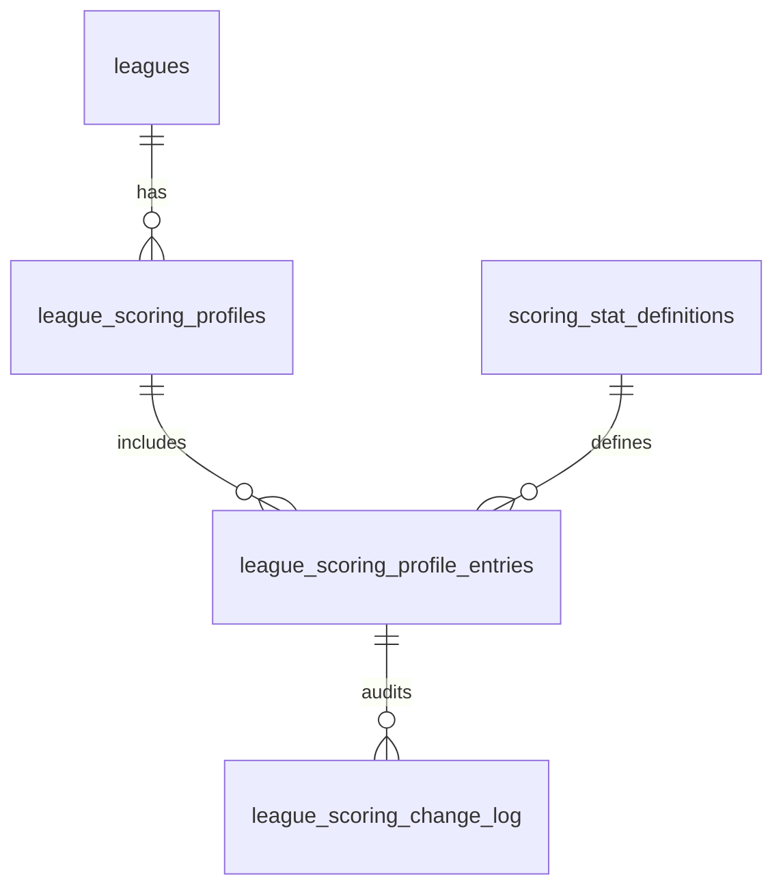

# Legacy Sports Database Tables Documentation

**Last Updated**: April 7, 2026

**Total Tables**: 36+ tables + views

**Recent Updates**:

- ✅ Documented matchup-system tables and links to [Matchup System Architecture](matchup-system.md) (LS-35)
- ✅ Added CASCADE DELETE relationships for leagues and teams (LS-66)
- ✅ Added week advancement status tracking to leagues
- ✅ Added stats loading status to matchups for async processing
- ✅ Removed unique constraint on matchup week numbers to support multiple concurrent matchups
- ✅ Added game_identifier to matchup_player_games for improved tracking
- ✅ Added nullable fielding position support
- ✅ Fixed SF column type in season_batting (changed from INTEGER to VARCHAR)
- ✅ Added queued status to stats loading workflow

---

## 🚨 CRITICAL: Database Query Guide

**FOR AI AGENTS**: Before writing database queries, read [Database Query Guide for AI Agents](../agents/database-query-guide.md)

### Two Separate Schemas

Legacy Sports uses **TWO PostgreSQL schemas**:

1. **`public`** - Fantasy league data (leagues, teams, matchups, players, statistics)
2. **`app_internal`** - Authentication and system internals (users table)

```sql
-- ❌ WRONG - Missing schema prefix
SELECT * FROM users WHERE id = 123;

-- ✅ CORRECT - Always specify schema
SELECT * FROM app_internal.users WHERE id = 123;
SELECT * FROM public.leagues WHERE id = 16;
```

### Common Query Mistakes

| ❌ Wrong                               | ✅ Correct                             | Issue                 |
| -------------------------------------- | -------------------------------------- | --------------------- |
| `SELECT * FROM users`                  | `SELECT * FROM app_internal.users`     | Missing schema prefix |
| `SELECT status FROM leagues`           | `SELECT draft_status FROM leagues`     | Wrong column name     |
| `SELECT selected_season FROM matchups` | Use `league_week_player_seasons` table | Column removed/moved  |
| `UPDATE career_batting SET hr = 500`   | Update `season_batting` instead        | View is read-only     |

**See**: [Database Query Guide](../agents/database-query-guide.md) for complete examples and patterns.

---

## Overview

The Legacy Sports database follows a **season-to-career aggregation pattern** with comprehensive baseball statistics tracking. The database stores both granular season-level data and pre-aggregated career statistics through PostgreSQL views.

## Table Categories

### Core Data (Players & Statistics)

1. Players - Master player registry
   2-4. Season Statistics (batting, pitching, fielding)
   5-8. Career Views (aggregated statistics)
   9-11. Game Statistics (game-level performance)

### League Management (12-25)

12. Leagues - League configuration and settings
13. Teams - Fantasy teams
14. League Members - User memberships and permissions
15. Team Members - Player rosters
    16-17. Drafts & Draft Teams - Draft system
    18-21. Matchups & Related - Head-to-head competition
    22-23. Roster Management - Position slots and lock rules
    24-25. System - Users and messages

### Matchup System

See [Matchup System Architecture](matchup-system.md) for the end-to-end
data flow and the [Matchup API Reference](../api/matchup-api.md) for the
GraphQL surface.

Defined in `lib/db-client/src/drizzle/public/models/Matchups.ts`:

| Table                         | Purpose                                                                                     |
| ----------------------------- | ------------------------------------------------------------------------------------------- |
| `matchups`                    | One row per (league, week, team1, team2). Holds `status`, `stats_loading_status`, scores.   |
| `matchup_players`             | Per-matchup roster snapshot with `position_id` and `manually_edited` flag for lineup edits. |
| `league_week_player_seasons`  | Per-player season selection for the matchup week (the season-selection feature).            |
| `matchup_player_games`        | Per-day game picks (`game_num`, `game_identifier`, `fielding_game_pos`, `sp_skipped`).      |
| `matchup_messages`            | Trash-talk / chat messages with reply threading, pinning, and soft-delete (LS-31).          |
| `matchup_message_reactions`   | Emoji reactions: `like` / `fire` / `laugh` / `wow` / `trophy` / `thumbs_down`.              |
| `matchup_chat_blocks`         | User block list with `matchup` / `league` / `global` scope and optional expiration.         |
| `matchup_message_connections` | WebSocket connection tracking for presence and live delivery.                               |
| `matchup_message_reports`     | Moderation queue: `pending` → `reviewing` → `resolved` / `dismissed`.                       |

> **Per-game scores are not persisted.** Only league-versioned scoring
> multipliers and the resulting team totals (`matchups.team1_score`,
> `matchups.team2_score`) are stored. See
> [Scoring engine](matchup-system.md#3-scoring-engine).

### Scoring System (26-29)

26. Scoring Stat Definitions (`scoring_stat_definitions`) - Available statistics catalog
27. League Scoring Profiles (`league_scoring_profiles`) - Versionable scoring configurations
28. League Scoring Profile Entries (`league_scoring_profile_entries`) - Per-stat multipliers
29. League Scoring Change Log (`league_scoring_change_log`) - Audit trail of profile changes

### Playoff System (30-33)

Defined in `lib/db-client/src/drizzle/public/models/Playoffs.ts`:

30. Playoff Brackets (`playoff_brackets`) - Tournament configuration: format (`4-team|6-team|8-team`), `start_week`, `multi_week_matchups`
31. Playoff Matchups (`playoff_matchups`) - Individual playoff games with `playoff_round` enum
32. Playoff Seeds (`playoff_seeds`) - Snapshot of top-N seeding at playoff start
33. Champion Trophies (`champion_trophies`) - Historical championship record, unique per `(league_id, season)`

### Tiebreaker System

Also defined in `Playoffs.ts`:

| Table                | Purpose                                                                                                                             |
| -------------------- | ----------------------------------------------------------------------------------------------------------------------------------- |
| `tiebreaker_rules`   | One row per league with `primary_method`, `secondary_method`, `tertiary_method`, `allow_commissioner_override`, and JSONB `config`. |
| `tiebreaker_history` | Append-only audit log: `applied_method`, `was_commissioner_override`, `winner_id`.                                                  |

Methods: `highest_category`, `total_season_points`, `head_to_head_record`,
`random`, `co_champion`.

### Notification System (34-36)

34. Notification Preferences - User notification settings
35. Device Tokens - Mobile device registration
36. Notification History - Sent notification audit trail

### Computed Views (37)

37. Player Eligible Positions - Position eligibility derived from career stats

## Database Architecture

### Core Design Principles

1. **Season-Level Source Data**: Individual season statistics are stored as the source of truth
2. **Career-Level Views**: Aggregated views automatically calculate career totals from season data
3. **Major League Filtering**: Career views filter for AL/NL leagues only
4. **Type Safety**: Drizzle ORM provides complete TypeScript integration
5. **Performance**: Indexed columns for common queries (player lookups, statistics)

---

## Core Data Tables

### 1. **Players** (`players`)

**Purpose**: Master registry of all baseball players in the system

| Column                  | Type                 | Description                                |
| ----------------------- | -------------------- | ------------------------------------------ |
| `id`                    | SERIAL (PK)          | Unique player identifier                   |
| `first_name`            | TEXT                 | Player's first name                        |
| `last_name`             | TEXT                 | Player's last name                         |
| `bref_id`               | VARCHAR(10) (UNIQUE) | Baseball Reference ID for external lookups |
| `stats_last_fetched_at` | TIMESTAMP            | When statistics were last updated          |

**Key Features**:

- Primary key: `id`
- Unique constraint: `bref_id` (Baseball Reference integration)
- Foreign key referenced by all statistics tables
- `stats_last_fetched_at` tracks data freshness for cache invalidation

---

## Season-Level Statistics Tables

### 2. **Season Batting** (`season_batting`)

**Purpose**: Individual season batting statistics per player/team

| Column                 | Type             | Description                                  |
| ---------------------- | ---------------- | -------------------------------------------- |
| `player_id`            | INTEGER (FK)     | References `players.id`                      |
| `season`               | INTEGER          | Year of the season                           |
| `team`                 | VARCHAR(20)      | Team abbreviation                            |
| `row_id`               | VARCHAR(10)      | Unique row identifier for multi-team seasons |
| `g`                    | INTEGER          | Games played                                 |
| `pa`                   | INTEGER          | Plate appearances                            |
| `ab`                   | INTEGER          | At bats                                      |
| `r`                    | INTEGER          | Runs scored                                  |
| `h`                    | INTEGER          | Hits                                         |
| `doubles`              | INTEGER          | Doubles                                      |
| `triples`              | INTEGER          | Triples                                      |
| `hr`                   | INTEGER          | Home runs                                    |
| `rbi`                  | INTEGER          | Runs batted in                               |
| `sb`                   | INTEGER          | Stolen bases                                 |
| `cs`                   | INTEGER          | Caught stealing                              |
| `bb`                   | INTEGER          | Walks                                        |
| `so`                   | INTEGER          | Strikeouts                                   |
| `batting_avg`          | DOUBLE PRECISION | Pre-calculated batting average               |
| `onbase_perc`          | DOUBLE PRECISION | On-base percentage                           |
| `slugging_perc`        | DOUBLE PRECISION | Slugging percentage                          |
| `onbase_plus_slugging` | DOUBLE PRECISION | OPS (On-base + Slugging)                     |
| `tb`                   | INTEGER          | Total bases                                  |
| `gidp`                 | INTEGER          | Grounded into double plays                   |
| `hbp`                  | INTEGER          | Hit by pitch                                 |
| `sh`                   | INTEGER          | Sacrifice hits                               |
| `sf`                   | VARCHAR(10)      | Sacrifice flies                              |
| `ibb`                  | INTEGER          | Intentional walks                            |
| `pos_season`           | VARCHAR(50)      | Positions played during season               |
| `award_summary`        | TEXT             | Awards won during season                     |
| `lg_id`                | VARCHAR(20)      | League ID (AL/NL/etc.)                       |

**Key Features**:

- Composite primary key: `(player_id, season, team, row_id)`
- Indexes: `player_id`, `hr` (for performance)
- Foreign key: `player_id` → `players.id`
- Supports multi-team seasons via `row_id`

### 3. **Season Pitching** (`season_pitching`)

**Purpose**: Individual season pitching statistics per player/team

| Column                         | Type                | Description                          |
| ------------------------------ | ------------------- | ------------------------------------ |
| `player_id`                    | INTEGER (FK)        | References `players.id`              |
| `season`                       | INTEGER             | Year of the season                   |
| `team`                         | VARCHAR(20)         | Team abbreviation                    |
| `row_id`                       | VARCHAR(10)         | Unique row identifier                |
| `w`                            | INTEGER             | Wins                                 |
| `l`                            | INTEGER             | Losses                               |
| `win_loss_perc`                | NUMERIC             | Win-loss percentage                  |
| `earned_run_avg`               | NUMERIC             | Earned run average                   |
| `g`                            | INTEGER             | Games                                |
| `gs`                           | INTEGER             | Games started                        |
| `gf`                           | INTEGER             | Games finished                       |
| `cg`                           | INTEGER             | Complete games                       |
| `sho`                          | INTEGER             | Shutouts                             |
| `sv`                           | INTEGER             | Saves                                |
| `ip`                           | DOUBLE PRECISION    | Innings pitched                      |
| `h`                            | INTEGER             | Hits allowed                         |
| `r`                            | INTEGER             | Runs allowed                         |
| `er`                           | INTEGER             | Earned runs                          |
| `hr`                           | INTEGER             | Home runs allowed                    |
| `bb`                           | INTEGER             | Walks                                |
| `ibb`                          | INTEGER             | Intentional walks                    |
| `so`                           | INTEGER             | Strikeouts                           |
| `hbp`                          | INTEGER             | Hit by pitch                         |
| `bk`                           | INTEGER             | Balks                                |
| `wp`                           | INTEGER             | Wild pitches                         |
| `batters_faced`                | INTEGER             | Total batters faced                  |
| `outs_recorded`                | INTEGER (GENERATED) | Calculated outs from innings pitched |
| `earned_run_avg_plus`          | DOUBLE PRECISION    | ERA+ (adjusted ERA)                  |
| `fip`                          | DOUBLE PRECISION    | Fielding Independent Pitching        |
| `whip`                         | DOUBLE PRECISION    | Walks + Hits per Inning Pitched      |
| `hits_per_nine`                | DOUBLE PRECISION    | Hits allowed per 9 innings           |
| `home_runs_per_nine`           | DOUBLE PRECISION    | HR allowed per 9 innings             |
| `bases_on_balls_per_nine`      | DOUBLE PRECISION    | Walks per 9 innings                  |
| `strikeouts_per_nine`          | DOUBLE PRECISION    | Strikeouts per 9 innings             |
| `strikeouts_per_base_on_balls` | DOUBLE PRECISION    | K/BB ratio                           |
| `award_summary`                | TEXT                | Awards won                           |
| `lg_id`                        | VARCHAR(20)         | League ID                            |

**Key Features**:

- Composite primary key: `(player_id, season, team, row_id)`
- Indexes: `player_id`, `w` (wins)
- Generated column: `outs_recorded` (calculated from `ip`)
- Advanced sabermetrics included (FIP, WHIP, etc.)

### 4. **Season Fielding** (`season_fielding`)

**Purpose**: Individual season fielding statistics per player/position

| Column                     | Type             | Description                                |
| -------------------------- | ---------------- | ------------------------------------------ |
| `player_id`                | INTEGER (FK)     | References `players.id`                    |
| `season`                   | INTEGER          | Year of the season                         |
| `pos`                      | VARCHAR(10)      | Position played                            |
| `team`                     | VARCHAR(20)      | Team abbreviation                          |
| `row_id`                   | VARCHAR(10)      | Unique row identifier                      |
| `lg_id`                    | VARCHAR(20)      | League ID                                  |
| `g`                        | INTEGER          | Games                                      |
| `gs`                       | INTEGER          | Games started                              |
| `cg`                       | INTEGER          | Complete games                             |
| `inn_def`                  | DOUBLE PRECISION | Innings played defensively                 |
| `chances`                  | DOUBLE PRECISION | Total chances (PO + A + E)                 |
| `po`                       | INTEGER          | Putouts                                    |
| `a`                        | INTEGER          | Assists                                    |
| `e_def`                    | INTEGER          | Errors                                     |
| `dp_def`                   | INTEGER          | Double plays                               |
| `fielding_perc`            | DOUBLE PRECISION | Fielding percentage                        |
| `range_factor_per_nine`    | DOUBLE PRECISION | Range factor per 9 innings                 |
| `range_factor_per_game`    | DOUBLE PRECISION | Range factor per game                      |
| `fielding_perc_lg`         | DOUBLE PRECISION | League average fielding percentage         |
| `range_factor_per_nine_lg` | DOUBLE PRECISION | League average range factor/9              |
| `range_factor_per_game_lg` | DOUBLE PRECISION | League average range factor/game           |
| `g_of_parts`               | INTEGER          | Games played at specific parts of position |
| `sb`                       | INTEGER          | Stolen bases allowed (catchers)            |
| `cs`                       | INTEGER          | Caught stealing (catchers)                 |
| `caught_stealing_perc`     | DOUBLE PRECISION | CS percentage                              |
| `caught_stealing_perc_lg`  | DOUBLE PRECISION | League average CS percentage               |
| `pickoffs`                 | INTEGER          | Pickoffs                                   |
| `award_summary`            | TEXT             | Awards won                                 |
| `wp`                       | INTEGER          | Wild pitches (catchers)                    |

**Key Features**:

- Composite primary key: `(player_id, season, pos, team, row_id)`
- Indexes: `player_id`, `(player_id, pos)`, `po`
- Position-specific statistics (catcher metrics for catchers)
- League comparison metrics included

---

## Career Aggregation Views

### 5. **Career Batting** (`career_batting` - VIEW)

**Purpose**: Lifetime batting totals aggregated from `season_batting`

**Data Source**: `SUM()` aggregation from `season_batting` WHERE `lg_id` IN ('AL', 'NL')

**Key Fields**: All batting statistics summed across career

- Total games, hits, home runs, RBI, etc.
- Excludes minor league or other league statistics
- Automatically updates when season data changes

### 6. **Career Pitching** (`career_pitching` - VIEW)

**Purpose**: Lifetime pitching totals aggregated from `season_pitching`

**Data Source**: `SUM()` aggregation from `season_pitching` WHERE `lg_id` IN ('AL', 'NL')

**Computed Fields**:

- `era`: Calculated career ERA from total ER and outs
- `out_rate`: Efficiency metric (outs per batter faced)

### 7. **Career Fielding** (`career_fielding` - VIEW)

**Purpose**: Lifetime fielding totals across all positions

**Data Source**: Aggregated from `season_fielding` WHERE `lg_id` IN ('AL', 'NL')

### 8. **Career Fielding by Position** (`career_fielding_by_position` - VIEW)

**Purpose**: Career fielding stats broken down by individual position

**Data Source**: Aggregated from `season_fielding` grouped by `(player_id, pos)`

---

## Game-Level Statistics Tables

### 9. **Game Batting** (`game_batting`)

**Purpose**: Individual game batting statistics

| Column            | Type     | Description                   |
| ----------------- | -------- | ----------------------------- |
| `player_id`       | INTEGER  | References `players.id`       |
| `season`          | INTEGER  | Season year                   |
| `game_number`     | INTEGER  | Game number in season         |
| `game_identifier` | CHAR(12) | Unique game identifier        |
| _batting stats_   | Various  | Same fields as season batting |

**Usage**: Detailed game-by-game performance tracking

### 10. **Game Pitching** (`game_pitching`)

**Purpose**: Individual game pitching statistics

**Structure**: Similar to `season_pitching` but at game level

- Generated `outs_recorded` column from innings pitched
- Game-level decision tracking (W/L/SV)

### 11. **Game Fielding** (`game_fielding`)

**Purpose**: Individual game fielding statistics

**Structure**: Subset of fielding stats at game level

- Position-specific defensive metrics per game

---

## League Management Tables

### 12. **Leagues** (`leagues`)

**Purpose**: Fantasy league configuration

| Column                 | Type                | Description                                                 |
| ---------------------- | ------------------- | ----------------------------------------------------------- |
| `id`                   | SERIAL (PK)         | League ID                                                   |
| `name`                 | VARCHAR             | League name                                                 |
| `owner`                | INTEGER             | League owner user ID                                        |
| `max_roster_size`      | INTEGER             | Maximum players per team (default: 25)                      |
| `current_matchup`      | INTEGER             | Current active matchup                                      |
| `draft_status`         | draft_status        | Status of the league draft (default: 'not-started')         |
| `invite_code`          | VARCHAR(8)          | Unique 8-character code for inviting users                  |
| `min_games_per_season` | INTEGER             | Minimum games required for season eligibility (default: 10) |
| `games_per_matchup`    | INTEGER             | Default number of games per player per matchup (default: 5) |
| `trade_deadline_week`  | INTEGER             | Week number when trades are locked                          |
| `roster_lock_timing`   | roster_lock_timing  | When rosters lock (default: 'matchup_start')                |
| `scheduling_strategy`  | scheduling_strategy | Matchup scheduling algorithm (default: 'round-robin')       |
| `week_advance_status`  | week_advance_status | Status of week advancement operation (default: 'idle')      |

**Roster Lock Timing Enum**: `matchup_start`, `day_before`, `week_before`, `custom`

**Scheduling Strategy Enum**: `round-robin`, `divisional`, `random`

**Week Advance Status Enum**: `idle`, `queued`, `processing`, `success`, `failed`

**Key Features**:

- `min_games_per_season`: Controls which seasons are eligible for selection in matchups (players must have played this many games)
- `games_per_matchup`: Default configuration for how many games to select per player in each matchup
- `roster_lock_timing`: Determines when roster changes are no longer allowed
- `scheduling_strategy`: Controls how weekly matchups are generated
- `week_advance_status`: Tracks asynchronous week advancement to prevent race conditions
- Unique constraint on `invite_code` for secure league joining
- **CASCADE DELETE**: Deleting a league cascades to teams, matchups, drafts, members, playoff data, and all related entities

### 13. **Teams** (`teams`)

**Purpose**: Fantasy teams within leagues

| Column      | Type         | Description             |
| ----------- | ------------ | ----------------------- |
| `id`        | SERIAL (PK)  | Team ID                 |
| `name`      | VARCHAR      | Team name               |
| `league_id` | INTEGER (FK) | References `leagues.id` |

**Key Features**:

- Foreign key: `league_id` → `leagues.id` (CASCADE DELETE)
- Unique constraint: `(id, league_id)`
- **CASCADE DELETE**: Deleting a team cascades to team_members, playoff seeds, and matchup data

### 14. **League Members** (`league_members`)

**Purpose**: User membership and permissions in leagues

| Column             | Type                    | Description                |
| ------------------ | ----------------------- | -------------------------- |
| `league_id`        | INTEGER (FK)            | References `leagues.id`    |
| `user_id`          | INTEGER                 | User identifier            |
| `team_id`          | INTEGER                 | Associated team (optional) |
| `permission_level` | league_permission_level | 'owner' or 'commissioner'  |

**Permission Level Enum**: `owner`, `commissioner`

**Key Features**:

- Composite primary key: `(league_id, user_id)`
- Foreign key: `league_id` → `leagues.id` (CASCADE DELETE)
- Permission levels control league management capabilities

### 15. **Team Members** (`team_members`)

**Purpose**: Player rosters for fantasy teams

| Column        | Type         | Description                      |
| ------------- | ------------ | -------------------------------- |
| `id`          | SERIAL (PK)  | Roster entry ID                  |
| `team_id`     | INTEGER (FK) | References `teams.id`            |
| `league_id`   | INTEGER (FK) | References `leagues.id`          |
| `player_id`   | INTEGER (FK) | References `players.id`          |
| `position_id` | INTEGER (FK) | References `league_positions.id` |

**Key Features**:

- Multiple foreign keys for data integrity
- Foreign key: `team_id` → `teams.id` (CASCADE DELETE)
- Foreign key: `league_id` → `leagues.id` (CASCADE DELETE)
- Links real players to fantasy teams
- Unique constraint: `(team_id, position_id)` ensures one player per position per team

---

## Draft and Competition Tables

### 16. **Drafts** (`drafts`)

**Purpose**: Draft event configuration

| Column        | Type         | Description                              |
| ------------- | ------------ | ---------------------------------------- |
| `id`          | SERIAL (PK)  | Draft ID                                 |
| `league_id`   | INTEGER (FK) | References `leagues.id`                  |
| `draft_type`  | draft_type   | Type of draft                            |
| `date`        | DATE         | Draft date                               |
| `draft_order` | draft_order  | Snake or normal order (default: 'snake') |

**Draft Type Enum**: `blind`, `normal`, `legacy`, `random-draft`

**Draft Order Enum**: `snake`, `normal`

**Key Features**:

- Foreign key: `league_id` → `leagues.id` (CASCADE DELETE)
- Supports multiple draft formats and ordering strategies

### 17. **Draft Teams** (`draft_teams`)

**Purpose**: Team participation and draft order

| Column        | Type         | Description             |
| ------------- | ------------ | ----------------------- |
| `draft_id`    | INTEGER (FK) | References `drafts.id`  |
| `team_id`     | INTEGER (FK) | References `teams.id`   |
| `league_id`   | INTEGER (FK) | References `leagues.id` |
| `draft_order` | INTEGER      | Draft position          |

**Key Features**:

- Composite primary key: `(draft_id, team_id, league_id)`
- Unique constraint on `(draft_id, draft_order)` ensures no duplicate draft positions
- Foreign key: `draft_id` → `drafts.id` (CASCADE DELETE)
- Links teams to specific drafts with ordering

### 18. **Matchups** (`matchups`)

**Purpose**: Weekly fantasy matchups with team pairings and scoring

| Column                 | Type                 | Description                               |
| ---------------------- | -------------------- | ----------------------------------------- |
| `id`                   | SERIAL (PK)          | Matchup ID                                |
| `league_id`            | INTEGER (FK)         | References `leagues.id`                   |
| `week_number`          | INTEGER              | Week in season                            |
| `team1_id`             | INTEGER (FK)         | References `teams.id` (first team)        |
| `team2_id`             | INTEGER (FK)         | References `teams.id` (second team)       |
| `team1_score`          | NUMERIC(10, 2)       | Score for team 1 after matchup completion |
| `team2_score`          | NUMERIC(10, 2)       | Score for team 2 after matchup completion |
| `status`               | matchup_status       | Current status of the matchup             |
| `stats_loading_status` | stats_loading_status | Status of background stats loading        |
| `games_per_matchup`    | INTEGER              | Number of games to select per player      |
| `start_time`           | TIMESTAMP            | When the matchup period begins            |
| `end_time`             | TIMESTAMP            | When the matchup period ends              |

**Matchup Status Enum**: `scheduled`, `in_progress`, `completed`, `cancelled`

**Stats Loading Status Enum**: `not_started`, `queued`, `loading`, `completed`, `failed`

**Key Features**:

- Foreign key: `league_id` → `leagues.id` (CASCADE DELETE)
- Foreign key: `team1_id` → `teams.id` (CASCADE DELETE)
- Foreign key: `team2_id` → `teams.id` (CASCADE DELETE)
- **Note**: Removed unique constraint on `(league_id, week_number)` to support multiple matchups per week
- Supports head-to-head competition between two teams
- Tracks scoring and matchup lifecycle
- `stats_loading_status` tracks asynchronous statistics loading for performance
- Season selection now managed per league-week-player (see `league_week_player_seasons`)

### 19. **Matchup Players** (`matchup_players`)

**Purpose**: Players selected for specific matchups

| Column       | Type         | Description              |
| ------------ | ------------ | ------------------------ |
| `id`         | SERIAL (PK)  | Entry ID                 |
| `matchup_id` | INTEGER (FK) | References `matchups.id` |
| `player_id`  | INTEGER (FK) | References `players.id`  |
| `team_id`    | INTEGER (FK) | References `teams.id`    |

**Key Features**:

- Foreign key: `matchup_id` → `matchups.id` (CASCADE DELETE via matchup cascade)
- Foreign key: `player_id` → `players.id`
- Foreign key: `team_id` → `teams.id` (CASCADE DELETE)
- **Note**: Season selection moved to `league_week_player_seasons` table for consistency across matchups and to support free agent projections

### 20. **League Week Player Seasons** (`league_week_player_seasons`)

**Purpose**: Season selection for players at the league-week level

| Column        | Type         | Description              |
| ------------- | ------------ | ------------------------ |
| `id`          | SERIAL (PK)  | Entry ID                 |
| `league_id`   | INTEGER (FK) | References `leagues.id`  |
| `week_number` | INTEGER      | Week number              |
| `player_id`   | INTEGER (FK) | References `players.id`  |
| `season`      | INTEGER      | Selected season          |
| `created_at`  | TIMESTAMP    | When season was selected |

**Key Features**:

- Unique constraint: `(league_id, week_number, player_id)` ensures one season per player per league per week
- Foreign key: `league_id` → `leagues.id` (CASCADE DELETE via league cascade)
- Foreign key: `player_id` → `players.id`
- Consistent season across all matchups in the same week
- Supports free agents having projections
- Cleaner separation: `matchup_players` tracks "who plays", this table tracks "which season"

### 21. **Matchup Player Games** (`matchup_player_games`)

**Purpose**: Specific games selected for matchup players

| Column              | Type         | Description                                          |
| ------------------- | ------------ | ---------------------------------------------------- |
| `id`                | SERIAL (PK)  | Entry ID                                             |
| `matchup_player_id` | INTEGER (FK) | References `matchup_players.id`                      |
| `game_num`          | INTEGER      | Sequential game number                               |
| `game_identifier`   | VARCHAR(20)  | Unique game identifier (Baseball Reference format)   |
| `batting_game_num`  | INTEGER      | Game number for batting stats                        |
| `fielding_game_num` | INTEGER      | Game number for fielding stats                       |
| `pitching_game_num` | INTEGER      | Game number for pitching stats                       |
| `fielding_game_pos` | CHAR(2)      | Position specification for fielding games (nullable) |

**Key Features**:

- Foreign key: `matchup_player_id` → `matchup_players.id` (CASCADE DELETE via matchup cascade)
- Links to individual batting, fielding, and pitching games
- `fielding_game_pos` can be NULL to support players with no fielding data
- Position specification for fielding games
- Granular game-by-game selections
- **IMPORTANT**: Scores are NOT stored in the database - they are calculated on the frontend using the `@legacy-sports/scoring` package with league-specific settings

---

## Roster Management Tables

### 22. **League Positions** (`league_positions`)

**Purpose**: Position slots configuration per league

| Column          | Type          | Description                     |
| --------------- | ------------- | ------------------------------- |
| `id`            | SERIAL (PK)   | Position ID                     |
| `league_id`     | INTEGER (FK)  | References `leagues.id`         |
| `position_type` | position_slot | Position type (C, 1B, 2B, etc.) |

**Position Slot Enum**: `SP`, `RP`, `C`, `1B`, `2B`, `3B`, `SS`, `RF`, `LF`, `CF`, `DH`, `XDH`, `OF`, `IF`

**Key Features**:

- Foreign key: `league_id` → `leagues.id` (CASCADE DELETE via league cascade)
- Flexible position slot configurations per league
- Includes special slots: `XDH` (extra DH), `OF` (any outfield), `IF` (any infield)

### 23. **Roster Lock Rules** (`roster_lock_rules`)

**Purpose**: Configurable rules for when and how rosters can be modified

| Column                      | Type               | Description                                                  |
| --------------------------- | ------------------ | ------------------------------------------------------------ |
| `id`                        | SERIAL (PK)        | Rule ID                                                      |
| `league_id`                 | INTEGER (FK)       | References `leagues.id`                                      |
| `allow_emergency_subs`      | BOOLEAN            | Whether emergency substitutions are allowed (default: false) |
| `emergency_sub_rule`        | emergency_sub_rule | Conditions for emergency subs (default: 'none')              |
| `custom_lock_time`          | TIMESTAMP          | Custom lock time if using custom timing                      |
| `lock_hours_before_matchup` | INTEGER            | Hours before matchup start to lock (default: 0)              |
| `commissioner_can_override` | BOOLEAN            | Whether commissioners can bypass locks (default: true)       |

**Emergency Sub Rule Enum**: `none`, `injury_only`, `injury_or_rest`, `commissioner_approval`

**Key Features**:

- Unique constraint: `league_id` ensures one rule set per league
- Foreign key: `league_id` → `leagues.id` (CASCADE DELETE via league cascade)
- Flexible emergency substitution policies
- Commissioner override capability

---

## System Tables

### 24. **Users** (`users` - VIEW)

**Purpose**: User authentication and authorization

**Data Source**: References `app_internal.users` (separate schema)

| Column         | Type         | Description       |
| -------------- | ------------ | ----------------- |
| `id`           | INTEGER      | User ID           |
| `email`        | VARCHAR(100) | User email        |
| `username`     | VARCHAR(50)  | Username          |
| `access_level` | access_level | 'none' or 'admin' |

**Access Level Enum**: `none`, `admin`

**Key Features**:

- View into internal authentication system (`app_internal.users` table)
- Access level controls: `none`, `admin`
- Separates public schema from internal authentication schema

### 25. **League Messages** (`league_messages`)

**Purpose**: League communication system

| Column         | Type         | Description                        |
| -------------- | ------------ | ---------------------------------- |
| `id`           | SERIAL (PK)  | Message ID                         |
| `league_id`    | INTEGER (FK) | References `leagues.id`            |
| `user_id`      | INTEGER      | Message author                     |
| `message_text` | VARCHAR      | Message content                    |
| `timestamp`    | TIMESTAMP    | Message timestamp (auto-generated) |

**Key Features**:

- Indexes: `league_id`, `(league_id, timestamp)`
- Foreign key: `league_id` → `leagues.id` (CASCADE DELETE via league cascade)
- Automatic timestamping

---

## League Scoring Extensions

### Storage Overview

- **Canonical definitions** live in `scoring_stat_definitions`. Each row locks down the stat group, source column, default multiplier, and range enforcement used across every league.
- **Per-league overrides** are stored in `league_scoring_profiles` and `league_scoring_profile_entries`. A league always has a single `is_default = true` profile that is cloned when commissioners stage draft changes.
- **Historical auditing** flows through `league_scoring_change_log`, which is populated by triggers whenever a multiplier or enabled flag changes. The log powers commissioner rollbacks and reporting.
- **Default multipliers** ship via migration seeds so brand-new leagues immediately inherit MLB-standard scoring without manual setup.

### Access Patterns

1. The database client exposes a typed `ScoringService` (`lib/db-client/src/lib/services/ScoringService.ts`) that composes the four tables above into a single graph of definitions, overrides, and audit rows.
2. The GraphQL layer (`lambdas/db/src/schema/scoring.ts`) calls that service to implement the `leagueScoringProfile`, `defaultScoringProfile`, and `updateLeagueScoringProfile` operations. Authorization checks ensure only league members (or commissioners for mutations) can reach the data.
3. `LeagueScoringProvider` on the client caches the GraphQL response per league and exposes normalized `BaseballScoringSettings` to hooks such as `useTeamMemberProjections`, so projections and UI editors never query tables directly.
4. Automation flows (CLI scoring calculators, background jobs) re-use the service layer to guarantee identical multiplier math between backend scoring and UI previews.

### 26. **Scoring Stat Definitions** (`scoring_stat_definitions`)

**Purpose**: Canonical catalog of stats that can be scored with allowable multiplier bounds.

| Column               | Type                     | Description                                        |
| -------------------- | ------------------------ | -------------------------------------------------- |
| `id`                 | SERIAL (PK)              | Unique stat definition identifier                  |
| `stat_key`           | VARCHAR(64) (UNIQUE)     | Machine key (e.g., `batting_hr`)                   |
| `group`              | ENUM                     | `batting`, `pitching`, or `fielding`               |
| `source_table`       | VARCHAR(48)              | Origin table (`season_batting`, `season_pitching`) |
| `source_column`      | VARCHAR(48)              | Column name containing the stat                    |
| `display_name`       | VARCHAR(80)              | Friendly label for UI                              |
| `description`        | TEXT                     | Additional context or tooltip text                 |
| `default_multiplier` | NUMERIC(6,3)             | System default multiplier                          |
| `min_multiplier`     | NUMERIC(6,3)             | Lower bound enforced via trigger                   |
| `max_multiplier`     | NUMERIC(6,3)             | Upper bound enforced via trigger                   |
| `step_size`          | NUMERIC(4,3)             | Preferred UI increment (default 0.5)               |
| `is_required`        | BOOLEAN                  | Prevents disabling critical stats                  |
| `enforce_positive`   | BOOLEAN                  | True if multiplier must remain >= 0                |
| `enforce_negative`   | BOOLEAN                  | True if multiplier must remain <= 0                |
| `created_at`         | TIMESTAMP WITH TIME ZONE | Creation timestamp                                 |
| `updated_at`         | TIMESTAMP WITH TIME ZONE | Auto-updated on change                             |

**Key Features**:

- Backing table for scoring UI and validation logic
- Stores per-stat multiplier bounds and requirements
- Indexed by `stat_key` and `group` for quick lookups

### 27. **League Scoring Profiles** (`league_scoring_profiles`)

**Purpose**: Versionable scoring configuration per league (supports default and draft profiles).

| Column                   | Type                     | Description                                           |
| ------------------------ | ------------------------ | ----------------------------------------------------- |
| `id`                     | SERIAL (PK)              | Profile identifier                                    |
| `league_id`              | INTEGER (FK)             | References `leagues.id`                               |
| `profile_name`           | VARCHAR(64)              | Display name (`Default`, `2026 Regular Season`, etc.) |
| `season_year`            | SMALLINT                 | Optional season association                           |
| `status`                 | ENUM                     | `draft`, `active`, `archived`                         |
| `is_default`             | BOOLEAN                  | Marks the active profile in use                       |
| `copied_from_profile_id` | INTEGER (FK self)        | Tracks cloning lineage                                |
| `created_at`             | TIMESTAMP WITH TIME ZONE | Creation timestamp                                    |
| `updated_at`             | TIMESTAMP WITH TIME ZONE | Auto-updated on change                                |
| `activated_at`           | TIMESTAMP WITH TIME ZONE | Set when status first becomes `active`                |

**Key Features**:

- Unique partial index ensures one default profile per league
- Supports draft editing by toggling `status`
- Self-referencing FK retains history when cloning profiles

### 28. **League Scoring Profile Entries** (`league_scoring_profile_entries`)

**Purpose**: Stores multipliers per stat within a given league profile.

| Column               | Type                     | Description                                 |
| -------------------- | ------------------------ | ------------------------------------------- |
| `id`                 | SERIAL (PK)              | Entry identifier                            |
| `profile_id`         | INTEGER (FK)             | References `league_scoring_profiles.id`     |
| `stat_definition_id` | INTEGER (FK)             | References `scoring_stat_definitions.id`    |
| `multiplier`         | NUMERIC(6,3)             | Custom multiplier value                     |
| `is_enabled`         | BOOLEAN                  | Allows toggling a stat off without deletion |
| `created_at`         | TIMESTAMP WITH TIME ZONE | Creation timestamp                          |
| `updated_at`         | TIMESTAMP WITH TIME ZONE | Auto-updated on change                      |

**Key Features**:

- Unique constraint on `(profile_id, stat_definition_id)`
- Trigger-enforced bounds derive from definition table
- `is_enabled` allows optional stats without dropping entries

### 29. **League Scoring Change Log** (`league_scoring_change_log`)

**Purpose**: Audit trail for multiplier changes to support commissioner oversight and rollback.

| Column                | Type                     | Description                                        |
| --------------------- | ------------------------ | -------------------------------------------------- |
| `id`                  | BIGSERIAL (PK)           | Change log entry                                   |
| `profile_id`          | INTEGER (FK)             | References `league_scoring_profiles.id`            |
| `stat_definition_id`  | INTEGER (FK)             | References `scoring_stat_definitions.id`           |
| `previous_multiplier` | NUMERIC(6,3)             | Multiplier before change (null on insert)          |
| `new_multiplier`      | NUMERIC(6,3)             | Multiplier after change                            |
| `changed_by`          | INTEGER (FK)             | References `users.id` (optional commissioner link) |
| `changed_at`          | TIMESTAMP WITH TIME ZONE | Timestamp of change                                |
| `change_reason`       | VARCHAR(120)             | Optional human-readable reason                     |
| `action`              | ENUM                     | `created`, `updated`, or `disabled`                |

**Key Features**:

- Populated via `AFTER` triggers on profile entries
- Enables auditing and approval workflows
- Supports rollback tooling by retaining previous value

#### Scoring Relationships Diagram



---

## Playoff System Tables

### 30. **Playoff Brackets** (`playoff_brackets`)

**Purpose**: Top-level playoff configuration for a league season

| Column             | Type                   | Description                    |
| ------------------ | ---------------------- | ------------------------------ |
| `id`               | SERIAL (PK)            | Bracket ID                     |
| `league_id`        | INTEGER (FK)           | References `leagues.id`        |
| `season`           | INTEGER                | Season year                    |
| `format`           | playoff_format         | Tournament format              |
| `start_week`       | INTEGER                | First week of playoffs         |
| `end_week`         | INTEGER                | Last week of playoffs          |
| `champion_team_id` | INTEGER (FK)           | References `teams.id` (winner) |
| `status`           | playoff_matchup_status | Overall bracket status         |
| `created_at`       | TIMESTAMP              | Creation timestamp             |

**Playoff Format Enum**: `4-team`, `6-team`, `8-team`

**Playoff Matchup Status Enum**: `scheduled`, `in_progress`, `completed`

**Key Features**:

- Unique constraint: `(league_id, season)` ensures one bracket per league per season
- Foreign key: `league_id` → `leagues.id` (CASCADE DELETE)
- Foreign key: `champion_team_id` → `teams.id` (CASCADE DELETE)
- Supports multiple tournament formats

### 31. **Playoff Matchups** (`playoff_matchups`)

**Purpose**: Individual matchups within a playoff bracket

| Column              | Type                   | Description                          |
| ------------------- | ---------------------- | ------------------------------------ |
| `id`                | SERIAL (PK)            | Matchup ID                           |
| `bracket_id`        | INTEGER (FK)           | References `playoff_brackets.id`     |
| `round`             | playoff_round          | Tournament round                     |
| `matchup_number`    | INTEGER                | Matchup identifier within round      |
| `high_seed_team_id` | INTEGER (FK)           | References `teams.id` (higher seed)  |
| `low_seed_team_id`  | INTEGER (FK)           | References `teams.id` (lower seed)   |
| `winner_team_id`    | INTEGER (FK)           | References `teams.id` (winner)       |
| `high_seed_score`   | NUMERIC(10, 2)         | Higher seed final score              |
| `low_seed_score`    | NUMERIC(10, 2)         | Lower seed final score               |
| `week_number`       | INTEGER                | Week when matchup occurs             |
| `status`            | playoff_matchup_status | Current matchup status               |
| `is_multi_week`     | BOOLEAN                | Whether matchup spans multiple weeks |

**Playoff Round Enum**: `wildcard`, `semifinals`, `finals`

**Key Features**:

- Foreign key: `bracket_id` → `playoff_brackets.id` (CASCADE DELETE)
- Foreign keys to `teams.id` for all team references (CASCADE DELETE)
- Tracks seeding information for tournament progression
- Supports multi-week championship matchups

### 32. **Playoff Seeds** (`playoff_seeds`)

**Purpose**: Team seeding information for playoffs

| Column                  | Type           | Description                      |
| ----------------------- | -------------- | -------------------------------- |
| `id`                    | SERIAL (PK)    | Seed ID                          |
| `bracket_id`            | INTEGER (FK)   | References `playoff_brackets.id` |
| `team_id`               | INTEGER (FK)   | References `teams.id`            |
| `seed_number`           | INTEGER        | Seed position (1-N)              |
| `regular_season_wins`   | INTEGER        | Regular season wins              |
| `regular_season_losses` | INTEGER        | Regular season losses            |
| `points_for`            | NUMERIC(10, 2) | Total points scored              |

**Key Features**:

- Unique constraint: `(bracket_id, team_id)` ensures one seed per team per bracket
- Foreign key: `bracket_id` → `playoff_brackets.id` (CASCADE DELETE)
- Foreign key: `team_id` → `teams.id` (CASCADE DELETE)
- Stores regular season performance for seeding calculation
- Tiebreaker data (wins, losses, points for)

### 33. **Champion Trophies** (`champion_trophies`)

**Purpose**: Historical championship records

| Column              | Type           | Description                       |
| ------------------- | -------------- | --------------------------------- |
| `id`                | SERIAL (PK)    | Trophy ID                         |
| `league_id`         | INTEGER (FK)   | References `leagues.id`           |
| `season`            | INTEGER        | Championship season               |
| `team_id`           | INTEGER (FK)   | References `teams.id` (champion)  |
| `championship_week` | INTEGER        | Week of championship              |
| `final_score`       | NUMERIC(10, 2) | Champion's final score            |
| `runner_up_team_id` | INTEGER (FK)   | References `teams.id` (runner-up) |
| `runner_up_score`   | NUMERIC(10, 2) | Runner-up's final score           |
| `awarded_at`        | TIMESTAMP      | When trophy was awarded           |

**Key Features**:

- Unique constraint: `(league_id, season)` ensures one champion per league per season
- Foreign key: `league_id` → `leagues.id` (CASCADE DELETE)
- Foreign key: `team_id` → `teams.id` (CASCADE DELETE)
- Foreign key: `runner_up_team_id` → `teams.id` (CASCADE DELETE)
- Permanent historical record of championships

---

## Notification System Tables

### 34. **Notification Preferences** (`notification_preferences`)

**Purpose**: User notification settings and thresholds

| Column                       | Type           | Description                                           |
| ---------------------------- | -------------- | ----------------------------------------------------- |
| `id`                         | SERIAL (PK)    | Preference ID                                         |
| `user_id`                    | INTEGER (FK)   | References `app_internal.users.id`                    |
| `matchup_started_enabled`    | BOOLEAN        | Notify when matchup starts (default: true)            |
| `matchup_ended_enabled`      | BOOLEAN        | Notify when matchup ends (default: true)              |
| `matchup_close_game_enabled` | BOOLEAN        | Notify for close games (default: true)                |
| `matchup_reminder_enabled`   | BOOLEAN        | Send matchup reminders (default: true)                |
| `push_enabled`               | BOOLEAN        | Enable push notifications (default: true)             |
| `email_enabled`              | BOOLEAN        | Enable email notifications (default: false)           |
| `close_game_threshold`       | NUMERIC(10, 2) | Score difference for close game alerts (default: 5.0) |
| `created_at`                 | TIMESTAMP      | Creation timestamp                                    |
| `updated_at`                 | TIMESTAMP      | Last update timestamp                                 |

**Key Features**:

- Unique constraint: `user_id` ensures one preference set per user
- Foreign key: `user_id` → `app_internal.users.id` (CASCADE DELETE)
- Granular notification control per notification type
- Configurable close game threshold

### 35. **Device Tokens** (`device_tokens`)

**Purpose**: Mobile device registration for push notifications

| Column         | Type         | Description                             |
| -------------- | ------------ | --------------------------------------- |
| `id`           | SERIAL (PK)  | Token ID                                |
| `user_id`      | INTEGER (FK) | References `app_internal.users.id`      |
| `device_token` | TEXT         | Firebase/APNS device token              |
| `platform`     | VARCHAR(20)  | Platform (iOS, Android, web)            |
| `endpoint_arn` | TEXT         | AWS SNS endpoint ARN                    |
| `enabled`      | BOOLEAN      | Whether token is active (default: true) |
| `created_at`   | TIMESTAMP    | Registration timestamp                  |
| `updated_at`   | TIMESTAMP    | Last update timestamp                   |

**Key Features**:

- Unique constraint: `device_token` prevents duplicate registrations
- Indexes: `user_id`, `enabled` for efficient lookups
- Foreign key: `user_id` → `app_internal.users.id` (CASCADE DELETE)
- Stores AWS SNS endpoint ARN for push delivery
- Supports multiple devices per user

### 36. **Notification History** (`notification_history`)

**Purpose**: Audit trail of all sent notifications

| Column              | Type                 | Description                            |
| ------------------- | -------------------- | -------------------------------------- |
| `id`                | SERIAL (PK)          | Notification ID                        |
| `user_id`           | INTEGER (FK)         | References `app_internal.users.id`     |
| `notification_type` | notification_type    | Type of notification                   |
| `channel`           | notification_channel | Delivery channel                       |
| `matchup_id`        | INTEGER (FK)         | References `matchups.id` (optional)    |
| `league_id`         | INTEGER (FK)         | References `leagues.id` (optional)     |
| `title`             | VARCHAR(255)         | Notification title                     |
| `message`           | TEXT                 | Notification message body              |
| `metadata`          | JSONB                | Additional structured data             |
| `read`              | BOOLEAN              | Whether user has read (default: false) |
| `sent_at`           | TIMESTAMP            | When notification was sent             |
| `read_at`           | TIMESTAMP            | When notification was read             |
| `created_at`        | TIMESTAMP            | Creation timestamp                     |

**Notification Type Enum**: `matchup_started`, `matchup_ended`, `matchup_close_game`, `matchup_reminder`

**Notification Channel Enum**: `in_app`, `push`, `email`

**Key Features**:

- Indexes: `user_id`, `matchup_id`, `league_id`, `read`, `sent_at` for efficient queries
- Foreign key: `user_id` → `app_internal.users.id` (CASCADE DELETE)
- Foreign key: `matchup_id` → `matchups.id` (CASCADE DELETE via matchup cascade)
- Foreign key: `league_id` → `leagues.id` (CASCADE DELETE via league cascade)
- JSONB metadata for flexible notification data
- Tracks read status and timing for engagement metrics

---

## Computed Views

### 37. **Player Eligible Positions** (`player_eligible_positions` - VIEW)

**Purpose**: Determines which positions players are eligible for based on games played

**Logic**:

- **Field positions**: 50+ games at position (excluding pitcher)
- **Starting pitcher**: 50+ games started
- **Relief pitcher**: 50+ relief appearances (games - games started)

**Data Source**: `career_fielding_by_position` and `career_pitching`

---

## Performance Optimizations

### Indexes

- **Player lookups**: `player_id` indexed on all statistics tables
- **Statistics queries**: Key stats fields indexed (HR, wins, putouts)
- **League operations**: `league_id` and timestamp indexes
- **Position lookups**: `(player_id, position)` compound indexes

### Data Types

- **Large numbers**: `BIGINT` with `mode: 'number'` for career totals
- **Precision**: `DOUBLE PRECISION` for calculated percentages
- **Generated columns**: Automatic calculation of derived fields (outs_recorded)

---

## GraphQL Integration

The database integrates with a GraphQL API through:

1. **StatisticsService** (`lib/db-client/src/lib/services/StatisticsService.ts`)
2. **GraphQL resolvers** (`lambdas/db/src/schema/statistics.ts`)
3. **Career statistics queries** with filtering and sorting support

**Available Operations**:

- `careerBattingStats()` - Top hitters with filtering
- `careerPitchingStats()` - Top pitchers with filtering
- `playerCareerBatting(playerId)` - Individual player career batting
- `playerCareerPitching(playerId)` - Individual player career pitching
- `playerCareerFielding(playerId)` - Individual player career fielding

---

## Database Cascade Delete Relationships

**Migration**: `20260205_210000_add_cascade_deletes_to_leagues_and_teams.ts`

The database implements comprehensive CASCADE DELETE behavior to maintain referential integrity and simplify data cleanup:

### League Deletion Cascades

When a **league** is deleted, the following entities are automatically removed:

- **Direct cascades**:
  - `teams` (all teams in the league)
  - `matchups` (all matchups)
  - `drafts` (all draft configurations)
  - `league_members` (all memberships)
  - `playoff_brackets` (all playoff brackets)
  - `champion_trophies` (championship history)

- **Indirect cascades** (via dependent tables):
  - `team_members` (via teams)
  - `matchup_players` (via matchups)
  - `matchup_player_games` (via matchup_players)
  - `playoff_matchups` (via playoff_brackets)
  - `playoff_seeds` (via playoff_brackets)
  - `draft_teams` (via drafts)
  - `league_positions` (via league reference)
  - `roster_lock_rules` (via league reference)
  - `league_scoring_profiles` (via league reference)
  - `notification_history` (via league reference)

### Team Deletion Cascades

When a **team** is deleted, the following entities are automatically removed:

- `team_members` (player roster)
- `matchup_players` (via team_id reference)
- `playoff_seeds` (playoff seeding data)
- `playoff_matchups` (where team is high seed, low seed, or winner)
- `champion_trophies` (where team is champion or runner-up)
- `matchups` (where team is team1 or team2)

### Benefits

1. **Data Integrity**: Prevents orphaned records across the database
2. **Simplified Cleanup**: No need for complex deletion scripts
3. **Atomic Operations**: All related data removed in single transaction
4. **Prevents Errors**: Eliminates foreign key constraint violations

### Important Notes

- All cascade deletes are transaction-safe
- Statistics tables (`season_batting`, `season_pitching`, etc.) are **NOT** affected by league/team deletions - they remain as historical data
- User accounts (`app_internal.users`) are preserved when leagues/teams are deleted

---

## Development Notes

### Database Client

- **ORM**: Drizzle with full TypeScript integration
- **Connection**: PostgreSQL via connection pooling
- **Migrations**: Automated through Drizzle migration system
- **Type Safety**: All tables and views have complete TypeScript definitions

### Data Sources

- **Historical Data**: Imported from Baseball Reference and similar sources
- **Real-time Data**: Game-level statistics for current seasons
- **Career Views**: Automatically maintained aggregations

### Schema Evolution

- **New seasons**: Add rows to season tables, career views update automatically
- **New statistics**: Add columns to season tables, update view definitions
- **New positions**: Extend position enums, update eligibility logic

This database architecture provides comprehensive baseball statistics tracking with both granular and aggregated views, full fantasy league management, and type-safe integration with the GraphQL API layer.
