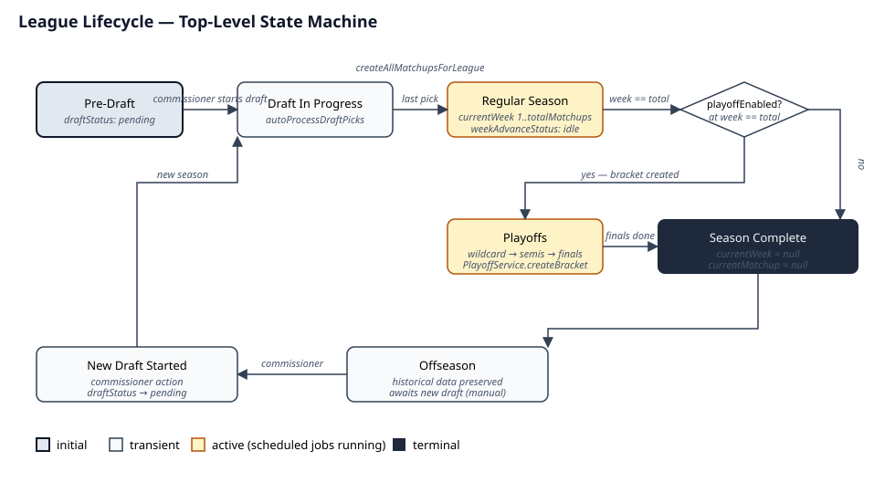
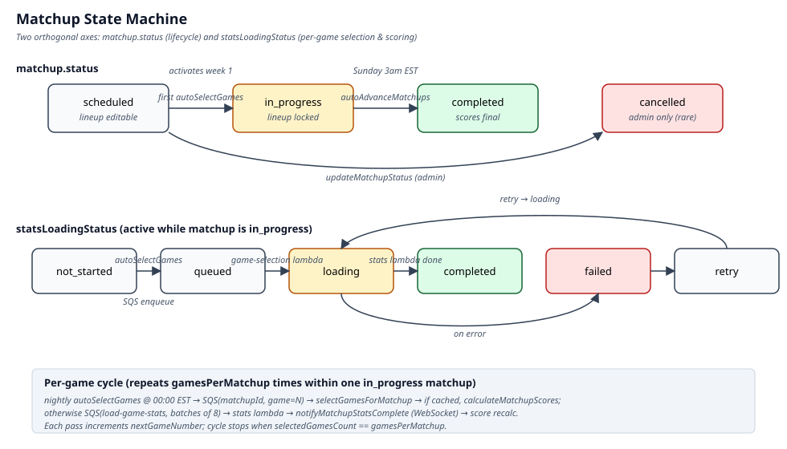
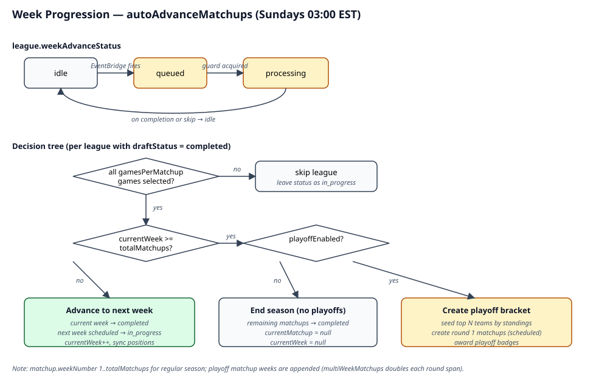
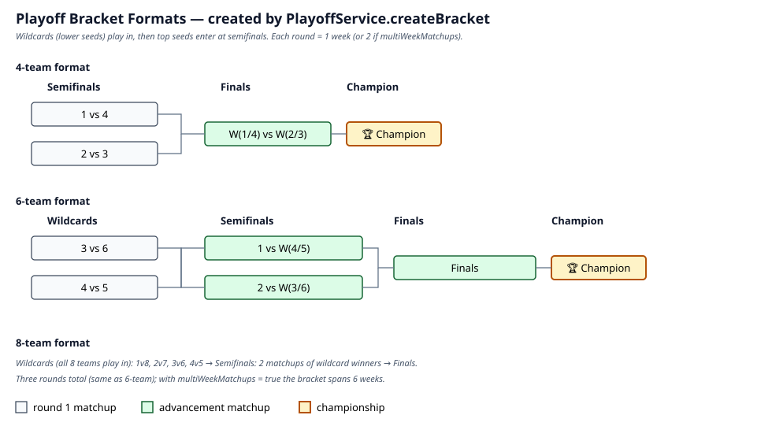
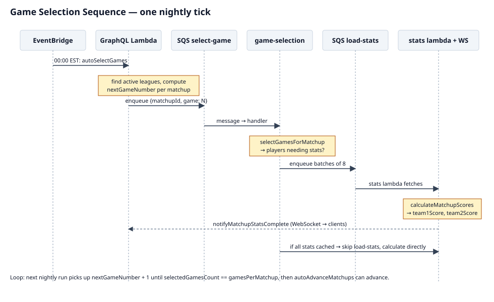

# League State Machine

This document is the canonical reference for how a fantasy league progresses through its lifecycle: from draft, through weekly game selection and matchup scoring, into playoffs, and across season boundaries.

Five state machines compose the overall behaviour. Each is documented below with an SVG diagram and the source-of-truth code locations.

- [1. League lifecycle (top level)](#1-league-lifecycle-top-level)
- [2. Matchup state machine](#2-matchup-state-machine)
- [3. Week progression](#3-week-progression)
- [4. Playoff bracket](#4-playoff-bracket)
- [5. Game selection sequence](#5-game-selection-sequence)
- [Appendix: enums, schedules, fields](#appendix-enums-schedules-and-key-fields)

---

## 1. League lifecycle (top level)

A league moves through five high-level phases. Phase changes are driven by two things: **manual commissioner actions** (start draft, start new season) and **scheduled EventBridge jobs** (nightly game selection, weekly week-advance).

| Transition                         | Trigger                                                                                                                     | Code                                                                                                                                                                                                                                                                                                     |
| ---------------------------------- | --------------------------------------------------------------------------------------------------------------------------- | -------------------------------------------------------------------------------------------------------------------------------------------------------------------------------------------------------------------------------------------------------------------------------------------------------- |
| Pre-Draft → Draft In Progress      | Commissioner starts the draft                                                                                               | [`startDraft` — leagues/mutations.ts:486](../../lambdas/db/src/schema/leagues/mutations.ts:486); for direct/admin flow [`initializeDraft` — drafts/mutations/initialize-draft.ts:32](../../lambdas/db/src/schema/drafts/mutations/initialize-draft.ts:32)                                                |
| Draft In Progress → Regular Season | Last pick made; `autoProcessDraftPicks` fires `createAllMatchupsForLeague`                                                  | [draft-pick-effects.ts:156-161](../../lambdas/db/src/schema/drafts/draft-pick-effects.ts:156)                                                                                                                                                                                                            |
| Regular Season → Playoffs          | `autoAdvanceMatchups` detects `currentWeek >= totalMatchups` and `playoffEnabled = true`                                    | [scheduled-mutations.ts:524-780](../../lambdas/db/src/schema/matchups/scheduled-mutations.ts:524)                                                                                                                                                                                                        |
| Regular Season → Season Complete   | Same condition with `playoffEnabled = false`; remaining matchups marked `completed`, `currentWeek`/`currentMatchup` cleared | [scheduled-mutations.ts:490-522](../../lambdas/db/src/schema/matchups/scheduled-mutations.ts:490)                                                                                                                                                                                                        |
| Playoffs → Season Complete         | Finals matchup completes; `PlayoffService.advanceBracket` flips bracket status and records the champion                     | [`advanceBracket` — playoff-service.ts:271-282](../../lambdas/db/src/services/playoff-service.ts:271) marks `playoffBrackets.status = 'completed'` and sets `championTeamId`; [`awardChampionship` — playoff-service.ts:303](../../lambdas/db/src/services/playoff-service.ts:303) writes the trophy row |
| Offseason → New Draft              | Commissioner action only — no automatic reset                                                                               | [`renewLeague` — leagues/mutations.ts:1787](../../lambdas/db/src/schema/leagues/mutations.ts:1787) creates the new league row; [`startSeason` — leagues/mutations.ts:2239](../../lambdas/db/src/schema/leagues/mutations.ts:2239) transitions it to active                                               |

Historical data (standings, matchups, playoff brackets) is preserved across season boundaries; a new season starts a fresh draft against the same league row.

---

## 2. Matchup state machine

Each matchup has **two orthogonal status axes**:

- `matchup.status` — the lifecycle of the matchup itself: `scheduled` → `in_progress` → `completed` (with `cancelled` as an admin-only escape).
- `matchup.statsLoadingStatus` — the per-game selection / scoring sub-state, only meaningful while the matchup is `in_progress`.

### Lifecycle (`matchup.status`)

| Status        | Meaning                                          | Lineup editable?                                                      |
| ------------- | ------------------------------------------------ | --------------------------------------------------------------------- |
| `scheduled`   | Pre-created, no games selected                   | Yes (via `updateMatchupPlayerPosition`, `swapMatchupPlayerPositions`) |
| `in_progress` | Active week — game selection / scoring in flight | No (locked at week activation)                                        |
| `completed`   | All games selected and scored                    | No                                                                    |
| `cancelled`   | Admin-only; rare                                 | No                                                                    |

The `scheduled → in_progress` transition is intentionally gated to the start of each week: it prevents managers from watching real-game outcomes and retroactively swapping players. See [scheduled-mutations.ts:161-190](../../lambdas/db/src/schema/matchups/scheduled-mutations.ts:161).

### Loading sub-state (`statsLoadingStatus`)

| Status        | Meaning                                                                              |
| ------------- | ------------------------------------------------------------------------------------ |
| `not_started` | Default; no game has been selected yet for the current cycle                         |
| `queued`      | SQS message dispatched by `autoSelectGames`                                          |
| `loading`     | `game-selection` lambda picked up the message and is selecting games / loading stats |
| `completed`   | Stats loaded and `team1Score` / `team2Score` updated                                 |
| `failed`      | Loader hit an error; matchup is marked for retry                                     |
| `retry`       | Retry attempt in flight                                                              |

A matchup cycles through the loading sub-states once per game (up to `gamesPerMatchup` times) before the week as a whole becomes eligible to advance.

---

## 3. Week progression

Week advancement is owned by the `autoAdvanceMatchups` mutation, scheduled by EventBridge for **Sundays at 03:00 EST**.

The `league.weekAdvanceStatus` field (`idle` / `queued` / `processing`) acts as a mutex so concurrent EventBridge firings cannot double-advance a league.

### Decision tree per active league

1. **All games selected?** If any matchup has `selectedGamesCount < gamesPerMatchup`, the league is skipped (status stays `in_progress`, retried on the next run).
2. **`currentWeek >= totalMatchups`?**
   - **No** → advance to next week:
     - Current week matchups → `completed` (badges evaluated fire-and-forget)
     - Next week pre-created matchups → `in_progress`
     - `matchupPlayers.positionId` synced from `teamMembers` so trades / waiver moves propagate
     - `currentWeek++`, `currentMatchup = first activated matchup id`
   - **Yes**: check `playoffEnabled`:
     - **Disabled** → end of season: remaining matchups marked `completed`, `currentMatchup = null`, `currentWeek = null`
     - **Enabled** → `PlayoffService.createBracket()` runs (see next section)
3. On completion (or skip), `weekAdvanceStatus → idle`.

In practice the `autoAdvanceMatchups` path only writes `idle` and `processing`. The `queued` value exists as a third "do not double-fire" signal that other code paths can set; if observed, `autoAdvanceMatchups` skips the league (see [scheduled-mutations.ts:416-420](../../lambdas/db/src/schema/matchups/scheduled-mutations.ts:416)).

Leagues with `currentWeek = null` are simply skipped — there is no special-cased repair branch.

---

## 4. Playoff bracket

When the regular season ends with playoffs enabled, `PlayoffService.createBracket()` creates three coupled rows:

- `playoffBrackets` — the bracket header (`leagueId`, `season`, `format`, `startWeek`, `endWeek`, `status`)
- `playoffSeeds` — top N teams seeded by `regularSeasonWins`, then `pointsFor`
- `playoffMatchups` — one row per bracket slot (`round`, `weekNumber`, `highSeedTeamId`, `lowSeedTeamId`)

Each `playoffMatchups` row also gets a sibling row in the normal `matchups` table so the existing game-selection / scoring pipeline runs unchanged.

| Format | Round 1                                              | Round 2                                   | Round 3 | Rounds |
| ------ | ---------------------------------------------------- | ----------------------------------------- | ------- | ------ |
| 4-team | Semifinals (1v4, 2v3)                                | Finals                                    | —       | 2      |
| 6-team | Wildcards (3v6, 4v5)                                 | Semifinals (1 v W(4/5), 2 v W(3/6))       | Finals  | 3      |
| 8-team | Wildcards (1v8, 2v7, 3v6, 4v5) — all 8 teams play in | Semifinals (2 matchups, wildcard winners) | Finals  | 3      |

`multiWeekMatchups = true` doubles each round to span two weeks; the bracket's `endWeek` accounts for this.

When the bracket is created, all participating teams receive a "playoff appearance" badge ([scheduled-mutations.ts:768](../../lambdas/db/src/schema/matchups/scheduled-mutations.ts:768)).

---

## 5. Game selection sequence

Within a single `in_progress` matchup, game selection and scoring run as a multi-lambda async pipeline triggered nightly. The cycle repeats `gamesPerMatchup` times across consecutive nights before the week can advance.

Step by step:

1. **00:00 EST** — EventBridge fires `autoSelectGames` on the GraphQL Lambda (system API key).
2. The mutation finds active leagues (`draftStatus = 'completed'`), reads the current week's `in_progress` matchups, computes `nextGameNumber = selectedGamesCount + 1`, and **skips** any matchup that already has all games selected.
3. For each remaining matchup, `statsLoadingStatus → queued` and an SQS FIFO message `{matchupId, game: N}` is sent to the `select-game` queue.
4. The `game-selection` lambda calls `selectGamesForMatchup(db, matchupId, gameNumber)`:
   - Selects the game per league rules (`season-game-selector`).
   - Returns `{ selectedGames, playersNeedingStatsLoading }`.
5. If any players need stats, batches of 8 are queued to the `load-game-stats` SQS queue; the stats lambda fetches and stores them, then triggers `calculateMatchupScores`.
6. If every player's stats are cached, scoring runs directly without the stats lambda hop.
7. Once scores are updated, a WebSocket `notifyMatchupStatsComplete` event fans out to subscribed clients.
8. On the next nightly tick, the cycle repeats with `nextGameNumber + 1`. When `selectedGamesCount == gamesPerMatchup`, the matchup is eligible to be advanced by the next `autoAdvanceMatchups` run.

Error paths set `statsLoadingStatus = 'failed'` on the matchup; the matchup remains `in_progress` and can be retried.

---

## Appendix: enums, schedules, and key fields

### Enums

| Type                                         | Values                                                                       | Source                                                                                                                                                                                                  |
| -------------------------------------------- | ---------------------------------------------------------------------------- | ------------------------------------------------------------------------------------------------------------------------------------------------------------------------------------------------------- |
| `MatchupStatus`                              | `scheduled` \| `in_progress` \| `completed` \| `cancelled`                   | [matchups/types.ts:27-29](../../lambdas/db/src/schema/matchups/types.ts:27)                                                                                                                             |
| `StatsLoadingStatus`                         | `not_started` \| `queued` \| `loading` \| `completed` \| `failed` \| `retry` | [matchups/types.ts:32-41](../../lambdas/db/src/schema/matchups/types.ts:32)                                                                                                                             |
| `PlayoffMatchupStatus`                       | `scheduled` \| `in_progress` \| `completed`                                  | [db/schema.graphql](../../lambdas/db/schema.graphql)                                                                                                                                                    |
| `PlayoffRound`                               | `wildcard` \| `semifinals` \| `finals`                                       | [db/schema.graphql](../../lambdas/db/schema.graphql)                                                                                                                                                    |
| `week_advance_status` (pg enum on `leagues`) | `idle` \| `queued` \| `processing` \| `success` \| `failed`                  | [Enums.ts:125-131](../../lib/db-client/src/drizzle/public/models/Enums.ts:125) — `autoAdvanceMatchups` only sets/checks `idle`, `queued`, `processing`; the other two are defined but unused at runtime |

### EventBridge schedules

All defined in [terraform/main/eventbridge.tf](../../terraform/main/eventbridge.tf).

| Mutation                     | Cadence       | Time (EST) | Purpose                                                               |
| ---------------------------- | ------------- | ---------- | --------------------------------------------------------------------- |
| `autoSelectGames`            | daily         | 00:00      | Nightly pick of the next game per active matchup                      |
| `autoAdvanceMatchups`        | weekly        | Sun 03:00  | End the current week, start the next (or start playoffs / end season) |
| `autoProcessDraftPicks`      | every minute  | —          | Make auto-picks when drafters time out                                |
| `processWaiverClaims`        | daily         | 02:00      | Process waiver wire claims                                            |
| `sendDiscordScoreAlerts`     | every 4 hours | —          | Score change alerts                                                   |
| `sendDiscordLineupReminders` | hourly        | —          | Lineup nag                                                            |
| `sendDiscordWeeklyRecaps`    | weekly        | Sun 10:00  | Weekly recap post                                                     |

> EventBridge cron expressions are fixed UTC; the times above assume EST (standard time). During US daylight saving the jobs effectively run one hour later in local time. The Terraform comments call this out per-job (search `eventbridge.tf` for "DST").

### Key league fields

| Field               | Type        | Notes                                                                      |
| ------------------- | ----------- | -------------------------------------------------------------------------- |
| `currentWeek`       | `Int?`      | Authoritative current week; `null` between seasons                         |
| `currentMatchup`    | `Int?` (FK) | First active matchup of current week; `null` between seasons               |
| `weekAdvanceStatus` | `String`    | Mutex for `autoAdvanceMatchups`                                            |
| `draftStatus`       | `String`    | `pending` / `in_progress` / `completed` (and others from the draft domain) |
| `totalMatchups`     | `Int`       | Regular-season length (typically 10)                                       |
| `playoffEnabled`    | `Boolean`   | Whether playoffs follow the regular season                                 |
| `playoffFormat`     | `String`    | `'4-team'` \| `'6-team'` \| `'8-team'`                                     |
| `playoffMultiWeek`  | `Boolean`   | Doubles each playoff round to 2 weeks                                      |
| `gamesPerMatchup`   | `Int`       | Number of nightly game-selection cycles per matchup                        |

### Critical invariants

1. **All weeks pre-created at draft completion.** Weeks are never created on demand; the `autoAdvanceMatchups` repair logic relies on this assumption.
2. **Lineup lock is at week start, not matchup creation.** Matchups are `scheduled` (lineup editable) until the first `autoSelectGames` of their week promotes them to `in_progress`.
3. **`currentWeek` is the source of truth for "what week is it?"** — never derive it from matchup rows.
4. **`weekAdvanceStatus` guards concurrency.** A league with status `queued` or `processing` is skipped by subsequent EventBridge firings until it returns to `idle`.
5. **Null pointers mean "no active week."** When `currentWeek` is `null`, the league is between seasons (all matchups `completed` or no draft yet). `autoAdvanceMatchups` simply skips these — there is no implicit repair path.

### Security & authorization boundaries

This document describes state transitions, not the authorization checks that gate them. Enforcement lives in the resolver and infra layers:

- **Commissioner actions** (start draft, start new season, manual `updateMatchupStatus`, manual `updateMatchupScore`) — enforced in the GraphQL resolvers via the commissioner-role check. Mutations marked "admin only" reject non-admin / non-commissioner callers before any state change.
- **Lineup edits** (`updateMatchupPlayerPosition`, `swapMatchupPlayerPositions`) — resolvers enforce that the caller manages the team owning the affected `matchupPlayer` row; cross-team writes are rejected. The `scheduled`-only status guard described above is layered on top of this team-ownership check.
- **System API key** (used by EventBridge → GraphQL Lambda for `autoSelectGames`, `autoAdvanceMatchups`, `autoProcessDraftPicks`, etc.) — scoped to system-only mutations; the key is provisioned via Terraform and rotated via the standard secret-rotation flow. Resolvers tagged `@systemOnly` reject non-system callers. Apply least-privilege when adding new system mutations: scope the key to the specific operations it needs.
- **SQS message payloads** (`select-game`, `load-game-stats`) — consumer lambdas validate every field of the message body and reject malformed payloads. `matchupId` is verified to exist and to belong to the calling system context before any DB write. The queues themselves are private to the VPC and use SQS-managed encryption.

For the canonical resolver authz patterns, see [graphql-integration.md](graphql-integration.md). For the IAM / least-privilege model around system keys and SQS, see the security docs under `docs/security/`.
