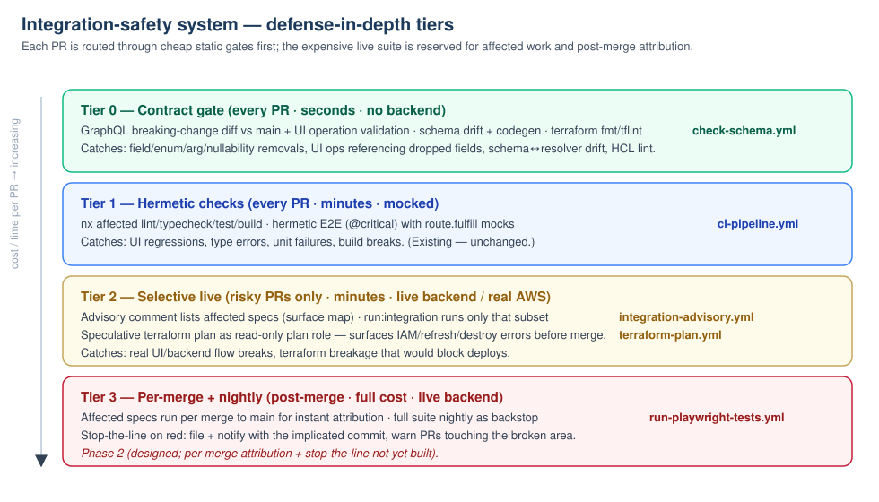
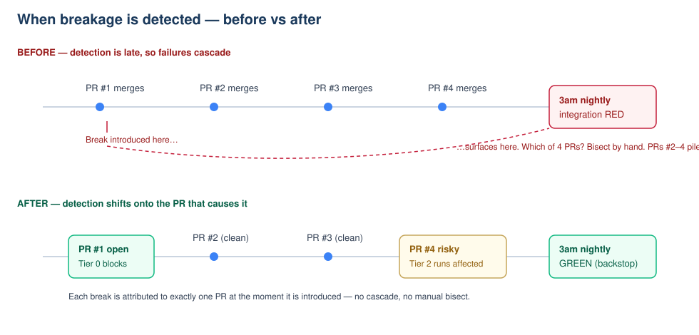
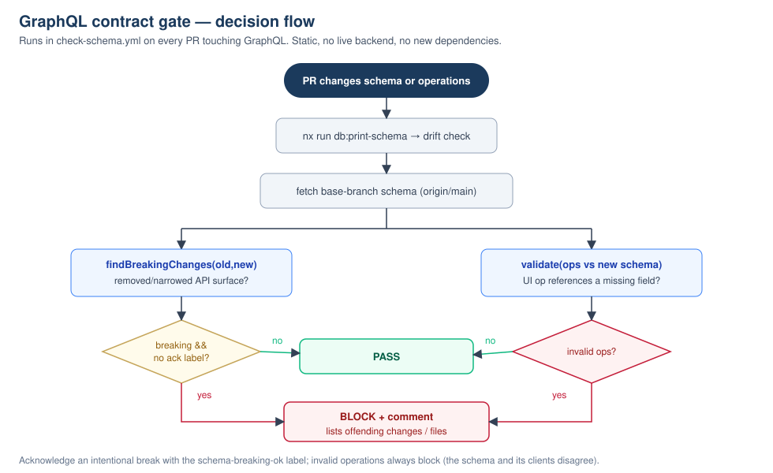

# Integration-Safety System

> Status: Phase 1 implemented (contract gate, terraform plan gate, selective integration + advisory). Phase 2 designed (per-merge attribution + stop-the-line). This document is both the design rationale and the operator reference.

## Problem

We iterate fast on the UI and the backend. When a major change lands, it frequently breaks the **nightly UI-driven integration suite** (`run-playwright-tests.yml`, 3am). Because that signal arrives long after merge, several more PRs stack on top before anyone notices, producing a **cascading failure mode** that is painful to bisect.

Running the full integration suite on every PR is not an option — it is slow and expensive (live backend, serial, 22 specs). Three distinct breakage classes feed the cascade:

1. **UI changes** break integration specs (routing, selectors, flows) that the hermetic suite doesn't cover.
2. **Backend changes** break integration specs because the UI and backend no longer agree (the GraphQL contract drifts).
3. **Terraform changes** break the apply, which blocks _all_ backend deploys until a follow-up PR fixes it — and the break is only discovered post-merge.

## Root cause

Detection happens too late to attribute blame. The expensive signals run nightly (integration) or post-merge (`terraform apply`). The fix is not "run everything on every PR" — it is to **shift cheap proxies left** and **reserve the expensive signal for affected work and post-merge attribution**.

Two observations make this tractable:

- The UI↔backend contract is the **GraphQL schema**. Most mismatch breakage is detectable _statically_ from the schema + committed operations, with no live backend.
- Terraform breakage is detectable with a **read-only speculative `plan`** as the existing PR plan role — the infrastructure already exists (`legacy-sports-dev-github-actions-plan`), it was just never wired to a PR workflow.

## The tiered model



| Tier                    | Runs on          | Cost                | Catches                                                         | Where                                                                         |
| ----------------------- | ---------------- | ------------------- | --------------------------------------------------------------- | ----------------------------------------------------------------------------- |
| 0 — Contract gate       | every PR         | seconds, no backend | schema breaking changes, invalid UI operations, drift, HCL lint | `check-schema.yml`, `terraform-plan.yml` (fmt/tflint)                         |
| 1 — Hermetic            | every PR         | minutes, mocked     | UI regressions, types, units, build                             | `ci-pipeline.yml` (existing)                                                  |
| 2 — Selective live      | risky PRs only   | minutes             | real UI/backend flow breaks, terraform breakage                 | `integration-advisory.yml`, `run-integration-tests.yml`, `terraform-plan.yml` |
| 3 — Per-merge + nightly | post-merge / 3am | full                | everything, with attribution                                    | `run-playwright-tests.yml` (+ Phase 2)                                        |



---

## Tier 0 — GraphQL contract gate

The highest-leverage piece. Added to `check-schema.yml`, which already generates the SDL from the Pothos resolvers and runs codegen.



Two static checks, implemented in `.github/scripts/schema-contract/check-contract.mjs` using only the `graphql` package (already a dependency via graphql-codegen — **zero new packages**):

1. **Breaking-change diff** — `findBreakingChanges` / `findDangerousChanges` between the PR's generated schema and the base-branch schema. Catches field/type/enum/argument removals and nullability changes that are type-valid for current operations but break deployed clients and the nightly suite. This is the net-new signal over the existing drift + codegen check.
2. **Operation validation** — every committed `**/src/api/db/**/*.graphql` operation is validated against the new schema, grouped by package so cross-file fragments resolve. Surfaces UI operations referencing dropped fields with a clear message and file path.

**Policy:**

- **Invalid operations always block** — the schema and its clients disagree.
- **Breaking changes block** unless the PR carries the **`schema-breaking-ok`** label (intentional, coordinated break with clients/specs updated).
- **Dangerous changes** (new enum values, new optional args) are advisory only.

Client-side hygiene rules (`NoUnusedVariables`, `NoUnusedFragments`) are intentionally excluded — they are not schema-compatibility problems and graphql-codegen tolerates them.

**Run locally:**

```bash
pnpm exec nx run db:print-schema
node .github/scripts/schema-contract/check-contract.mjs \
  --old <base schema.graphql> --new lambdas/db/schema.graphql
```

Unit tests: `.github/scripts/schema-contract/__tests__/check-contract.test.mjs` (run in CI via `.github/checks/schema-contract-tests.sh`).

### Future: deploy-ordering check

The integration suite hits the _deployed_ backend, which may lag a merged schema. A follow-up can validate UI operations against the **currently-deployed** schema (introspection) to flag "this UI change needs the backend deployed first." Designed, not yet built.

---

## Tier 2 — Selective integration

We never auto-run the full suite on a PR. Instead we **select the minimal affected set** from a maintained manifest and make running it an explicit, low-cost decision.

- **Manifest:** `apps/web-e2e/src/integration/integration-surface-map.json` maps each integration spec to the source surfaces (routes, features, components, lambdas) it exercises. Shared/backend-schema changes select every spec (`runAllWhenChanged`). A unit test enforces that every spec on disk is mapped.
- **Selector:** `.github/scripts/integration-select/select-specs.mjs` unions edited specs + surface matches. Over-selection is safe; under-selection is the risk, so globs lean broad.
- **Advisory (`integration-advisory.yml`):** on every PR, posts/updates a comment listing the specs that cover the change and how to run them. Non-blocking, no live-backend time. Turns "we forgot to run integration" into a visible recommendation for author and reviewer.
- **Runner (`run-integration-tests.yml`):** the `run:integration` label runs exactly the selected subset (now surface-aware, not just edited spec files).

This keeps the live-backend cost proportional to risk: a draft change runs ~5 draft specs, not all 22.

---

## Tier 2 — Terraform plan gate

`terraform validate -backend=false` (in the build job) only checks syntax. Real breakage — missing IAM permissions, plan-time errors, destructive diffs — currently surfaces only at **post-merge apply**, blocking all backend deploys.

`.github/workflows/terraform-plan.yml` runs on PRs touching `terraform/main/**`:

- **fmt + tflint** (`.tflint.hcl`) — static, no AWS.
- **Speculative `terraform plan`** assuming the read-only `legacy-sports-dev-github-actions-plan` role (OIDC trust already allows `pull_request`), with `-lock=false` so it never contends with the post-merge apply. Plan errors / `AccessDenied` block the PR and post a comment pointing at the missing permission.

This implements the "Plan job" that `.agents/skills/terraform-permission-planning/SKILL.md` already references but that was never built — moving terraform breakage from post-merge (everyone blocked) to pre-merge (one PR blocked).

**Scope:** `terraform/main` only — the Lambda/API/RDS infra whose apply gates backend deploys. `terraform/runners` (separate state, separate TF_VARs, does not block deploys) is a follow-up.

**Note:** apply-only permissions (`Create*`/`Delete*`/`Tag*`) still cannot be validated by a read-only plan; the predict step in the permission-planning skill remains the pre-merge mitigation for those.

**Bootstrap caveat:** the plan role's own read permissions live in `github_actions_plan_policy` and only take effect after a `terraform apply` on `main`. When the gate surfaces a missing read action (e.g. it found the plan role lacked `s3:GetBucketPolicy` on the state bucket, `dynamodb:DescribeContinuousBackups` on the locks table, and `lambda:GetFunctionUrlConfig` on the mcp-* function URLs on first run), the fix is to mirror that action into the plan policy — but the *current\* PR's plan will keep failing until the change is merged and applied. This is a one-time cost per missing permission; subsequent PR plans pass.

---

## Phase 2 — Per-merge attribution + stop-the-line (designed)

Even with shift-left, some breaks only manifest live. To make those non-cascading:

- **Per-merge affected integration** — after each merge to `main`, run only the affected subset (same selector) so attribution is automatic. The full suite still runs nightly as a backstop.
- **Stop-the-line** — when a post-merge/nightly run goes red, auto-file an issue/Jira tagged with the implicated commit + owner (Discord webhook already exists in `run-playwright-tests.yml`) and warn/block further PRs touching the broken area until green.

These require main-branch automation and are intentionally not implemented in Phase 1.

---

## Rollout

1. Land Phase 1 with the new checks **non-required** (observe-only) for one cycle.
2. Once the contract gate and terraform plan gate have a green baseline, promote them to required checks in `.github/ruleset.json`.
3. Tune the surface map as integration coverage changes (the coverage test will flag unmapped specs).
4. Build Phase 2.

## File index

| Concern              | Path                                                                                    |
| -------------------- | --------------------------------------------------------------------------------------- |
| Contract gate script | `.github/scripts/schema-contract/check-contract.mjs`                                    |
| Contract gate tests  | `.github/scripts/schema-contract/__tests__/check-contract.test.mjs`                     |
| Contract gate wiring | `.github/workflows/check-schema.yml`                                                    |
| Spec selector        | `.github/scripts/integration-select/select-specs.mjs`                                   |
| Surface manifest     | `apps/web-e2e/src/integration/integration-surface-map.json`                             |
| Advisory workflow    | `.github/workflows/integration-advisory.yml`                                            |
| Integration runner   | `.github/workflows/run-integration-tests.yml`                                           |
| Terraform plan gate  | `.github/workflows/terraform-plan.yml`, `.tflint.hcl`                                   |
| CI test hooks        | `.github/checks/schema-contract-tests.sh`, `.github/checks/integration-select-tests.sh` |
