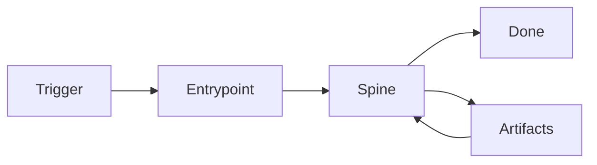

# Development Process

Human-facing summary of how work flows from trigger to merged change in this repository. The detailed reference is the [dev-process agent skill](../../.agents/skills/dev-process/SKILL.md) — this doc is the orientation for new team members.

## TL;DR

Every task — feature, bug, hotfix, spike, RFC, revert — funnels through one of **13 entrypoints** into a shared **6-phase spine**, gated by **risk-tier checks** and producing **structured artifacts**.

The point: predictable rigor without burying simple work under ceremony. A docs-only change skips most gates; a database migration triggers all of them.

## The 6-phase spine

1. **Frame** — restate the problem, assign risk tier, repro any defect.
2. **Design** — RFC for non-trivial work, ADR for architectural choices, test plan for everything.
3. **Implement** — vertical slices, green tree per commit, docs alongside code.
4. **Verify** — `make pc` + manual exercise + determinism checklist for E2E.
5. **Document** — touch-map enforcement, archive RFC/ADR, postmortem if Critical.
6. **Handoff** — self-review, draft PR, bot-PR contract, drive to merge.

## The 13 entrypoints

| #   | Entrypoint                                                                                  | When                                       |
| --- | ------------------------------------------------------------------------------------------- | ------------------------------------------ |
| 1   | [incident-hotfix](../../.agents/skills/dev-process/entrypoints/01-incident-hotfix.md)       | Production currently broken                |
| 2   | [bug-investigation](../../.agents/skills/dev-process/entrypoints/02-bug-investigation.md)   | Defect reported, no ticket yet             |
| 3   | [security-cve](../../.agents/skills/dev-process/entrypoints/03-security-cve.md)             | CVE alert / security advisory              |
| 4   | [ci-flaky-triage](../../.agents/skills/dev-process/entrypoints/04-ci-flaky-triage.md)       | Flaky test / CI on main failing            |
| 5   | [new-feature](../../.agents/skills/dev-process/entrypoints/05-new-feature.md)               | Backlog feature ticket (the dominant path) |
| 6   | [refactor](../../.agents/skills/dev-process/entrypoints/06-refactor.md)                     | Behavior-preserving cleanup                |
| 7   | [dependency-upgrade](../../.agents/skills/dev-process/entrypoints/07-dependency-upgrade.md) | Dependabot / manual upgrade                |
| 8   | [migration](../../.agents/skills/dev-process/entrypoints/08-migration.md)                   | Schema / data / infra change               |
| 9   | [docs-only](../../.agents/skills/dev-process/entrypoints/09-docs-only.md)                   | Documentation change with no code          |
| 10  | [inherited-pr](../../.agents/skills/dev-process/entrypoints/10-inherited-pr.md)             | Picking up someone else's in-flight PR     |
| 11  | [spike](../../.agents/skills/dev-process/entrypoints/11-spike.md)                           | Timeboxed research / POC                   |
| 12  | [experimentation](../../.agents/skills/dev-process/entrypoints/12-experimentation.md)       | Feature flag / A/B test rollout            |
| 13  | [revert](../../.agents/skills/dev-process/entrypoints/13-revert.md)                         | Roll back a merged change                  |

Decision tree for picking your entrypoint: [.agents/skills/dev-process/entrypoints/README.md](../../.agents/skills/dev-process/entrypoints/README.md).

## The artifacts you may produce

| Artifact          | Lives at                              | When                                    |
| ----------------- | ------------------------------------- | --------------------------------------- |
| RFC               | `docs/rfcs/LS-####-slug.md`           | Medium-tier or higher feature work      |
| ADR               | `docs/decisions/NNNN-slug.md`         | Any architectural decision              |
| Test plan         | PR body or `docs/test-plans/`         | Always (except docs-only)               |
| Repro report      | Jira ticket field                     | Bug investigation, CI flake triage      |
| Continuation plan | PR comment                            | Inheriting someone else's PR            |
| Postmortem        | `docs/postmortems/YYYY-MM-DD-slug.md` | Production incidents, security, reverts |

Templates for each: [.agents/skills/dev-process/templates/](../../.agents/skills/dev-process/templates/).

## Risk tiers

| Tier         | Time budget   | When                                                    |
| ------------ | ------------- | ------------------------------------------------------- |
| **Low**      | 2–3 min       | Single file, docs, tests, mechanical                    |
| **Medium**   | 5–10 min      | Business logic, multi-file, schema usage                |
| **High**     | 10–15 min     | Auth, payments, infra, migrations                       |
| **Critical** | No time limit | Production incidents, security, data integrity, reverts |

Full table: [risk-tiers.md](../../.agents/skills/dev-process/gates/risk-tiers.md).

## Determinism in tests

E2E and integration tests must satisfy the **12 determinism levers** before merge — see [e2e-determinism.md](../../.agents/skills/testing/references/e2e-determinism.md). Flake is a P1 bug; tests that "sometimes pass" are worse than tests that always fail.

## How this relates to existing process docs

- **`AGENTS.md`** is the agent-facing root. It now references this framework for the design layer.
- **`workflow-overview` SKILL.md** remains the executable runbook for the new-feature entrypoint (steps 0–18, MCP tool calls, CI pipelines). This framework explains _which entrypoint_ you're on; workflow-overview explains _how to execute_ it.
- **`pr-lifecycle` SKILL.md** is unchanged — it's the bot-PR contract that takes over at Phase 6 (Handoff).

## Where to read next

- New to the codebase? Start with [AGENTS.md](../../AGENTS.md), then read this doc, then the [dev-process SKILL.md](../../.agents/skills/dev-process/SKILL.md).
- Picking up an in-flight PR? Read [10-inherited-pr.md](../../.agents/skills/dev-process/entrypoints/10-inherited-pr.md).
- Investigating a bug? Read [02-bug-investigation.md](../../.agents/skills/dev-process/entrypoints/02-bug-investigation.md).
- Writing tests? Read [e2e-determinism.md](../../.agents/skills/testing/references/e2e-determinism.md).
- Production is on fire? Read [01-incident-hotfix.md](../../.agents/skills/dev-process/entrypoints/01-incident-hotfix.md) and follow it.
