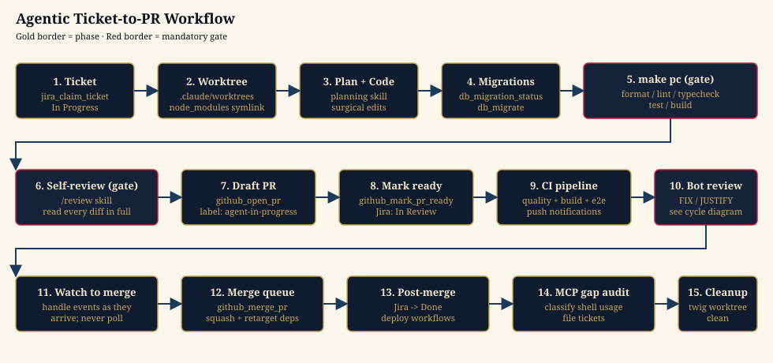
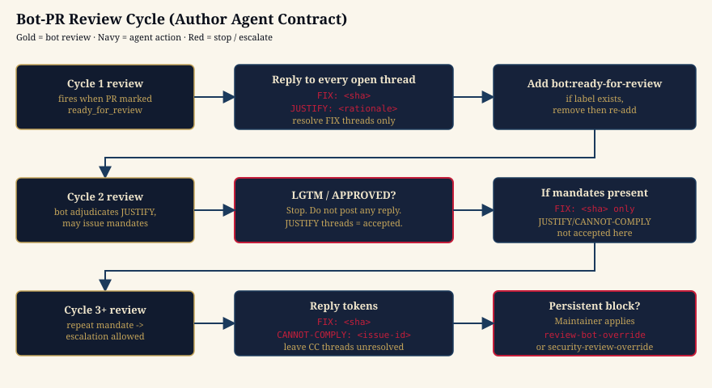

# Agentic Ticket-to-PR Workflow

Human-facing orientation for how an AI coding agent (Claude Code, Copilot Coding Agent, or a cloud agent) takes a Jira ticket from "To Do" to merged on `main`. This page summarizes the flow at a glance. The **executable runbook** is [`.agents/skills/workflow-overview/SKILL.md`](../../.agents/skills/workflow-overview/SKILL.md) — that is the source of truth for individual steps and tool calls; this doc only links into it.

## At a glance

The agent moves left-to-right through 15 steps grouped into three bands:

| Band              | Steps | Purpose                                                                       |
| ----------------- | ----- | ----------------------------------------------------------------------------- |
| Setup & implement | 1–5   | Claim the ticket, set up an isolated worktree, write code, validate locally.  |
| Ship & review     | 6–10  | Self-review, open a draft PR, mark it ready, satisfy CI and the bot reviewer. |
| Land & clean up   | 11–15 | Watch the PR through merge, audit MCP/shell gaps, tear down the worktree.     |

Two **mandatory gates** (red borders in the diagram) stand between writing code and pushing it:

1. **`make pc`** — full pre-commit pipeline (format, lint, typecheck, test, build). Run via `make_run({ target: "pc" })`; never substitute individual targets.
2. **Self-review** — `/review` skill (or the manual checklist in [`pr-lifecycle/references/self-review.md`](../../.agents/skills/pr-lifecycle/references/self-review.md)). Read every changed file in full and check against the [common review patterns](../../.agents/skills/pr-lifecycle/references/common-review-patterns.md). Every Copilot round costs 30–60 min of agent time — a thorough self-review eliminates most of them.

Neither gate may be skipped to "save time".

## Step-by-step (with canonical references)

| #   | Step             | Canonical reference                                                                                                                                                                             |
| --- | ---------------- | ----------------------------------------------------------------------------------------------------------------------------------------------------------------------------------------------- |
| 1   | Claim ticket     | [`workflow-overview` steps 0–3](../../.agents/skills/workflow-overview/SKILL.md#agent-workflow-checklist-steps-016)                                                                             |
| 2   | Worktree         | [`worktree-workflow`](../../.agents/skills/worktree-workflow/SKILL.md)                                                                                                                          |
| 3   | Plan + code      | [`planning`](../../.agents/skills/planning/SKILL.md) · [`architecture` FILE-MAP](../../.agents/skills/architecture/FILE-MAP.md)                                                                 |
| 4   | Migrations       | [`repo-tooling`](../../.agents/skills/repo-tooling/SKILL.md)                                                                                                                                    |
| 5   | `make pc` gate   | [`workflow-overview` Phase 1](../../.agents/skills/workflow-overview/SKILL.md#phase-1-local-validation)                                                                                         |
| 6   | Self-review gate | [`pr-lifecycle/references/self-review.md`](../../.agents/skills/pr-lifecycle/references/self-review.md)                                                                                         |
| 7   | Draft PR         | [`pr-lifecycle`](../../.agents/skills/pr-lifecycle/SKILL.md)                                                                                                                                    |
| 8   | Mark ready       | [`workflow-overview` Phase 2](../../.agents/skills/workflow-overview/SKILL.md#phase-2-pr-creation)                                                                                              |
| 9   | CI pipeline      | [`workflow-overview` Phase 3](../../.agents/skills/workflow-overview/SKILL.md#phase-3-ci-pipeline) · [ci-checks-reference](../../.agents/skills/pr-lifecycle/references/ci-checks-reference.md) |
| 10  | Bot review       | [Author Agent Contract](../../AGENTS.md#author-agent-contract-bot-pr-flow)                                                                                                                      |
| 11  | Watch to merge   | [`workflow-overview` Phase 5–6](../../.agents/skills/workflow-overview/SKILL.md#phase-5-jira-branch-sync-jira-branch-syncyml)                                                                   |
| 12  | Merge queue      | [`workflow-overview` Phase 6](../../.agents/skills/workflow-overview/SKILL.md#phase-6-merge-queue-merge-queueyml)                                                                               |
| 13  | Post-merge       | [`workflow-overview` Phase 7](../../.agents/skills/workflow-overview/SKILL.md#phase-7-post-merge)                                                                                               |
| 14  | MCP gap audit    | [`mcp-gaps`](../../.agents/skills/mcp-gaps/SKILL.md)                                                                                                                                            |
| 15  | Cleanup          | [`worktree-workflow`](../../.agents/skills/worktree-workflow/SKILL.md)                                                                                                                          |

## The bot-PR cycle

After the PR is marked ready, the Code Reviewer Bot drives a structured review loop. Agents must respond in the exact format the bot expects — free-form replies are ignored, and unaddressed threads escalate.

| Cycle    | Accepted reply tokens                      | Notes                                                                                             |
| -------- | ------------------------------------------ | ------------------------------------------------------------------------------------------------- |
| Cycle 1  | `FIX: <sha>` · `JUSTIFY: <rationale>`      | Resolve only the `FIX:` threads; leave `JUSTIFY:` threads open for bot adjudication.              |
| Cycle 2  | `FIX: <sha>` only                          | If the bot returns LGTM with no new findings, **stop** — do not post anything.                    |
| Cycle 3+ | `FIX: <sha>` · `CANNOT-COMPLY: <issue-id>` | `CANNOT-COMPLY` escalates to a human; resolve `FIX:` threads, leave `CANNOT-COMPLY` threads open. |

The full contract — including format errors, override labels (`review-bot-override`, `security-review-override`), and the no-edit-bot-comments rule — lives in [`AGENTS.md` § Author Agent Contract](../../AGENTS.md#author-agent-contract-bot-pr-flow).

## Common stop conditions

These are the moments where an agent must **stop and ask** rather than improvise:

- A blocker ticket is not yet "In Review" or "Done" → halt and surface to the user.
- `make pc` fails on a step the agent can't diagnose from the structured `steps[]` output.
- `node_modules` symlink resolves but `nx` is missing (empty target) → repair per [`workflow-overview` step 5](../../.agents/skills/workflow-overview/SKILL.md#agent-workflow-checklist-steps-016).
- The PR's branch can't be cleanly rebased on `main` and the conflict needs domain judgment.
- A `CANNOT-COMPLY:` reply is rejected and `bot-review` remains failing → escalate via `review-bot-override` (maintainer action).

## When this doc doesn't apply

The diagram above is the **new-feature entrypoint** — the dominant path. Twelve other entrypoints (incident, security-CVE, CI flake, refactor, dependency upgrade, migration, docs-only, inherited-PR, spike, experimentation, revert, bug investigation) layer their own pre/post phases on top of the same 6-phase spine. Pick the right entrypoint with [`dev-process/entrypoints/README.md`](../../.agents/skills/dev-process/entrypoints/README.md); the orientation page is [`README.md`](./README.md) in this directory.

## See also

- [`dev-process/README.md`](./README.md) — the 13-entrypoint framework and 6-phase spine.
- [`AGENTS.md`](../../AGENTS.md) — agent-facing rules, tier-1 safety, MCP-first.
- [`.agents/skills/workflow-overview/SKILL.md`](../../.agents/skills/workflow-overview/SKILL.md) — the executable runbook this page summarizes.
- [`.agents/skills/pr-lifecycle/SKILL.md`](../../.agents/skills/pr-lifecycle/SKILL.md) — PR creation, self-review, Copilot fix workflow.
