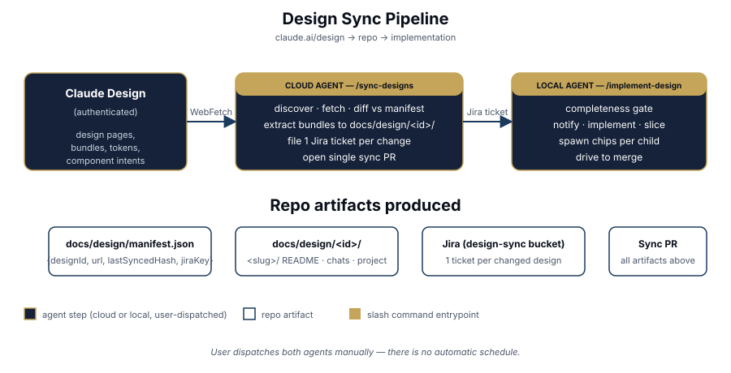
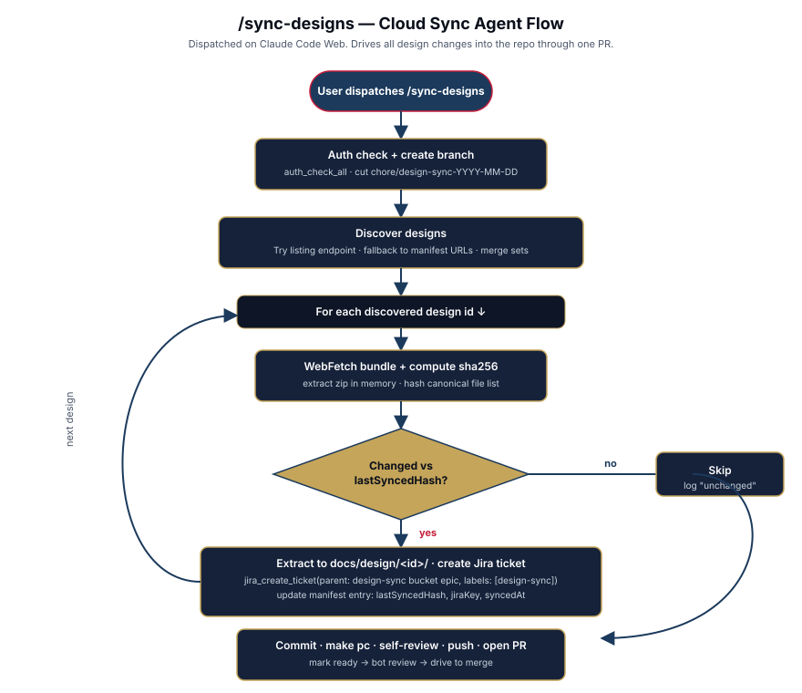
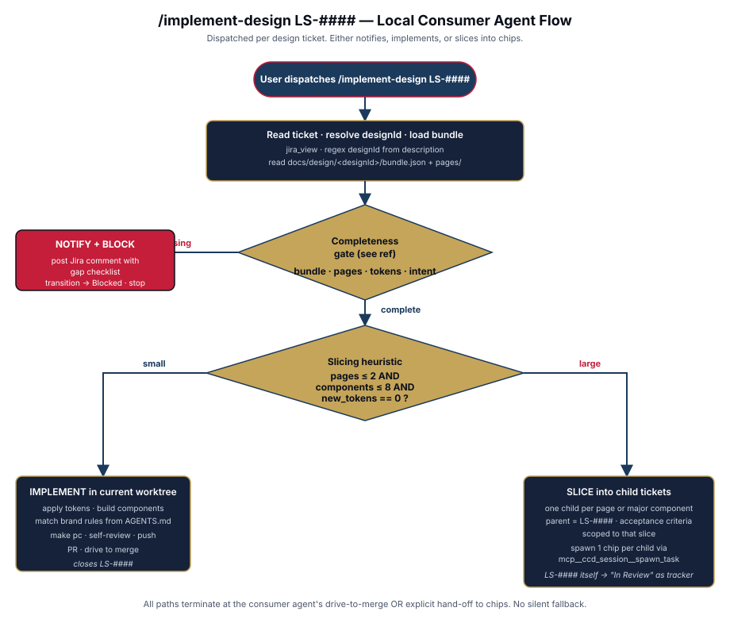

# Design Sync Process

How designs in Claude Design (https://claude.ai/design) become Jira tickets and shipped code in this repo.

> **Operator runbook**: [`.agents/skills/design-sync/SKILL.md`](../../.agents/skills/design-sync/SKILL.md) is the authoritative procedure for agents. This doc is the human-facing overview.

## Why this exists

The project's design system and feature designs live in Claude Design, behind authentication. Cloud Claude Code sessions can `WebFetch` design URLs and receive the full handoff bundle (HTML prototypes, design tokens, JSX, intent transcripts); local sessions cannot. To keep designs version-controlled, reviewable, and consumable by local implementation agents, we bring the bundles into the repo via a cloud-driven sync, then consume them via a separate local agent.

## The three phases



| Phase       | Who runs it                          | Where                 | Output                                                   |
| ----------- | ------------------------------------ | --------------------- | -------------------------------------------------------- |
| **Source**  | —                                    | Claude Design (cloud) | Living design pages                                      |
| **Sync**    | Cloud agent, you dispatch            | Claude Code Web       | `docs/design/<id>/` bundles + Jira tickets + one sync PR |
| **Consume** | Local agent, you dispatch per ticket | Your machine          | Implementation PR(s), possibly chips for child tickets   |

Both agents are **manually dispatched**. There is no schedule and no automatic trigger — runs happen when you say so.

## Phase 1: Sync (cloud)



**Slash command**: `/sync-designs` (defined in [`.claude/commands/sync-designs.md`](../../.claude/commands/sync-designs.md)).

**How you trigger it**: open a Claude Code Web session against this repo, paste `/sync-designs`, send.

**What it does**:

1. Authenticates and cuts a fresh branch (`chore/design-sync-YYYY-MM-DD`).
2. Discovers designs — tries the listing endpoint first; falls back to URLs already in `docs/design/manifest.json`.
3. For each design: `WebFetch` the bundle, extract in memory, compute a content hash, compare to `manifest.lastSyncedHash`.
4. For each **new or changed** design: extract files under `docs/design/<id>/`, create one Jira ticket under the `design-sync` bucket epic, update the manifest entry.
5. For each **removed** design: mark the manifest entry `status: "archived"` (preserve the directory; don't delete history).
6. Commit, run `make pc`, self-review, push, open a single sync PR, mark ready, drive to merge per the bot-PR contract.

**Output**: one PR titled `LS-#### chore(designs): sync N designs (X new, Y changed, Z removed)`, containing the bundles, manifest update, and a generated `SYNC-REPORT.md`.

## Phase 2: Consume (local)



**Slash command**: `/implement-design LS-####` (defined in [`.claude/commands/implement-design.md`](../../.claude/commands/implement-design.md)).

**How you trigger it**: open a local Claude Code session in a fresh worktree, paste `/implement-design LS-4561` (or whichever design ticket), send.

**Decision tree**:

1. **Completeness gate** — reject if the bundle is missing structural pieces (no `bundle.json`, no rendered HTML, empty `pages: []`, no design tokens). On reject: post a Jira comment with a checklist of what's missing, transition the ticket to **Blocked**, stop. See [completeness-gate.md](../../.agents/skills/design-sync/references/completeness-gate.md).

2. **Slicing heuristic** — if the design fits in one PR (≤2 pages, ≤8 distinct components, no net-new tokens) → implement directly in the worktree, drive the original ticket to merge. Otherwise → create one child Jira ticket per page or major component under the parent design ticket, spawn one chip per child via `mcp__ccd_session__spawn_task`, transition the parent to "In Review" as a tracker. See [slicing-heuristic.md](../../.agents/skills/design-sync/references/slicing-heuristic.md).

3. **Implementation** — when the agent does implement, it follows the standard new-feature entrypoint: worktree → code → `make pc` → self-review → PR → bot review → merge → MCP gap audit. Brand rules from AGENTS.md apply (typography, color palette, motion, no generic card grids).

## Repo layout

```
docs/
  design/
    manifest.json              # source-of-truth registry, updated by sync agent
    README.md                  # human readme pointing here
    <design-id>/               # one folder per design
      bundle.json              # canonical metadata extracted from Claude Design
      pages/                   # rendered HTML per page
      ds/                      # design system files (tokens, fonts)
      components/              # JSX prototypes
      SYNC-REPORT.md           # what changed in the most recent sync
docs/
  dev-process/
    design-sync.md             # this file
    design-sync/
      overview.svg             # pipeline diagram
      cloud-sync-flow.svg      # /sync-designs state machine
      consumer-flow.svg        # /implement-design state machine
.agents/skills/design-sync/
  SKILL.md                     # operator runbook (loaded by both agents)
  references/
    manifest-schema.md
    completeness-gate.md
    slicing-heuristic.md
.claude/commands/
  sync-designs.md              # cloud agent prompt
  implement-design.md          # local agent prompt
```

## Manifest schema (summary)

Full schema: [manifest-schema.md](../../.agents/skills/design-sync/references/manifest-schema.md).

```jsonc
{
  "version": 1,
  "lastSyncedAt": "2026-05-20T00:00:00Z",
  "designs": [
    {
      "id": "670f7892-5193-4b8a-a54c-20b112ad11bb",
      "url": "https://claude.ai/design/p/670f7892-5193-4b8a-a54c-20b112ad11bb",
      "title": "League Detail",
      "lastSyncedHash": "sha256-...",
      "lastSyncedAt": "2026-05-20T00:00:00Z",
      "jiraKey": "LS-4561",
      "status": "active",
    },
  ],
}
```

The `lastSyncedHash` is computed over the canonical sorted file list of the extracted bundle (`sha256(JSON.stringify(sortedEntries))`) so any change to any file flips the hash exactly once.

## One-time setup

Before the first `/sync-designs` run, register the bucket epic:

1. Create an epic in Jira titled e.g. **"Design Sync: Bundles and Implementations"**, leave it `In Progress`.
2. Register it: `jira_set_bucket_epic({ bucket: "design-sync", epicKey: "LS-####" })`.

The cloud sync agent reads this via `jira_get_bucket_epic({ bucket: "design-sync" })` and parents every per-design ticket under it.

## Why **manually** dispatched, not scheduled?

Three reasons:

- **Designer agency**: a design isn't "done" the moment the URL is reachable; the designer says when it's ready to sync. A scheduler would catch in-progress work.
- **Token economy**: cloud agent runs cost real tokens. Triggering on demand is cheaper than a hourly cron.
- **Surprise mitigation**: an unscheduled run that creates 12 Jira tickets at 3am is a worse failure mode than a forgotten manual run.

## See also

- Operator skill: [`.agents/skills/design-sync/SKILL.md`](../../.agents/skills/design-sync/SKILL.md)
- Cloud agent prompt: [`.claude/commands/sync-designs.md`](../../.claude/commands/sync-designs.md)
- Local agent prompt: [`.claude/commands/implement-design.md`](../../.claude/commands/implement-design.md)
- Brand rules: [AGENTS.md](../../AGENTS.md) "Design Context" section
- Frontend skill: [`.agents/skills/frontend-design/SKILL.md`](../../.agents/skills/frontend-design/SKILL.md)
