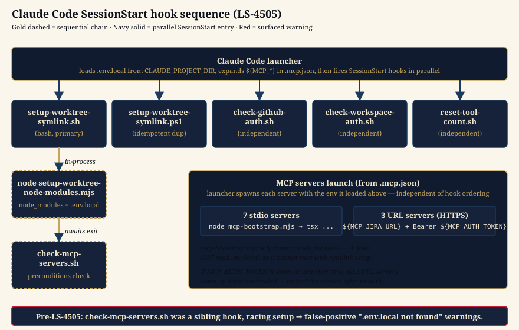

# Claude Code Session Startup

Human-facing reference for what happens between "launcher fires" and "agent's first turn" in a Claude Code session — the hook chain that prepares a worktree for MCP-server connections, the precondition checks that surface failures, and the env-loading ordering that determines whether the 10 MCP servers come up authenticated.

The authoritative ordering for diagnostics lives in [`.agents/skills/mcp-diagnostics/SKILL.md`](../../.agents/skills/mcp-diagnostics/SKILL.md); this doc is the orientation. The bug that prompted this doc — false-positive `[MCP WARNING] .env.local not found` output — is fixed in LS-4505 by chaining `check-mcp-servers.sh` sequentially after `setup-worktree-symlink.sh` instead of registering it as a sibling SessionStart entry.

## At a glance



Three things happen, roughly in order:

1. **Launcher env load** — Claude Code reads `.env.local` from `CLAUDE_PROJECT_DIR`, expands `${MCP_*}` placeholders inside `.mcp.json`, and prepares to spawn MCP servers.
2. **SessionStart hooks fire in parallel** — five entries in [`.claude/settings.json`](../../.claude/settings.json) execute concurrently. Four are independent. The fifth — `setup-worktree-symlink.sh` — owns a small **sequential sub-chain** of its own.
3. **MCP servers spawn** — fed by the env loaded in step 1, independent of hook ordering.

## The SessionStart entries

These five hooks run in parallel — Claude Code does not guarantee ordering between sibling SessionStart entries. Any dependency between them must be encoded inside a single entry, not assumed.

| Hook                                                                           | Purpose                                                                                                   | Independent?                    |
| ------------------------------------------------------------------------------ | --------------------------------------------------------------------------------------------------------- | ------------------------------- |
| [`setup-worktree-symlink.sh`](../../.claude/hooks/setup-worktree-symlink.sh)   | Create `node_modules` and `.env.local` symlinks in ephemeral worktrees, then chain `check-mcp-servers.sh` | **No** — owns its own sub-chain |
| [`setup-worktree-symlink.ps1`](../../.claude/hooks/setup-worktree-symlink.ps1) | Same as above for PowerShell-only environments; idempotent with the bash version                          | Yes (duplicate, safe)           |
| [`check-github-auth.sh`](../../.claude/hooks/check-github-auth.sh)             | Verify `gh` token is present and unexpired                                                                | Yes                             |
| [`check-workspace-auth.sh`](../../.claude/hooks/check-workspace-auth.sh)       | Verify workspace credentials                                                                              | Yes                             |
| [`reset-tool-count.sh`](../../.claude/hooks/reset-tool-count.sh)               | Reset the per-session tool-call counter that feeds the compact reminder                                   | Yes                             |

## The sequential sub-chain inside `setup-worktree-symlink.sh`

This is the part that LS-4505 changed. `check-mcp-servers.sh` reads two artifacts — the `node_modules/.bin/tsx` symlink target and the `.env.local` symlink — that **`setup-worktree-symlink.sh` is responsible for creating**. That makes it an ordering dependency, not a concurrent peer. The pre-fix design registered `check-mcp-servers.sh` as a sibling SessionStart entry, leaving the ordering to chance and producing intermittent false-positive `[MCP WARNING] .env.local not found` output when the check raced setup.

The fix is sequential invocation, not retries:

```bash
# Inside setup-worktree-symlink.sh, after the setup script returns:
CHECK_SCRIPT="$(dirname "$0")/check-mcp-servers.sh"
if [ -x "$CHECK_SCRIPT" ]; then
  "$CHECK_SCRIPT"
elif [ -f "$CHECK_SCRIPT" ]; then
  bash "$CHECK_SCRIPT"
fi
```

`check-mcp-servers.sh` remains a standalone file so it can still be invoked ad-hoc for diagnostics (`bash .claude/hooks/check-mcp-servers.sh`); it just no longer has its own entry in `.claude/settings.json`.

### Why not just add retries?

The pre-fix code already polled for `node_modules/.bin/tsx` for up to 3 seconds before warning. That polling masked the same race the `.env.local` check was hitting — it papered over an ordering dependency instead of expressing it. Retries make the warning "less wrong on average" but never eliminate it, because the race window scales with resolver runtime (`node scripts/modules-pool/link.mjs` re-links in milliseconds on a pool hit but runs a full `pnpm install` on a cold-lockfile miss). LS-4505 removed the retry loop alongside the sibling registration.

## MCP-server launch (independent of hook ordering)

Once the launcher has loaded `.env.local` and expanded `${MCP_*}` placeholders, it spawns each server in [`.mcp.json`](../../.mcp.json). There are two flavors:

- **7 stdio servers** (`worktree`, `legacy-sports-make`, `legacy-sports-nx`, `legacy-sports-db`, `legacy-sports-ci-local`, `legacy-sports-aws`, `legacy-sports-browser`) start with `node .github/copilot/hooks/mcp-bootstrap.mjs node --import tsx tools/mcp/<srv>/src/index.ts`. The bootstrap shim only repairs the `node_modules` symlink if needed; **it does not read `.env.local`**, so it cannot race with symlink setup the way the precondition check did.
- **3 URL servers** (`legacy-sports-jira`, `legacy-sports-github`, `legacy-sports-ci`) connect via Streamable HTTP to the MCP HTTP API Gateways at `${MCP_JIRA_URL}`, `${MCP_GITHUB_URL}`, `${MCP_CI_URL}`. Their `Authorization` header is produced at each (re)connect by the `headersHelper` command in [`.mcp.json`](../../.mcp.json) (`node scripts/mcp-mint-token.mjs`), which mints a short-lived, per-server-scoped Cognito `client_credentials` token from the locally-held machine secret (epic LS-5089, Track A — the legacy static `${MCP_AUTH_TOKEN}` ID-token header is still dual-accepted server-side during migration, removal tracked in LS-5094). If the launcher's env lacks the `${MCP_*_URL}` values or the machine credential at spawn time, the servers come up unauthenticated — recovery is `node scripts/mcp-auth.mjs` (or `--setup` the first time) followed by a session restart. (Claude Code on the web uses neither path — it reaches these servers via OAuth custom connectors registered in claude.ai; see [`.agents/skills/cloud-agent-mode/SKILL.md`](../../.agents/skills/cloud-agent-mode/SKILL.md) and the [MCP Connector Access Guide](./mcp-connector-access.md) for how to get a Cognito user account and connect the three connectors.)

The `mcp-bootstrap.mjs` audit performed alongside LS-4505 confirmed it touches only `node_modules` (no `.env.local` read). The race described in this doc is **purely** about the SessionStart hook ordering; bootstrap is unaffected.

## When you see `[MCP WARNING] ...`

Real warnings (post-LS-4505) mean what they say. Walk the checklist:

| Warning                                               | Cause                                                                                                   | First fix to try                                                                 |
| ----------------------------------------------------- | ------------------------------------------------------------------------------------------------------- | -------------------------------------------------------------------------------- |
| `node_modules/.bin/tsx is missing`                    | Symlink absent, broken, or the pool slot is unhealthy                                                   | `node scripts/modules-pool/link.mjs` from worktree root (or `make install`)      |
| `.mcp.json not found`                                 | `CLAUDE_PROJECT_DIR` not set to the worktree path                                                       | Restart Claude Code from inside the worktree                                     |
| `mcp-bootstrap.mjs missing`                           | File deleted from working tree                                                                          | `git checkout main -- .github/copilot/hooks/mcp-bootstrap.mjs`                   |
| `MCP_AUTH_TOKEN not set in .env.local`                | `.env.local` is missing, malformed, or the token row is absent                                          | `node scripts/mcp-auth.mjs --setup` then restart                                 |
| `MCP_AUTH_TOKEN has expired` / `expires in N minutes` | OIDC JWT past its lifetime                                                                              | `node scripts/mcp-auth.mjs` then restart                                         |
| `MCP_*_URL not set in .env.local`                     | API Gateway URL not written by terraform                                                                | `node scripts/mcp-auth.mjs` (runs `terraform apply` first when URLs are missing) |
| `.env.local not found`                                | Main repo has no `.env.local` (cold-start case), or the worktree's symlink-creation legitimately failed | Check `<main-repo>/.env.local` exists, then `node scripts/modules-pool/link.mjs` |

The full diagnostic checklist (including pre-flight `auth_check_all` and the report-don't-fall-back protocol) is [`.agents/skills/mcp-diagnostics/SKILL.md`](../../.agents/skills/mcp-diagnostics/SKILL.md).

## See also

- [`.agents/skills/mcp-diagnostics/SKILL.md`](../../.agents/skills/mcp-diagnostics/SKILL.md) — the executable diagnostic checklist this doc orients you to.
- [`.agents/skills/mcp-first/SKILL.md`](../../.agents/skills/mcp-first/SKILL.md) — server load order and per-server tool substitution table.
- [`AGENTS.md` § MCP Servers](../../AGENTS.md#mcp-servers) — agent-facing rules for MCP-server health.
- [`scripts/modules-pool/link.mjs`](../../scripts/modules-pool/link.mjs) — the dependency-free Node resolver that owns `node_modules` pool-slot linking and `.env`/`.env.local` symlinking.
