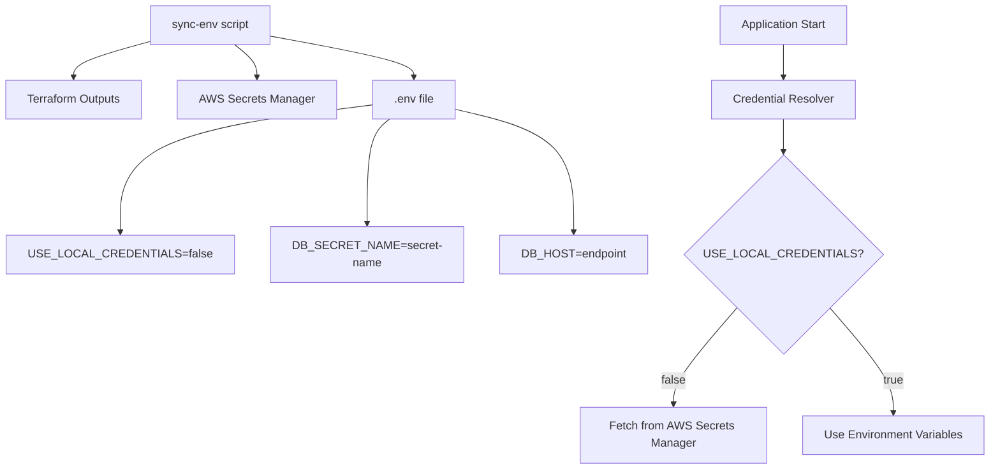

# 🎉 Sync-Env Script Update Complete!

## What Was Updated

I have successfully updated both the **Bash** and **PowerShell** sync-env scripts to work seamlessly with the new unified database credential management system.

## 🔄 Key Changes Made

### **Before (Legacy System):**

```bash
# Script fetched actual credentials and put them in .env
DB_USER=postgres
DB_PASSWORD=actual-password-here
USE_LOCAL_CREDS=true  # Confusing naming
```

### **After (New Unified System):**

```bash
# Script stores secret name, credentials fetched at runtime
USE_LOCAL_CREDENTIALS=false
DB_SECRET_NAME=legacy-sports-dev-db-creds-xyz
DB_HOST=proxy-endpoint.amazonaws.com
```

## 🚀 New Features

### **Enhanced Security**

- ✅ **No plain-text passwords** in environment files
- ✅ **Secret names only** - credentials fetched securely at runtime
- ✅ **AWS Secrets Manager integration** for production

### **Improved CLI Experience**

```bash
# Easy-to-use commands
pnpm run sync-env              # Standard production sync
pnpm run sync-env:direct       # For database migrations
pnpm run sync-env:dry-run      # Preview changes
pnpm run sync-env:backup       # Create backup before sync
```

### **Better Default Behavior**

- **Proxy endpoint by default** (better for production performance)
- **Direct endpoint option** available for migrations/admin tasks
- **Clear status messages** showing which endpoint is being used

## 📋 Testing Results

The updated scripts have been tested and are working perfectly:

```bash
> pnpm run sync-env:dry-run

✓ Database secret name: legacy-sports-dev-db-creds-xyz (will be resolved at runtime)
✓ Using RDS proxy endpoint for DB_HOST (recommended for production)
✓ Setting USE_LOCAL_CREDENTIALS=false
✓ Configuring DB_SECRET_NAME for runtime credential resolution
```

## 🛠️ How to Use

### **Standard Production Setup**

```bash
# Update .env with AWS production configuration
pnpm run sync-env

# Test database connectivity
pnpm run db:test:production
```

### **Database Migration Setup**

```bash
# Use direct endpoint for migrations (bypasses proxy)
pnpm run sync-env:direct

# Run your database migrations
pnpm run migrate
```

### **Preview Changes (Safe)**

```bash
# See what would change without modifying files
pnpm run sync-env:dry-run
```

## 📁 Files Updated

### **Scripts Updated:**

- `scripts/sync-env.sh` - Bash version (Linux/macOS/WSL)
- `scripts/sync-env.ps1` - PowerShell version (Windows)

### **Documentation Created:**

- `SYNC_ENV_UPDATED.md` - Comprehensive usage guide

### **Package Scripts Added:**

```json
{
  "sync-env": "Run standard production sync",
  "sync-env:direct": "Use direct DB endpoint for migrations",
  "sync-env:dry-run": "Preview changes without applying",
  "sync-env:backup": "Create backup before syncing"
}
```

## 🔒 Security Benefits

1. **Production Secrets**: All sensitive credentials stored in AWS Secrets Manager
2. **No Credential Exposure**: Environment files only contain secret names, not passwords
3. **Runtime Resolution**: Applications fetch credentials securely when needed
4. **Local Development**: Separate `.env.local` for development credentials

## 🎯 Integration with New Credential System

The sync scripts now perfectly integrate with the unified credential system:



## ✅ Ready to Use!

The sync-env scripts are now fully compatible with the new database credential system and ready for production use. They provide:

- **Security**: AWS best practices for credential storage
- **Convenience**: Simple npm commands for common tasks
- **Flexibility**: Support for both production and migration workflows
- **Safety**: Dry-run and backup options for safe operation

Your environment synchronization is now more secure, simpler, and better integrated with the unified credential management system! 🔐
