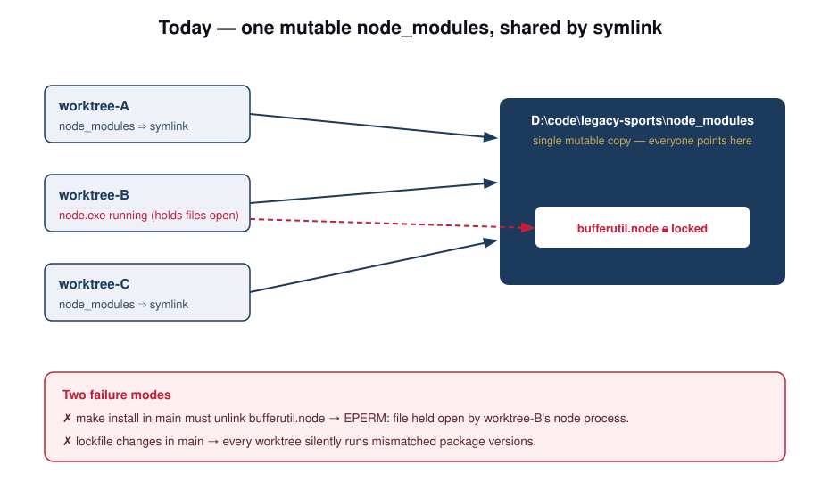
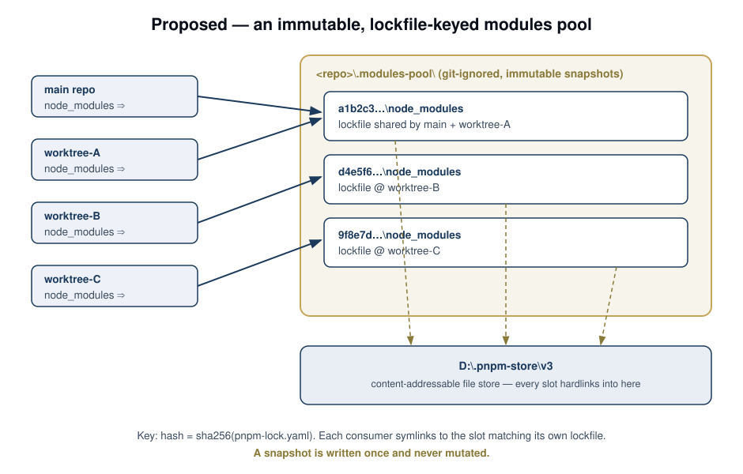
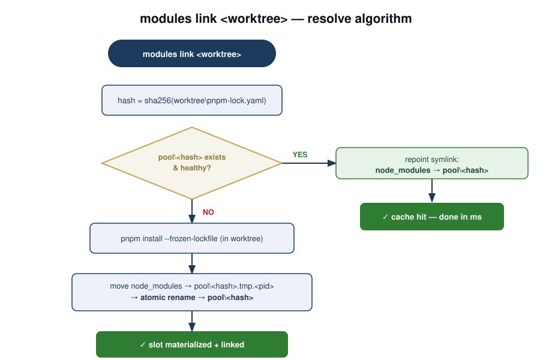
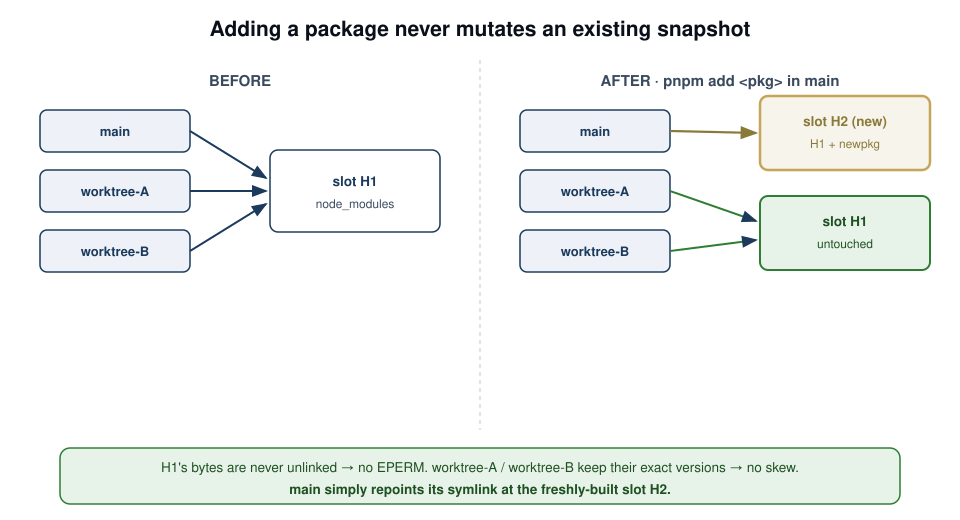
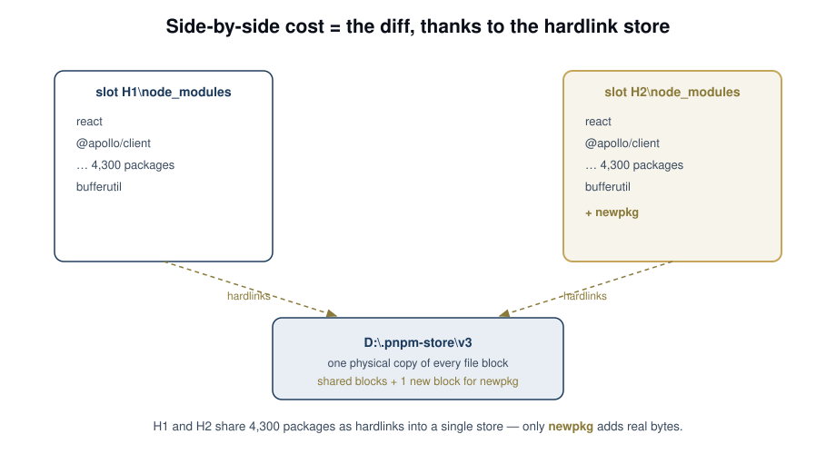

# RFC: Content-addressable `node_modules` pool for worktrees

|             |                                                                                                                                |
| ----------- | ------------------------------------------------------------------------------------------------------------------------------ |
| **Status**  | Draft — for review                                                                                                             |
| **Author**  | (drafted with Claude Code)                                                                                                     |
| **Date**    | 2026-05-30                                                                                                                     |
| **Affects** | `scripts/setup-worktree-node-modules.mjs`, `scripts/pnpm-install-lock.ps1`, `make install`, `make wt-setup`, SessionStart hook |

---

## TL;DR

Replace the single mutable `D:\code\legacy-sports\node_modules` (which every worktree symlinks into) with a pool of **immutable snapshots keyed by lockfile hash** — the same idea as `nvm` keeping many Node versions side-by-side. The pool lives in a **git-ignored directory inside the repo** (`<repo>\.modules-pool\`), exactly like the worktrees already do under `.claude/worktrees/`. Each worktree (and main) symlinks its `node_modules` to the snapshot that matches _its own_ `pnpm-lock.yaml`. Installs never mutate an existing snapshot; they materialise a new one. Result: `make install` in main can no longer trigger `EPERM` file-lock failures, and can no longer change the packages out from under a running worktree.

The expensive-sounding part — keeping many full `node_modules` trees on disk — is nearly free here because the repo already uses `package-import-method=hardlink` against a shared content-addressable store at `D:\.pnpm-store\v3`.

---

## 1. Problem

Worktrees today symlink **only** their root `node_modules` into the main repo's `node_modules`. That works because `.npmrc` sets `node-linker=hoisted` + `public-hoist-pattern[]=*`, so the entire dependency tree is flattened into one root directory.

The shared-mutable model has two failure modes:



1. **`EPERM` on install.** When `make install` runs in main, pnpm must `unlink` and replace files in place — e.g. `node_modules\bufferutil\prebuilds\win32-x64\bufferutil.node`. If any worktree has a live `node` process (MCP servers via `tsx`, a dev server, the Claude Code session itself), that process holds the native `.node` binary open _through the symlink_, and Windows refuses the unlink:

   ```
   ERR_PNPM_EPERM  EPERM: operation not permitted, unlink '…\node_modules\bufferutil\prebuilds\win32-x64\bufferutil.node'
   ```

2. **Silent version skew.** Even when an install succeeds, it rewrites the one tree every worktree shares. A worktree on a branch with a _different_ lockfile is now running mismatched versions, with no signal that anything changed.

The current mitigation ("detach each worktree into an independent `node_modules` first, then install in main") works but is manual, easy to forget, and reinstalls from scratch every time.

## 2. Goals / non-goals

**Goals**

- `make install` in main never fails due to a lock held by a worktree.
- Installing/updating packages anywhere never changes the packages a _different_ worktree is running.
- Worktree setup on an already-seen lockfile is instant (no reinstall).
- Disk cost of N side-by-side trees stays close to one tree.
- Dependency-free bootstrap path preserved (the resolver must run with plain `node`, before `tsx`/MCP exist — same constraint as today's `setup-worktree-node-modules.mjs`).

**Non-goals**

- Changing `node-linker` away from `hoisted` (RN/Metro/Tamagui depend on the flat layout).
- Replacing pnpm's global store. The pool sits _above_ the existing CAS store, not in place of it.
- Cross-machine / CI behaviour — CI installs fresh and is unaffected.

## 3. Design overview

A pool of immutable snapshots, each keyed by a hash of the lockfile that produced it. Every consumer symlinks to the slot matching its lockfile.



```
D:\.pnpm-store\v3\                          ← unchanged: pnpm's machine-global CAS (shared by every repo)
D:\code\legacy-sports\                      ← the repo
    .modules-pool\                          ← NEW · git-ignored · lives inside the repo
        a1b2c3…\node_modules\   ← immutable snapshot for lockfile hash a1b2c3
        d4e5f6…\node_modules\   ← snapshot for a branch that changed the lockfile
        9f8e7d…\node_modules\
    .claude\worktrees\<name>\               ← existing precedent: git-ignored nested working trees
```

The pool sits **inside the repo and git-ignored**, not in a machine-global location. The pnpm store stays global (it is shared across all repos on the machine and must remain on the same drive as the pool so hardlinks are valid — both are on `D:`).

- **Content key:** `hash = sha256(pnpm-lock.yaml)`. The lockfile fully determines the resolved tree (it encodes resolved versions, workspace importers, overrides, and patches). Optionally salt with the pnpm version (`packageManager` field) so a pnpm upgrade forces a rebuild — see [open question Q4](#5-open-questions).
- **Consumer link:** each worktree's `node_modules` and main's `node_modules` are directory symlinks into the pool slot for their lockfile hash.
- **Immutability:** a slot is written exactly once and never modified. This is the property that makes both failure modes impossible.

The nvm analogy, made literal:

| nvm                                             | this design                                        |
| ----------------------------------------------- | -------------------------------------------------- |
| `node -v` → which binary                        | `pnpm-lock.yaml` hash → which slot                 |
| `~/.nvm/versions/node/<ver>/`                   | `<repo>\.modules-pool\<hash>\`                     |
| `nvm use` flips a symlink                       | `modules link` flips a symlink                     |
| installing a new version leaves old ones intact | a new lockfile builds a new slot, old slots intact |

## 4. Detailed design

### 4.1 `modules link <worktree>` — the resolve algorithm

One command does everything. It is the replacement for `setup-worktree-node-modules.mjs`.



1. Compute `hash = sha256(<worktree>\pnpm-lock.yaml)`.
2. **Pool hit** (`pool\<hash>\node_modules` exists and is healthy) → point the worktree's `node_modules` symlink at it. Milliseconds, zero install. This is the common case: a fresh worktree on an unchanged lockfile, a branch switch, or a sibling that already built this lockfile.
3. **Pool miss** → materialise:
   1. `pnpm install --frozen-lockfile` in the worktree (produces a real `node_modules` there).
   2. Move that `node_modules` into `pool\<hash>.tmp.<pid>`, then **atomically rename** to `pool\<hash>` (same volume → instant; the rename is the commit point and makes concurrent materialisation safe — a loser just discards its tmp dir).
   3. Symlink the worktree's `node_modules` → `pool\<hash>`.

"Healthy" reuses today's checks: `.bin` populated, `nx` present, symlink resolvable, and the `.modules.yaml` `virtualStoreDir` sanity check already implemented in `setup-worktree-node-modules.mjs`.

### 4.2 Adding a package never disturbs anyone



When you `pnpm add` in main (or any worktree):

- The lockfile changes → a **new hash** → `modules link` materialises a **new slot** and repoints _that consumer's_ symlink to it.
- Every other consumer still points at its old slot, whose bytes were never touched.

This is why both failure modes vanish:

- **No `EPERM`:** an install writes a brand-new directory; it never `unlink`s a file another process holds open.
- **No skew:** a worktree's packages change only when _its_ lockfile changes and _it_ re-links.

### 4.3 Why disk stays cheap



`.npmrc` already sets `package-import-method=hardlink` with the store at `D:\.pnpm-store\v3` (same drive as the repo and the proposed pool, so hardlinks are valid). Two slots that differ by one package share the other 4,300 packages as hardlinks into the single store — you pay for the diff, not the whole tree. This is exactly why nvm-style side-by-side installs are affordable.

### 4.4 Garbage collection

The pool grows with every distinct lockfile. `modules gc`:

1. Enumerate the live set = symlink targets of `node_modules` across main + every worktree under `.claude/worktrees/`.
2. Delete any `pool\<hash>` not in the live set and older than `N` days (default 14).

Orphans accrue mainly from cleaned-up worktrees and abandoned branches; GC is safe to run from a SessionStart hook or a scheduled task.

### 4.5 Integration points

| Today                                                                             | Becomes                                                                     |
| --------------------------------------------------------------------------------- | --------------------------------------------------------------------------- |
| `scripts/setup-worktree-node-modules.mjs` symlinks worktree → main `node_modules` | `modules link` symlinks worktree → `pool\<hash>` (materialise on miss)      |
| `make install` in main rewrites the shared tree                                   | `make install` in main = `modules link` for main (builds/links main's slot) |
| `scripts/pnpm-install-lock.ps1` detach-and-reinstall recovery                     | obsolete — every consumer is always independent by construction             |
| `make wt-setup`                                                                   | calls `modules link`                                                        |
| SessionStart hook checks symlink health                                           | unchanged checks, now pointed at the slot; optionally triggers `modules gc` |

The resolver stays a **dependency-free `node` script** (like today's `setup-worktree-node-modules.mjs`) so it runs before `tsx`/MCP exist.

### 4.6 Where it lives — repo-internal and git-ignored

The pool is a directory **inside the repo**: `<repo>\.modules-pool\`. This is not a new pattern — the repo already nests full working trees with their own `node_modules` under `.claude/worktrees/`, git-ignored at `.gitignore:347`. The pool reuses the same machinery.

Why in-repo (vs. a machine-global `D:\…`):

- **Self-contained & self-cleaning** — delete/move the repo and the pool goes with it; no orphaned global state on the drive.
- **No drive-root pollution** and no assumptions about a writable global location.
- **Same volume guaranteed** — the pool is on the repo's drive, so the atomic-rename publish step (§4.1) and hardlinks into the store both stay valid by construction.

Why it stays cheap for tooling (the legitimate worry with an in-repo tree): everything that recursively scans the repo already copes with `.claude/worktrees/` the same way it will cope with `.modules-pool/`, because both are git-ignored and the scanners honour git-ignore. Concretely, the **ignore wiring** to land with this change:

| File                           | Entry             | Why                                                                                     |
| ------------------------------ | ----------------- | --------------------------------------------------------------------------------------- |
| `.gitignore`                   | `/.modules-pool/` | git status stays clean; Nx project-graph + ripgrep/`Grep` honour git-ignore and skip it |
| `.nxignore`                    | `.modules-pool/`  | belt-and-suspenders: Nx plugin glob scans skip it (joins `resources/`, `docs/`, etc.)   |
| `.eslintignore`                | `.modules-pool/`  | ESLint never lints pooled trees                                                         |
| `.prettierignore`              | `.modules-pool/`  | Prettier never formats pooled trees                                                     |
| `tsconfig.base.json` `exclude` | `.modules-pool`   | tsc already excludes `node_modules` at any depth; this excludes the wrapper dir too     |

The inner `node_modules` directories are auto-skipped by virtually every tool already (they are literally named `node_modules`). The only thing the entries above protect is the **wrapper** `.modules-pool/<hash>` path being _walked into_ to reach them — git-ignore alone covers the git/Nx/ripgrep walkers; the explicit excludes cover tsc/eslint/prettier.

> One watch item for the validation phase (Q6 below): confirm the **Nx daemon's file watcher** and **Metro/Watchman** (React Native) do not index `.modules-pool/`. Nx respects `.nxignore`/`.gitignore` for watching; Metro has its own `blockList` and may need an explicit pattern. This is the same class of concern that `.claude/worktrees/` already passes today.

## 5. Open questions

1. **Per-project `node_modules` (the one to validate first).** `apps/*/node_modules`, `lib/*/node_modules` exist in main but the current scheme symlinks only the _root_ — and it works, thanks to full hoisting. The pool inherits that assumption (snapshot root only). **Validation:** run an `nx` build + test in a worktree whose only `node_modules` is a pooled root link, and confirm green. Today's setup is the existence proof, but this must be checked explicitly before flipping the default.
2. **`.modules.yaml` relocatability.** pnpm records paths in `.modules.yaml`; the existing `checkVirtualStoreDir` guard exists precisely because of this. Confirm a slot built in worktree A and linked from worktree B keeps `pnpm exec`/nx resolution working (paths must be relative or inside the slot).
3. **Store GC interaction.** `pnpm store prune` must not remove blocks a pool slot still hardlinks. Hardlinks keep inodes alive regardless, but `prune` may delete the store's own index entry; confirm slots survive a prune, or exclude the pool drive's store from prune.
4. **Hash inputs.** Lockfile-only vs. lockfile + pnpm version. Lockfile alone is ~complete; salting with pnpm version costs nothing and prevents a stale slot after a pnpm upgrade. Recommend salting from day one.
5. **Windows symlink privilege.** Directory symlinks need Developer Mode — already required today, no regression. Materialisation's atomic rename also needs both tmp and final on the same volume (guaranteed: both under `<repo>\.modules-pool`).
6. **In-repo watchers.** With the pool inside the repo, confirm the Nx daemon file-watcher and Metro/Watchman do not index `.modules-pool/` despite the git-ignore (Metro uses its own `blockList`). Covered by §4.6's ignore wiring; verify empirically in the validation phase.

## 6. Validation plan

1. Stand up the pool + `modules link` as an **opt-in** script (`MODULES_POOL=1`) alongside the existing symlink path — no default change.
2. On one machine: create 2 worktrees on different lockfiles, confirm independent slots, run `nx` build/test in each (covers Q1, Q2).
3. Reproduce the original bug: launch a worktree dev/MCP process, then `pnpm add` in main — confirm **no `EPERM`** and the worktree's versions are unchanged (covers the headline goal).
4. `pnpm store prune`, then re-run worktree builds — confirm slots survive (covers Q3).
5. Measure disk: pool size with 4 slots differing by a handful of packages vs. 4 independent installs (should be ~1×).

## 7. Rollout

- **Phase 0** — land `modules link` + `modules gc` as opt-in scripts; no behaviour change by default.
- **Phase 1** — dogfood on a few worktrees; run the validation plan; fix Q1/Q2 fallout.
- **Phase 2** — flip `make wt-setup` / SessionStart to use the pool by default; keep the old symlink path behind `MODULES_LEGACY=1`.
- **Phase 3** — remove `pnpm-install-lock.ps1` detach logic and the legacy path once the pool has soaked.

## 8. Alternatives considered

- **Independent install per worktree (status quo, automated).** Drop symlinks entirely; every worktree always `make install`s its own tree. Cheap on disk (hardlink store) and _already_ solves breakage — but reinstalls from scratch each time and gives no cache reuse across worktrees on the same lockfile. The pool is this plus a content-addressable cache. **This is the natural fallback if the pool proves too complex.**
- **Switch `node-linker=isolated`.** pnpm's default symlinked `.pnpm` layout is more relocatable, but the repo deliberately chose `hoisted` for RN/Metro/Tamagui. Out of scope.
- **Lean on pnpm `--modules-dir` only.** pnpm can target an alternate modules dir, but doesn't manage a hash-keyed pool, GC, or atomic publish. We'd be building this design anyway; better to own the thin layer.

---

### Diagrams

- [diagram-1-current.svg](diagram-1-current.svg) — today's shared-mutable model and its two failure modes
- [diagram-2-pool.svg](diagram-2-pool.svg) — the proposed pool architecture
- [diagram-3-resolve-flow.svg](diagram-3-resolve-flow.svg) — `modules link` resolve algorithm
- [diagram-4-add-package.svg](diagram-4-add-package.svg) — add-package before/after
- [diagram-5-hardlinks.svg](diagram-5-hardlinks.svg) — hardlink sharing keeps disk cost ≈ the diff
